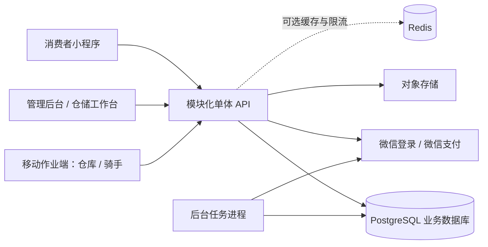

2026-11-03积分P4d接续：真实出库单分配、本仓骑手本人精确接货、隐私/权限隔离及原键恢复完成本地验证；仍未开始配送或上线，下一项P4e配送开始与送达。见[记录](verification/P4D-REDEMPTION-DELIVERY-2026-11-03.md)。

2026-11-02积分P4c接续：完整装包、原预占幂等出库与库存/位置流水配平完成本地验证；未应用业务主库或生产，尚无骑手接货配送。下一项P4d真实兑换骑手分配与接货。详见[记录](verification/P4C-REDEMPTION-PACKING-2026-11-02.md)。

2026-11-02积分P4b接续：真实预占完整件数核对、缺货/破损阻断、仓管原需求备齐确认及重核完成已交付本地验证；未出库或上线，下一项打包前完整性与幂等出库。详见[记录](verification/P4B-REDEMPTION-PICKING-WORK-2026-11-02.md)。

2026-11-02积分P4a接续：兑换Outbox租约/重试、唯一真实来源拣货任务、竞争领取及领取/取消互斥完成本地验证；12项专项、45项相关PG、4项配置及全构建/类型/lint通过；17张专项和19张回归截图见[记录](verification/P4A-REDEMPTION-PICKING-2026-11-02.md)。作业与Worker默认关闭，未出库或上线；下一项P4b真实预占逐项核对与缺货阻断。

2026-11-02积分P3接续：报价、扣分预占、订单查询和本人取消完成本地验证；12项兑换及33项相关PG、4项配置、构建/类型/lint与19张双端截图通过。默认关闭、不接真实仓配，下一项P4真实拣货待办接入与领取/取消竞争。见[记录](verification/P3-REDEMPTIONS-2026-11-02.md)。

2026-11-02积分P2接续：后台兑换商品与小程序商城/详情完成本地验证，14项真实PG及双端浏览器通过，构建/类型/lint通过；不开放兑换下单。下一项P3报价、扣分预占与订单取消。验收与迁移边界见[记录](verification/P2-REWARD-CATALOG-2026-11-02.md)。

2026-11-02积分P1c接续：关联误发冲正、独立审批、来源额度/余额保护及负流水追溯完成本地验证；8项PG和28张双端浏览器截图通过，未扣减真实积分。下一项P2兑换商品管理与小程序商城/详情，微信/真机及生产未验，见[记录](verification/P1C-POINTS-CORRECTIONS-2026-11-02.md)。

2026-11-02积分P1b接续：发放申请/独立审批、单笔与每日预算和原键恢复完成本地验证；6项PG与双员工浏览器闭环通过，小程序同源码预览查到账。未启用正式发放，下一项P1纠错扣减/冲正，见[记录](verification/P1B-POINTS-GRANTS-2026-11-02.md)。

2026-11-02积分P1a界面接续：后台与小程序同源码浏览器实际API验证、分页重试/筛选隔离/账号切换保护及16张截图完成；Node24.22.1全构建类型规范和3项PG通过。微信工具/真机未验，下一项P1b发放审批与预算，见[记录](verification/P1A-POINTS-UI-2026-11-02.md)。

2026-11-02最新优先级：负责人要求新增积分商城，小程序与运营后台同时交付，优先实现并上线，其他功能随后依次上线。详见[积分商城首发设计](product/POINTS-MALL-V1.md)。本轮为设计，尚未实现或上线；积分经营参数仍待配置。该要求覆盖历史排除积分及旧下一步顺序，必要的真实登录、库存、履约、售后和生产验收依赖仍须完成。API与数据新增内容均为设计草案，非已发布契约。

2026-11-02合成骑手分配接续：已合成出库任务分配、本仓启用骑手选择、本人任务隔离及交接资格动态核验完成；新增7项PG与33项相关检查、桌面/手机UI及全构建通过。两库迁移已应用，OpenAPI0.31.0；演练默认关闭，尚未接货/送达或改变真实订单库存。下项合成骑手接货与重复交接保护，见[记录](verification/S7-DELIVERY-LAB-2026-11-02.md)。此前下一步按历史理解。

2026-11-01合成打包出库接续：两行完整性/精确装包数量、领取人打包、负责人/仓管一次性合成出库及不可变凭据/原键恢复完成；8项新增及24项相关PG、1项配置检查，桌面/手机UI与全构建通过。两库新增迁移已应用，OpenAPI0.30.0；演练默认关闭，真实订单/库存不变。下项合成骑手任务分配与交接资格基础，见[记录](verification/S6-PICKING-PACKING-2026-11-01.md)。此前下一步按历史理解。

2026-11-01合成缺货接续：领取人缺货/破损上报、整项未决阻断、仓管原需求备齐确认、独立缺货版本及原键恢复完成；9项新增与15项相关PG共24项、1项配置测试及桌面/手机UI和全构建通过。两库迁移已应用，OpenAPI0.29.0；演练默认关闭，真实订单/库存不变。下项打包前完整性核验与幂等出库的隔离基础，见[记录](verification/S6-PICKING-SHORTAGE-2026-11-01.md)。此前下一步按历史理解。

2026-11-01拣货演练接续：独立合成任务、竞争领取、本人逐行数量核对/完成及原键恢复完成；8项新增及14项相关PG共22项、1项配置测试、桌面/手机UI和全构建通过。两库新增迁移已应用，OpenAPI0.28.0；演练默认关闭，正式订单/库存不变。下项缺货上报与未决异常阻断的隔离流程，见[记录](verification/S6-PICKING-LAB-2026-11-01.md)。此前下一步按历史理解。

2026-11-01拣货准备接续：仓管/拣货只读订单清单、批次库位预占及资格/冻结/停用/效期核验、后台和手机角色入口完成；7项新增及25项交易回归共32项PG测试、实际UI和全构建通过。OpenAPI0.27.0，无迁移；当前订单仍待付款/取消，未开放领取或出库。下项拣货任务领取与逐行核对的隔离基础，见[记录](verification/S6-PICKING-READINESS-2026-11-01.md)。此前下一步按历史理解。

2026-11-01核查概览接续：授权仓库内只读总数/四类原因汇总、去重口径及读取时间、卡片筛选和空错重试完成；5项新增与16项相关PG回归、桌面/手机UI及全构建通过。OpenAPI0.26.0，无迁移，真实支付与自动查询仍关闭。下项S6仓库拣货任务基础与订单资格边界，见[记录](verification/S5-REVIEW-SUMMARY-2026-11-01.md)。此前下一步按历史理解。

2026-11-01核查跨页导航接续：通知/支付尝试直达精确证据、返回来源选择/分页/焦点、分仓分尝试草稿及未知保存原键恢复完成；16项PG回归、桌面/手机UI及全构建通过。无迁移，真实支付与自动查询仍关闭。下项支付核查只读概览与异常分类汇总，见[记录](verification/S5-REVIEW-NAVIGATION-2026-11-01.md)。此前下一步按历史理解。

2026-11-01统一证据时间线接续：四来源只读聚合、稳定分页/筛选、外键关联定位与备注原始快照链接、摘要折叠及焦点滚动完成；8项新增与16项相关PG回归、桌面/手机UI及全构建通过。无迁移、无新资金动作，实验与自动查询仍关闭。下项通知/尝试页到核查详情的跨页入口与返回定位，见[记录](verification/S5-EVIDENCE-TIMELINE-2026-11-01.md)。此前下一步按历史理解。

2026-11-01通知关联接续：新尝试固定测试绑定、通知标识/交易号双重去重、关联成功证据与任务结算同事务、错绑拒绝及双向详情完成；8项新增与41项相关PG回归、14项逻辑测试、桌面/手机UI及全构建通过。两库增量迁移已应用，旧记录不补关联，真实支付与自动查询仍关闭。下项核查详情统一证据时间线与关联定位，见[记录](verification/S5-NOTIFICATION-LINKS-2026-11-01.md)。此前下一步按历史理解。

2026-11-01查询分类接续：合成查询分类/证据/建议不可变持久化、退避重试与REVIEW停止分流、相反已知证据冲突保护及详情场景/历史完成；8项新增与26项相关PG回归、12项纯逻辑测试、桌面/手机UI和全构建通过。增量迁移已应用两库，真实渠道及自动查询仍关闭。下项合成通知与支付尝试关联及证据一致性，见[记录](verification/S5-PAYMENT-CLASSIFICATION-2026-11-01.md)。此前下一步按历史理解。

2026-11-01渠道契约接续：查询适配器内部契约、单次超时/中止、13种保护性分类和后台17场景隔离验证完成；6项契约测试、20项真实PG新增/回归、桌面/手机UI及全构建通过。无迁移，真实渠道和自动查询保持关闭；契约尚未接入Worker持久化。下项查询分类结果持久化与任务处理策略的隔离接入，见[记录](verification/S5-PAYMENT-ADAPTER-2026-11-01.md)。此前下一步按历史理解。

2026-11-01补偿核查接续：异常筛选/分页、当前快照详情与不可变核查备注/原键恢复完成；8项新增及18项相关回归共26个真实PG用例、6项判定和全构建通过。两库只新增备注表，写入及自动查询默认关闭，备注不改变资金/库存/证据。下项支付渠道适配器契约与失败分类的隔离基础，见[记录](verification/S5-PAYMENT-REVIEW-2026-11-01.md)。此前下一步按历史理解。

2026-11-01查询补偿接续：合成未知任务、租约抢占/过期恢复/旧令牌拦截、3轮退避耗尽、原键重新安排与详情任务区完成；10项新增及32项回归共42个真实PG用例、6项判定及全构建通过。新增迁移两库已应用，自动查询Worker默认关闭，真实支付未接入。下项补偿任务异常列表与人工核查记录，见[记录](verification/S5-PAYMENT-QUERY-2026-11-01.md)。此前下一步按历史理解。

2026-11-01支付尝试接续：独立合成尝试/不可变证据链、未知结果持久化、后台列表详情与模拟动作完成；8项新增及24项回归共32项真实PG测试、6项共享判定测试和全构建通过。两库新增迁移已应用，默认关闭，不关联真实订单或调用渠道。下项未知结果查询补偿任务与租约的隔离基础，见[记录](verification/S5-PAYMENT-ATTEMPT-2026-11-01.md)。此前下一步按历史理解。

2026-11-01支付关闭接续：关闭前锁定重读、支付证据合并与保护性判定及后台12场景验证页完成；新增6项与18项回归共24项真实PG测试、6项纯判定测试及全构建通过。无迁移，默认关闭，不开放真实支付状态/回调。下项支付尝试与未知结果持久化的隔离基础，见[记录](verification/S5-PAYMENT-CLOSE-2026-11-01.md)。此前下一步按历史理解。

2026-11-01通知持久化接续：合成通知独立记录、事务去重/冲突拒绝及后台列表/详情/重放完成；7项新增与28项相关回归共35项真实PG测试、8项密码学测试及完整构建通过。本机新迁移已应用，默认关闭，未入账或开放真实回调。下项支付结果与订单关闭竞争的隔离处理设计与验证，见[记录](verification/S5-NOTIFICATION-RECORDS-2026-11-01.md)。此前下一步按历史记录理解。

2026-11-01通知验签隔离接续：原文RSA验签、AES-GCM解密及绑定金额核验核心、管理员9场景合成验证页完成；8项密码学/40项相关PG回归和全构建通过。无公开回调或支付成功写入，实验默认关闭且生产拒启。下项通知接收记录与持久化去重隔离基础，见[记录](verification/S5-NOTIFICATION-CRYPTO-2026-11-01.md)。此前下一步按历史理解。

2026-11-01支付接入检查接续：管理员只读11项报告、非敏感配置离线检查与支付模式禁用保护完成；42项相关PG回归、4项配置测试、桌面/手机UI及全构建通过。无新迁移，不读取凭据或联网探测，真实支付始终关闭；下项支付通知验签/解密隔离基础，见[记录](verification/S5-PAYMENT-READINESS-2026-11-01.md)。以下旧下一步按历史记录理解。

2026-11-01支付准备接续：本机PREPARED→CLOSED准备单、同键幂等、取消/超时事务联动及小程序/后台卡片完成；206项真实PostgreSQL全量、微信原生桥接和全工作区构建通过。未调用渠道/扣款，NOT_STARTED保持；经营规则仍未配置，下单/准备默认关闭。下一项支付渠道接入准备与配置校验，见[交付记录](verification/S5-PAYMENT-PREPARATION-2026-11-01.md)。以下较早下一步为历史记录。

2026-11-01后台订单查询接续：授权仓库列表/状态与订单号筛选、游标分页和独立预占详情完成，顾客联系资料不读取；新增7项及订单/员工回归共29项真实PG测试、桌面/手机实际UI与全工作区构建通过。无新迁移，经营规则仍未配置、真实支付关闭。下一项支付单与幂等状态机前置基础，详见[交付记录](verification/S5-ADMIN-ORDERS-2026-11-01.md)。以下较早下一步为历史记录。

2026-11-01订单预占接续：本机开发订单创建、本人列表/详情、取消及worker超时释放完成，UI沿用现有风格；191项真实PostgreSQL全量测试、5项客户端状态测试、微信原生桥接及九页面编译通过。经营规则仍未配置，下单默认关闭，真实支付/微信网络和真机未验。下一项后台订单查询与预占明细，见[交付记录](verification/S5-ORDER-RESERVATION-2026-11-01.md)。以下较早“下一项”按历史记录理解。

2026-10-31结算核验接续：后台运费/起送/免运及手动报价开关、小程序本人地址+账号购物车核验与120秒报价基础完成；新建规则默认暂停，未配置不计算应付。125项相关PG回归、微信原生桥接和浏览器UI验证通过，见[交付记录](verification/S4-CHECKOUT-QUOTE-2026-10-31.md)。本机经营规则仍为空，未生成样例报价；订单/支付和微信真实网络/真机未验，下一项提交订单与库存预占基础，经营规则仍待负责人提供。

2026-10-31收货地址接续：本人地址列表/新增/编辑/删除/显式默认地址、小程序独立表单和有效范围写时校验已实现；联系资料AES-256-GCM加密，审计/回执无明文。37项相关PG回归、微信原生桥接与同源码浏览器检查通过，见[交付记录](verification/S4-CONSUMER-ADDRESS-2026-10-31.md)。本机只新增表与忽略的开发密钥，无合成经营范围/地址；微信真实登录、域名网络/真机和交易未验，下一项结算前校验与报价基础，运费/起送等经营规则仍待确认。

2026-10-31配送范围接续：后台唯一小区与楼栋白名单维护、小程序只读范围/搜索及启停过滤完成；默认停用、真实资料待提供。7项真实PG范围测试通过，隔离API后台和微信快照组件已验证，详见[交付记录](verification/S4-SERVICE-AREA-2026-10-31.md)。本机只新增表，不写入样例范围；地址保存、微信真机与结算未验，下一项消费者收货地址基础。

2026-10-31账号购物车接续：本人账号购物车、版本化数量/勾选/移除、详情登录加购及游客幂等合并完成；原键重试、账号绑定、失效/超量保留和未知结果恢复有验证。11项真实PG购物车、8项合并状态及9项会话/67项商品回归通过，微信组件/API桥接验收通过。开发登录默认关闭，微信/真机和结算未验；下一项服务小区/楼栋白名单基础，真实范围资料待提供。见[记录](verification/S4-ACCOUNT-CART-2026-10-31.md)。

2026-10-31消费者会话接续：本机开发顾客A/B、独立Bearer会话、恢复/退出与“我的”页完成；9项真实PG消费者测试、12项员工/67项商品回归及8项状态测试通过，微信模拟器经隔离API桥接验证。开发登录默认关闭，非微信登录；购物车保留未合并，下一项账号购物车与游客幂等合并。见[交付记录](verification/S4-CONSUMER-SESSION-2026-10-31.md)。

2026-10-31游客草稿接续：本机购物车加入/数量/勾选/移除、当前资料核验和参考小计完成；9项草稿测试及原生夹具/编译验证通过，无后端/迁移变化。结算和登录合并未开放；下一项消费者身份与登录合并基础，真实微信/真机另验。见[记录](verification/S4-GUEST-CART-2026-10-31.md)。

2026-10-31商品卡片接续：列表按商品合并多规格、按商品游标分页、有货规格起价/缺货参考价及正确详情入口完成；67项相关DB、8项浏览状态、3项分类/5项详情回归及微信夹具UI通过，无新迁移。下一切片S4游客购物车草稿；真机/生产仍未验。见[记录](verification/S3-PRODUCT-CARDS-2026-10-31.md)。

2026-10-31消费者分类接续：真实公开分类、父/子导航、分类内搜索/分页及空错重试完成；64项相关DB、10项分类/浏览状态测试、5项详情回归、weapp编译及微信原生夹具验收通过，无新迁移。下一项列表按商品合并多规格展示；真机待HTTPS API。见[交付记录](verification/S2-CONSUMER-CATEGORIES-2026-10-31.md)。

2026-10-31详情规格接续：同商品启用规格完整读取、切换/刷新售价和有货状态完成；61项相关PostgreSQL、5项切换状态、4项浏览回归、weapp编译与微信原生夹具验收通过。无新增迁移；真机待HTTPS测试API。下一项消费者真实分类浏览，见[记录](verification/S2-PRODUCT-VARIANTS-2026-10-31.md)。

2026-10-31多图接续：本地开发版商品图片集（最多6张）、排序/设主图/移除及消费者详情轮播完成；58项相关DB测试、合成/真实浏览器、weapp编译和微信原生组件夹具验证通过。两项增量迁移已应用本机开发库；生产存储和真机未验。下一项消费者详情规格切换。见[交付记录](verification/S2-PRODUCT-GALLERY-2026-10-31.md)。以下早期记录按对应历史切片解读。

2026-10-31商品主图接续：本地开发版单主图上传/替换/移除与后台、小程序显示完成；51项相关PostgreSQL测试、浏览器、weapp编译及微信原生图片组件夹具验证通过。生产对象存储、完整微信网络与真机未验；下一项商品多图与排序。见[交付记录](verification/S2-PRODUCT-IMAGE-2026-10-31.md)。以下较早下一步按历史记录解读。

2026-10-31收货条码接续：仓库授权下的完整条码查询与每行明确选入已完成；45项相关真实DB测试、异常/迟到响应UI及真实收货草稿验证通过，库存不变，本轮无新增迁移。见[记录](verification/S2-RECEIPT-BARCODE-2026-10-31.md)。下一项商品图片管理，先完成本地可审查版本；扫码设备与微信真机仍未验收。

2026-10-30条码接续：SKU单条数字条码绑定/清空、唯一约束与独立窗口完成；42项相关真实DB测试及合成/真实浏览器通过，本机已应用可空条码增量迁移。见[记录](verification/S2-SKU-BARCODE-2026-10-30.md)。下一项条码精确查询与收货选品（手动输入），硬件扫码/正式商品规范另验；真机仍待HTTPS测试API。

2026-10-30规格说明接续：SKU展示文字更正API及独立窗口已完成，36项相关真实DB测试、合成/真实浏览器验证通过；沿用Product.version与现有spec列，不新增迁移，编码/单位/库存/成本保持原值。见[交付记录](verification/S2-SKU-SPEC-2026-10-30.md)。下一项SKU条码维护；微信真机仍待HTTPS测试API。

2026-10-30分类接续：分类改名/启停API及独立窗口已完成，31项相关真实DB测试与合成/真实浏览器验证通过；新增分类version增量迁移，本机开发库已应用；父级停用只改变目录可见性，不改子级/商品/库存状态。见[交付记录](verification/S2-CATEGORY-MAINTENANCE-2026-10-30.md)。下一项SKU规格说明维护，条码等继续按计划补齐；微信真机仍待HTTPS测试API。

2026-10-30规格接续：SKU售价与启停API/独立窗口已完成，25项真实PostgreSQL商品收货测试及合成/真实浏览器验证通过；保留历史库存成本，无迁移，见[本轮记录](verification/S2-SKU-MAINTENANCE-2026-10-30.md)。下一项分类名称与启停维护；规格描述/条码等仍待办，真机仍待HTTPS测试API。

2026-10-30最新接续：负责人授权沿用当前风格自主完成未做UI和交互调整，不再将逐页UI确认作为推进前提。原商品维护计划已接续，名称/分类/说明编辑完成；18项相关真实DB测试与浏览器实链通过，见[本轮交付](verification/S2-PRODUCT-DETAILS-2026-10-30.md)。后续继续其余商品资料维护；真机待HTTPS API，支付/部署等原边界不变。以下早期暂停/等待确认条目按历史记录解读。

# 玉米百货｜全流程开发总纲 V1.1

更新：2026-10-28。商品收货、库位/移位/核对、实物盘点、数量隔离/解除/报损及收货逆向纠错已落地，见[最新报告](verification/S2-RECEIPT-REVERSAL-2026-10-28.md)。78项集成通过，小程序工具/真机未验收。PostgreSQL与本机Docker Desktop选型不变，完整仓储、交易与生产部署尚未完成。

最新运行约定（负责人2026-10-28）：本机有Docker Desktop则优先使用，否则使用Docker Engine。当前主机无Desktop，Engine/PostgreSQL17.11已完成仓储UI相关验证，见[本轮报告](verification/UI-STOCK-TASKS-2026-10-28.md)。当前优先完成仓储UI，库位/核对页及仓管/拣货查询已完成本地验证，收货入库UI也已完成本轮本地验证，首页/商品/分类/库存状态与角色入口已完成本地验证，微信weapp编译与入口检查通过，下一项为微信工具/真机和整体UI审阅，见[最新报告](verification/UI-LIST-STATES-MINI-2026-10-29.md)，暂缓新增商品维护业务。

## 1. 项目目标与已经确认的边界

做一套具有社区即时零售核心体验的小程序及运营系统，参考成熟超市产品的信息结构和购买效率，使用玉米百货自身品牌、商品资料与业务规则。首期目标是完成真实采购入库、上架、购买、支付、拣货、出库、骑手配送、售后和资金核对。

“类似朴朴的购物体验”和“具备全国连锁平台的规模能力”是两个交付层次。本项目先完成第一层，架构保留仓库、服务区域和配送任务边界，后续按实际经营数据扩展。

| 维度 | 本次用户已确认 | 仍待确认 |
|---|---|---|
| 经营范围 | 单小区、单仓、自营配送 | 具体小区、城市、服务楼栋 |
| 商品 | 暂无生鲜 | 是否含有保质期食品、冷冻品、酒类及 SKU 数量 |
| 系统 | 消费者端、后台、轻量仓库系统、骑手配送系统 | 现有仓库设备、打印机、扫码器 |
| 研发 | 项目负责人 + Codex；尽快交付并保证质量 | 每周投入时数、负责人技术经验 |
| 成本 | 优先性价比 | 云服务月预算上限、设计协作工具预算 |
| 上线 | 真实交易与全流程闭环 | 主体、AppID、商户号、域名及资质准备情况 |

未回答“是否已有账号资质”不等于已经具备，也不等于没有。该项是支付与发布前置依赖，不能由 AI 代填。

## 2. 首版交付的五个应用与角色

| 应用 | 使用者 | 核心功能 |
|---|---|---|
| 消费者微信小程序 | 小区居民 | 浏览、搜索、购物车、地址、支付、订单、售后 |
| 运营后台 Web | 负责人、运营、客服 | 商品、分类、订单、设置、退款、报表和权限 |
| 仓库系统 | 仓管、拣货员 | 仓库/库位、收货入库、批次效期、盘点报损、拣货打包、出库 |
| 骑手配送端 | 自营配送人员 | 登录、分配任务、接单、开始配送、送达、配送异常 |
| API 与后台任务 | 全系统 | 认证、报价、库存、交易、微信支付、重试、对账、审计 |

仓库系统首期由后台仓储工作台和移动作业页组成；骑手端采用独立移动 H5 入口。二者共享账号体系和服务端，不共享业务权限。一个人可以具有多个角色，但每次操作均记录真实操作者。

## 3. 首期、后续与扩展范围

| 版本 | 要解决的问题 | 能力 |
|---|---|---|
| V1 必须 | 商品、资金、库存和配送能真实闭环 | 普通定价定量商品；单仓入出库；骑手任务；全额/部分退款；对账；基础效期管理；监控备份 |
| V1.1 | 减少人工工作与漏单 | 扫码优化、打印适配、进货单导入、订阅消息、简单促销；按实际需求排序 |
| V2 | 扩大服务范围与运营效率 | 多小区、容量和配送时段、供应商采购流程、多仓库存；独立评审 |
| 后续专项 | 规模化与复杂经营 | 轨迹、智能调度、骑手结算、会员、复杂优惠、生鲜称重、跨仓调拨 |

V1 的“仓库系统”包含真实库存与作业闭环，暂不做大型 WMS 的波次、自动补货、复杂计费和多仓调拨。V1 的“骑手系统”是独立权限与任务闭环，暂不做轨迹和调度算法。

## 4. 对原方案的主要调整

1. 原有 P0–P9 和 YM-001–086 保留可追溯性；新增任务从 YM-087 开始，阶段以 S0–S9 表示，避免与缺陷优先级混淆。
2. 按用户新要求，将仓库与骑手模块纳入首版，并提前设计数据与权限，不能只写“以后扩展”。
3. 暂无生鲜，商品按固定 SKU、固定售价、整数销售单位处理；移除“约重后补差价”语义。普通食品仍可能需要批次效期。
4. 积分商城已由2026-11-02用户要求纳入优先首发；继续清理优惠券、满减、预约时段、骑手位置等范围冲突。现金订单优惠字段保持零，积分兑换单独记账，防止把示意图当成规则。
5. 核心交易采用订单、支付、履约、售后分别建模；缺货、超时、退款和异常恢复在 UI 开发前确定。
6. 资质、域名、账号、实物备货与配送安排从项目开始并行准备，不留到代码完成之后。
7. 完成标准按业务风险分级，交易与库存强化测试，文档和简单视觉修改不过度测试。

## 5. 建议技术栈

| 层级 | 推荐 | 选择理由 / 边界 |
|---|---|---|
| 小程序 | Taro 4 系列 + React + TypeScript + SCSS | 延续原方案，团队统一 TS；必须验证原生支付、隐私授权、长列表和真机表现 |
| 管理后台 | React + Vite + Ant Design | 表格、表单、权限操作成熟；版本以兼容矩阵锁定 |
| 移动作业端 | React + Vite，移动 H5 | 仓管和骑手快速交付、共用登录与组件；不假设 H5 有微信小程序能力 |
| 服务端 | NestJS + TypeScript，REST/OpenAPI | 领域模块、鉴权、校验、后台作业易管理 |
| 数据 | PostgreSQL 17 稳定分支 + Prisma 7 稳定版本 | 数据事务是库存与交易基石；优先核验 Prisma 7，具体版本在 S0 锁定 |
| 任务 | PostgreSQL 任务表 + Outbox + 独立 Worker | 首期减少依赖；支持重试、租约、死信和故障恢复 |
| 缓存 | Redis 可选 | 不承担库存真相；出现明确限流/性能需求再加入 |
| 基础设施 | 国内云主机 + 托管 PostgreSQL + 对象存储 + HTTPS | 以腾讯云为首选评估，其他国内云也可；购买前按地域与续费重新核价 |
| 工程 | pnpm workspace、锁文件、CI、Docker | 可复现构建，模块共享但不强行共用 React 运行时 |
| 验证 | 单元测试 + PostgreSQL 集成测试 + 浏览器 E2E + 微信真机 | Playwright 覆盖 Web/H5，不能替代小程序验收 |

注意：本次官方资料核查显示 Prisma 正处于大版本切换，文档入口与支持列表不能混用；Nest 新版也存在 Node/TypeScript 门槛。这里确定的是技术方向，不是未经实测的依赖组合。详见[资料与核验记录](research/SKILLS-AND-SOURCES.md)。

## 6. 交付顺序和工期假设

主链路：规则冻结 → 版本验证 → 工程环境 → 商品与入库 → 浏览与账户 → 报价与支付 → 仓库拣货出库 → 骑手送达 → 退款对账 → 集成试运营。

按一位负责人能够全职参与、及时反馈、账号资质并行准备估算，规划 **55–90 个有效工作日，约 11–18 周**。这是任务规模估算，不是交付承诺；负责人可投入时间、技术基础和平台审核会影响日历时间。前三个工作日完成技术验证后再修订估算。

最快见到的成果应当是完整业务切片，而非一次铺满所有页面：先做“后台新增商品并入库 → 小程序看到可售商品”；随后才做“购买一件商品 → 真支付 → 出库 → 骑手送达”。

## 7. 研发协作方式

- 负责人提供业务决策、商品资料、账号、真机、真实仓库与配送反馈；AI 负责设计细化、实现、可运行检查、问题定位和文档同步。
- 每个切片交付：业务规则、模型/迁移、API、界面、异常处理、验证记录、演示步骤。
- 每次只推动一组有依赖的任务；未完成真实支付联调不能标记交易上线通过。
- 代码合并前检查 CI 和关键业务测试；上线前检查迁移、备份恢复与回退方案。
- 不以“AI 写完代码”或“测试没发现问题”宣称零风险；以覆盖的场景、实际结果和试运营数据判断质量。

## 8. 本轮与下一轮

本轮完成资料评审、技能调研、架构与产品设计基线、API/数据库设计、上线方案和研发路线。原始文件归档，不覆盖。

自动技术验证、商品收货、库位/移位/核对及实物盘点的本地HTTP/浏览器检查已通过，精确版本见[矩阵](verification/VERSION-MATRIX.md)。接续报损与不可售库存隔离/解除，并行补齐微信工具/真机、经营参数与商品资料；完整阶段门禁保持待验收。

2026-10-29微信浏览接续：分页/搜索重试修正及4项测试通过，weapp编译与产物检查通过；负责人确认临时本地开发设置后，真实API→微信模拟器商品浏览、搜索/空态和合成失败/分页恢复通过，临时域名校验已恢复。见[实际记录与截图](verification/WECHAT-BROWSE-2026-10-29.md)。下一项为真机和整体UI审阅，未恢复新业务切片。

## 真机验收准备（2026-10-29）

负责人确认暂无HTTPS测试API，先完成准备。已识别ADB连接就绪的Android设备；新增本地/真机编译入口、地址校验、实际API与产物SHA256清单及真机包检查，4项针对性测试和实际本地weapp编译通过；缺少地址和local包的真机检查按预期拒绝。没有改微信配置、部署或上传，未验证真机。下一步取得测试API后联通并审阅整体UI，仍暂缓新业务，见[准备与检查表](verification/WECHAT-DEVICE-PREP-2026-10-29.md)。

## 整体UI复核与弹窗交互（2026-10-30）

修复共享弹窗内部留白误关草稿、Tab/Shift+Tab循环与关闭后恢复焦点；提交时继续阻止关闭，失败保留输入。专项浏览器检查、收货/库位/盘点/处置纠错回归及后台/H5构建类型检查通过；真实API只读走查管理员9页、手机仓管7页和骑手未开放提示，截图及异常/任务历史证据汇总于[负责人审阅入口](verification/UI-REVIEW-2026-10-30.md)。本轮没有业务写入/规则/API/迁移变化，未重跑历史交易集成套件。技术复核不替代负责人整体UI确认；新业务继续暂缓，真机待HTTPS测试API。

2026-11-02：合成骑手接货实现进行中；迁移/构建/PG/UI验证尚未执行，继续本项验收，不推进下一切片。详见[接货接续记录](verification/S7-DELIVERY-HANDOFF-2026-11-02.md)。

2026-11-02接货验证更新：已补齐37项PG、1项配置、后台/H5构建与实际API浏览器验证，详见接货接续记录。前述未执行说明为历史状态。迁移仅临时schema验证，未启用正式开发库；weapp构建受沙箱限制未通过。下一项合成配送开始与送达凭据基础。

2026-11-02合成配送开始与送达：本人按阶段动作、不可变凭据及原键恢复完成；24项PG+1项配置、API/后台/H5构建类型及实际UI通过。迁移仅临时schema，真实配送/微信真机/生产未验。下一项合成配送异常上报与未决阻断，详见S7-DELIVERY-JOURNEY-2026-11-02记录。

2026-11-02合成配送异常：本人固定原因上报、不可变凭据及未决阶段阻断完成；18项PG、API/后台/H5构建类型及实际UI通过。迁移仅临时schema、真实配送/真机未验。截图图片已从索引移除并忽略、本地保留；历史未改写。下项合成异常处置与恢复配送隔离基础。

2026-11-02合成异常处置与恢复完成本地验证：20项PG、构建类型和实际UI通过，OpenAPI0.35.0；仅临时schema迁移，真实履约/真机未验。下一项合成异常清单筛选与待处置概览，详见S7-DELIVERY-RESOLUTION-2026-11-02。

2026-11-02合成异常清单及待处置概览完成：22项PG、构建类型规范及实际UI通过，OpenAPI0.36.0，无迁移；真实配送/真机/生产未验。下一项合成配送凭据时间线与异常追溯，见S7-DELIVERY-EXCEPTION-LIST-2026-11-02记录。

2026-11-02合成配送时间线与追溯完成本地验证：23项PG、构建类型规范及实际UI通过，OpenAPI0.37.0，无迁移；真实配送/真机/生产未验。下一项异常清单到时间线精确定位与返回恢复。见S7-DELIVERY-TIMELINE-2026-11-02。

2026-11-02配送导航接续：异常直达事实与返回原筛选/已加载页数/焦点完成，实际PG浏览器与构建类型规范通过；无迁移/契约变化，真实履约/真机/生产未验。下一项合成履约端到端权限与弱网回归收尾。见S7-DELIVERY-NAVIGATION-2026-11-02。

2026-11-02履约回归收尾：在途分配人撤权保护及DB门禁补齐，53项PG、1配置与实际浏览器回归通过；迁移仅临时schema，S6/S7真实验收未通过。下一项真实履约联调前门禁与本机环境重建准备，见S6-FULFILLMENT-REGRESSION-2026-11-02。

2026-11-02本机准备接续：独立原生PG17.11开发/测试库重建、36项迁移及校验和/UTC通过，新增脱敏预检/临时schema重放和built preview；4项配置+1项PG重建测试及实际本机桌面/手机通过。真实联调门禁仍未通过，下一步按REAL-FULFILLMENT-PREFLIGHT操作指南收集真实业务/HTTPS测试API等非敏感状态。
