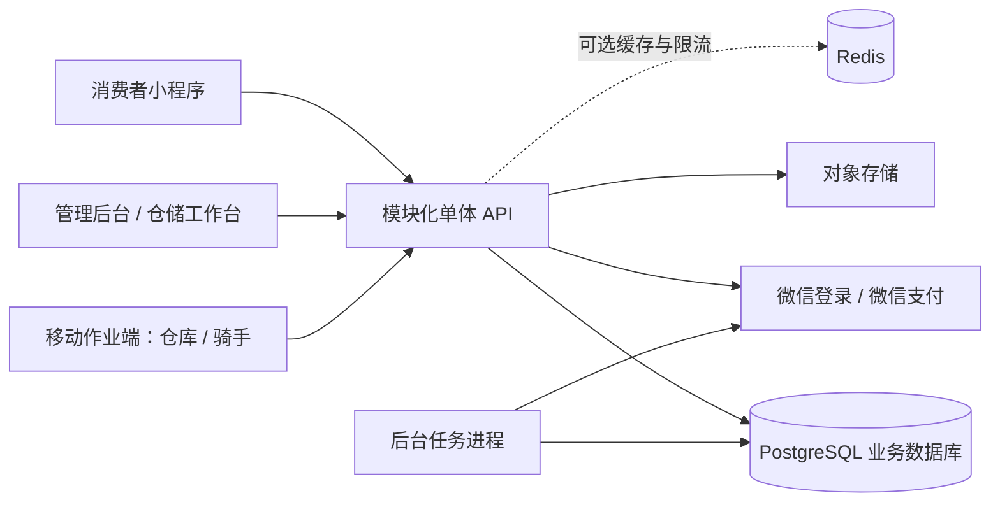

2026-10-31消费者会话接续：本机开发顾客A/B、独立Bearer会话、恢复/退出与“我的”页完成；9项真实PG消费者测试、12项员工/67项商品回归及8项状态测试通过，微信模拟器经隔离API桥接验证。开发登录默认关闭，非微信登录；购物车保留未合并，下一项账号购物车与游客幂等合并。见[交付记录](verification/S4-CONSUMER-SESSION-2026-10-31.md)。

2026-10-31游客草稿接续：本机购物车加入/数量/勾选/移除、当前资料核验和参考小计完成；9项草稿测试及原生夹具/编译验证通过，无后端/迁移变化。结算和登录合并未开放；下一项消费者身份与登录合并基础，真实微信/真机另验。见[记录](verification/S4-GUEST-CART-2026-10-31.md)。

2026-10-31商品卡片接续：列表按商品合并多规格、按商品游标分页、有货规格起价/缺货参考价及正确详情入口完成；67项相关DB、8项浏览状态、3项分类/5项详情回归及微信夹具UI通过，无新迁移。下一切片S4游客购物车草稿；真机/生产仍未验。见[记录](verification/S3-PRODUCT-CARDS-2026-10-31.md)。

2026-10-31消费者分类接续：真实公开分类、父/子导航、分类内搜索/分页及空错重试完成；64项相关DB、10项分类/浏览状态测试、5项详情回归、weapp编译及微信原生夹具验收通过，无新迁移。下一项列表按商品合并多规格展示；真机待HTTPS API。见[交付记录](verification/S2-CONSUMER-CATEGORIES-2026-10-31.md)。

2026-10-31详情规格接续：同商品启用规格完整读取、切换/刷新售价和有货状态完成；61项相关PostgreSQL、5项切换状态、4项浏览回归、weapp编译与微信原生夹具验收通过。无新增迁移；真机待HTTPS测试API。下一项消费者真实分类浏览，见[记录](verification/S2-PRODUCT-VARIANTS-2026-10-31.md)。

2026-10-31多图接续：本地开发版商品图片集（最多6张）、排序/设主图/移除及消费者详情轮播完成；58项相关DB测试、合成/真实浏览器、weapp编译和微信原生组件夹具验证通过。两项增量迁移已应用本机开发库；生产存储和真机未验。下一项消费者详情规格切换。见[交付记录](verification/S2-PRODUCT-GALLERY-2026-10-31.md)。以下早期记录按对应历史切片解读。

2026-10-31商品主图接续：本地开发版单主图上传/替换/移除与后台、小程序显示完成；51项相关PostgreSQL测试、浏览器、weapp编译及微信原生图片组件夹具验证通过。生产对象存储、完整微信网络与真机未验；下一项商品多图与排序。见[交付记录](verification/S2-PRODUCT-IMAGE-2026-10-31.md)。以下较早下一步按历史记录解读。

2026-10-31收货条码接续：仓库授权下的完整条码查询与每行明确选入已完成；45项相关真实DB测试、异常/迟到响应UI及真实收货草稿验证通过，库存不变，本轮无新增迁移。见[记录](verification/S2-RECEIPT-BARCODE-2026-10-31.md)。下一项商品图片管理，先完成本地可审查版本；扫码设备与微信真机仍未验收。

2026-10-30条码接续：SKU单条数字条码绑定/清空、唯一约束与独立窗口完成；42项相关真实DB测试及合成/真实浏览器通过，本机已应用可空条码增量迁移。见[记录](verification/S2-SKU-BARCODE-2026-10-30.md)。下一项条码精确查询与收货选品（手动输入），硬件扫码/正式商品规范另验；真机仍待HTTPS测试API。

2026-10-30规格说明接续：SKU展示文字更正API及独立窗口已完成，36项相关真实DB测试、合成/真实浏览器验证通过；沿用Product.version与现有spec列，不新增迁移，编码/单位/库存/成本保持原值。见[交付记录](verification/S2-SKU-SPEC-2026-10-30.md)。下一项SKU条码维护；微信真机仍待HTTPS测试API。

2026-10-30分类接续：分类改名/启停API及独立窗口已完成，31项相关真实DB测试与合成/真实浏览器验证通过；新增分类version增量迁移，本机开发库已应用；父级停用只改变目录可见性，不改子级/商品/库存状态。见[交付记录](verification/S2-CATEGORY-MAINTENANCE-2026-10-30.md)。下一项SKU规格说明维护，条码等继续按计划补齐；微信真机仍待HTTPS测试API。

2026-10-30规格接续：SKU售价与启停API/独立窗口已完成，25项真实PostgreSQL商品收货测试及合成/真实浏览器验证通过；保留历史库存成本，无迁移，见[本轮记录](verification/S2-SKU-MAINTENANCE-2026-10-30.md)。下一项分类名称与启停维护；规格描述/条码等仍待办，真机仍待HTTPS测试API。

2026-10-30最新接续：负责人授权沿用当前风格自主完成未做UI和交互调整，不再将逐页UI确认作为推进前提。原商品维护计划已接续，名称/分类/说明编辑完成；18项相关真实DB测试与浏览器实链通过，见[本轮交付](verification/S2-PRODUCT-DETAILS-2026-10-30.md)。后续继续其余商品资料维护；真机待HTTPS API，支付/部署等原边界不变。以下早期暂停/等待确认条目按历史记录解读。

# 玉米百货｜全流程开发总纲 V1.1

更新：2026-10-28。商品收货、库位/移位/核对、实物盘点、数量隔离/解除/报损及收货逆向纠错已落地，见[最新报告](verification/S2-RECEIPT-REVERSAL-2026-10-28.md)。78项集成通过，小程序工具/真机未验收。PostgreSQL与本机Docker Desktop选型不变，完整仓储、交易与生产部署尚未完成。

最新运行约定（负责人2026-10-28）：本机有Docker Desktop则优先使用，否则使用Docker Engine。当前主机无Desktop，Engine/PostgreSQL17.11已完成仓储UI相关验证，见[本轮报告](verification/UI-STOCK-TASKS-2026-10-28.md)。当前优先完成仓储UI，库位/核对页及仓管/拣货查询已完成本地验证，收货入库UI也已完成本轮本地验证，首页/商品/分类/库存状态与角色入口已完成本地验证，微信weapp编译与入口检查通过，下一项为微信工具/真机和整体UI审阅，见[最新报告](verification/UI-LIST-STATES-MINI-2026-10-29.md)，暂缓新增商品维护业务。

## 1. 项目目标与已经确认的边界

做一套具有社区即时零售核心体验的小程序及运营系统，参考成熟超市产品的信息结构和购买效率，使用玉米百货自身品牌、商品资料与业务规则。首期目标是完成真实采购入库、上架、购买、支付、拣货、出库、骑手配送、售后和资金核对。

“类似朴朴的购物体验”和“具备全国连锁平台的规模能力”是两个交付层次。本项目先完成第一层，架构保留仓库、服务区域和配送任务边界，后续按实际经营数据扩展。

| 维度 | 本次用户已确认 | 仍待确认 |
|---|---|---|
| 经营范围 | 单小区、单仓、自营配送 | 具体小区、城市、服务楼栋 |
| 商品 | 暂无生鲜 | 是否含有保质期食品、冷冻品、酒类及 SKU 数量 |
| 系统 | 消费者端、后台、轻量仓库系统、骑手配送系统 | 现有仓库设备、打印机、扫码器 |
| 研发 | 项目负责人 + Codex；尽快交付并保证质量 | 每周投入时数、负责人技术经验 |
| 成本 | 优先性价比 | 云服务月预算上限、设计协作工具预算 |
| 上线 | 真实交易与全流程闭环 | 主体、AppID、商户号、域名及资质准备情况 |

未回答“是否已有账号资质”不等于已经具备，也不等于没有。该项是支付与发布前置依赖，不能由 AI 代填。

## 2. 首版交付的五个应用与角色

| 应用 | 使用者 | 核心功能 |
|---|---|---|
| 消费者微信小程序 | 小区居民 | 浏览、搜索、购物车、地址、支付、订单、售后 |
| 运营后台 Web | 负责人、运营、客服 | 商品、分类、订单、设置、退款、报表和权限 |
| 仓库系统 | 仓管、拣货员 | 仓库/库位、收货入库、批次效期、盘点报损、拣货打包、出库 |
| 骑手配送端 | 自营配送人员 | 登录、分配任务、接单、开始配送、送达、配送异常 |
| API 与后台任务 | 全系统 | 认证、报价、库存、交易、微信支付、重试、对账、审计 |

仓库系统首期由后台仓储工作台和移动作业页组成；骑手端采用独立移动 H5 入口。二者共享账号体系和服务端，不共享业务权限。一个人可以具有多个角色，但每次操作均记录真实操作者。

## 3. 首期、后续与扩展范围

| 版本 | 要解决的问题 | 能力 |
|---|---|---|
| V1 必须 | 商品、资金、库存和配送能真实闭环 | 普通定价定量商品；单仓入出库；骑手任务；全额/部分退款；对账；基础效期管理；监控备份 |
| V1.1 | 减少人工工作与漏单 | 扫码优化、打印适配、进货单导入、订阅消息、简单促销；按实际需求排序 |
| V2 | 扩大服务范围与运营效率 | 多小区、容量和配送时段、供应商采购流程、多仓库存；独立评审 |
| 后续专项 | 规模化与复杂经营 | 轨迹、智能调度、骑手结算、会员、复杂优惠、生鲜称重、跨仓调拨 |

V1 的“仓库系统”包含真实库存与作业闭环，暂不做大型 WMS 的波次、自动补货、复杂计费和多仓调拨。V1 的“骑手系统”是独立权限与任务闭环，暂不做轨迹和调度算法。

## 4. 对原方案的主要调整

1. 原有 P0–P9 和 YM-001–086 保留可追溯性；新增任务从 YM-087 开始，阶段以 S0–S9 表示，避免与缺陷优先级混淆。
2. 按用户新要求，将仓库与骑手模块纳入首版，并提前设计数据与权限，不能只写“以后扩展”。
3. 暂无生鲜，商品按固定 SKU、固定售价、整数销售单位处理；移除“约重后补差价”语义。普通食品仍可能需要批次效期。
4. 清理 UI 中的积分、优惠券、满减、预约时段、骑手位置等范围冲突。首版不实现任何促销，优惠字段保持零，防止把示意图当成规则。
5. 核心交易采用订单、支付、履约、售后分别建模；缺货、超时、退款和异常恢复在 UI 开发前确定。
6. 资质、域名、账号、实物备货与配送安排从项目开始并行准备，不留到代码完成之后。
7. 完成标准按业务风险分级，交易与库存强化测试，文档和简单视觉修改不过度测试。

## 5. 建议技术栈

| 层级 | 推荐 | 选择理由 / 边界 |
|---|---|---|
| 小程序 | Taro 4 系列 + React + TypeScript + SCSS | 延续原方案，团队统一 TS；必须验证原生支付、隐私授权、长列表和真机表现 |
| 管理后台 | React + Vite + Ant Design | 表格、表单、权限操作成熟；版本以兼容矩阵锁定 |
| 移动作业端 | React + Vite，移动 H5 | 仓管和骑手快速交付、共用登录与组件；不假设 H5 有微信小程序能力 |
| 服务端 | NestJS + TypeScript，REST/OpenAPI | 领域模块、鉴权、校验、后台作业易管理 |
| 数据 | PostgreSQL 17 稳定分支 + Prisma 7 稳定版本 | 数据事务是库存与交易基石；优先核验 Prisma 7，具体版本在 S0 锁定 |
| 任务 | PostgreSQL 任务表 + Outbox + 独立 Worker | 首期减少依赖；支持重试、租约、死信和故障恢复 |
| 缓存 | Redis 可选 | 不承担库存真相；出现明确限流/性能需求再加入 |
| 基础设施 | 国内云主机 + 托管 PostgreSQL + 对象存储 + HTTPS | 以腾讯云为首选评估，其他国内云也可；购买前按地域与续费重新核价 |
| 工程 | pnpm workspace、锁文件、CI、Docker | 可复现构建，模块共享但不强行共用 React 运行时 |
| 验证 | 单元测试 + PostgreSQL 集成测试 + 浏览器 E2E + 微信真机 | Playwright 覆盖 Web/H5，不能替代小程序验收 |

注意：本次官方资料核查显示 Prisma 正处于大版本切换，文档入口与支持列表不能混用；Nest 新版也存在 Node/TypeScript 门槛。这里确定的是技术方向，不是未经实测的依赖组合。详见[资料与核验记录](research/SKILLS-AND-SOURCES.md)。

## 6. 交付顺序和工期假设

主链路：规则冻结 → 版本验证 → 工程环境 → 商品与入库 → 浏览与账户 → 报价与支付 → 仓库拣货出库 → 骑手送达 → 退款对账 → 集成试运营。

按一位负责人能够全职参与、及时反馈、账号资质并行准备估算，规划 **55–90 个有效工作日，约 11–18 周**。这是任务规模估算，不是交付承诺；负责人可投入时间、技术基础和平台审核会影响日历时间。前三个工作日完成技术验证后再修订估算。

最快见到的成果应当是完整业务切片，而非一次铺满所有页面：先做“后台新增商品并入库 → 小程序看到可售商品”；随后才做“购买一件商品 → 真支付 → 出库 → 骑手送达”。

## 7. 研发协作方式

- 负责人提供业务决策、商品资料、账号、真机、真实仓库与配送反馈；AI 负责设计细化、实现、可运行检查、问题定位和文档同步。
- 每个切片交付：业务规则、模型/迁移、API、界面、异常处理、验证记录、演示步骤。
- 每次只推动一组有依赖的任务；未完成真实支付联调不能标记交易上线通过。
- 代码合并前检查 CI 和关键业务测试；上线前检查迁移、备份恢复与回退方案。
- 不以“AI 写完代码”或“测试没发现问题”宣称零风险；以覆盖的场景、实际结果和试运营数据判断质量。

## 8. 本轮与下一轮

本轮完成资料评审、技能调研、架构与产品设计基线、API/数据库设计、上线方案和研发路线。原始文件归档，不覆盖。

自动技术验证、商品收货、库位/移位/核对及实物盘点的本地HTTP/浏览器检查已通过，精确版本见[矩阵](verification/VERSION-MATRIX.md)。接续报损与不可售库存隔离/解除，并行补齐微信工具/真机、经营参数与商品资料；完整阶段门禁保持待验收。

2026-10-29微信浏览接续：分页/搜索重试修正及4项测试通过，weapp编译与产物检查通过；负责人确认临时本地开发设置后，真实API→微信模拟器商品浏览、搜索/空态和合成失败/分页恢复通过，临时域名校验已恢复。见[实际记录与截图](verification/WECHAT-BROWSE-2026-10-29.md)。下一项为真机和整体UI审阅，未恢复新业务切片。

## 真机验收准备（2026-10-29）

负责人确认暂无HTTPS测试API，先完成准备。已识别ADB连接就绪的Android设备；新增本地/真机编译入口、地址校验、实际API与产物SHA256清单及真机包检查，4项针对性测试和实际本地weapp编译通过；缺少地址和local包的真机检查按预期拒绝。没有改微信配置、部署或上传，未验证真机。下一步取得测试API后联通并审阅整体UI，仍暂缓新业务，见[准备与检查表](verification/WECHAT-DEVICE-PREP-2026-10-29.md)。

## 整体UI复核与弹窗交互（2026-10-30）

修复共享弹窗内部留白误关草稿、Tab/Shift+Tab循环与关闭后恢复焦点；提交时继续阻止关闭，失败保留输入。专项浏览器检查、收货/库位/盘点/处置纠错回归及后台/H5构建类型检查通过；真实API只读走查管理员9页、手机仓管7页和骑手未开放提示，截图及异常/任务历史证据汇总于[负责人审阅入口](verification/UI-REVIEW-2026-10-30.md)。本轮没有业务写入/规则/API/迁移变化，未重跑历史交易集成套件。技术复核不替代负责人整体UI确认；新业务继续暂缓，真机待HTTPS测试API。
