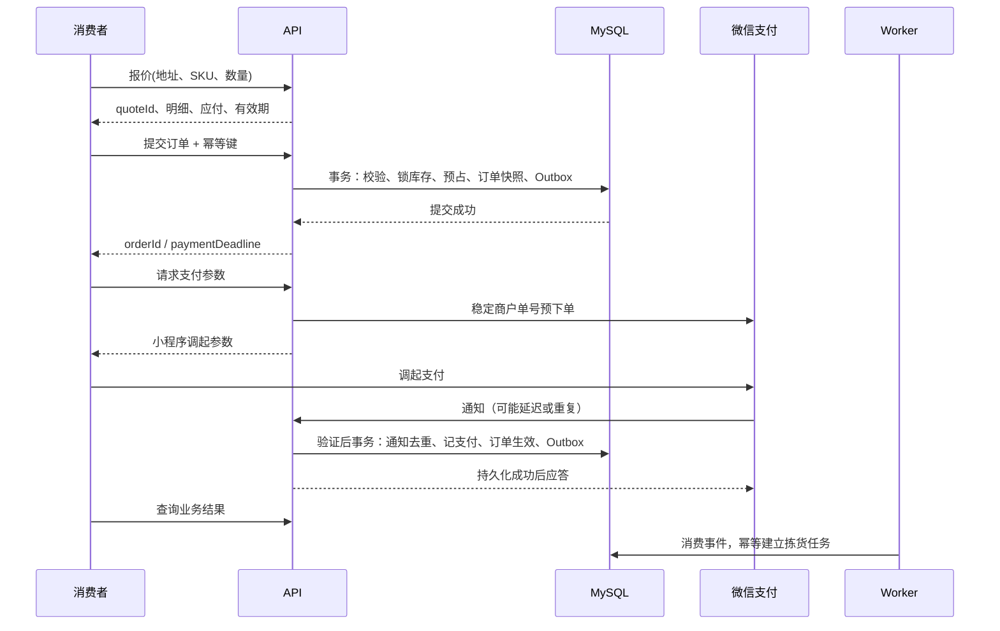

# 系统架构与技术决策 V1.1

## 1. 架构原则

首期使用模块化单体：一个业务代码库、一套 MySQL 业务数据库，API 与 Worker 使用同一镜像的不同启动入口。消费者、员工后台、仓库与骑手通过明确接口访问。无需为单仓业务先搭建微服务、服务网格、Kafka 或 Kubernetes。

单体不等于把业务写在一个大文件里。各领域拥有自己的服务与表，跨领域写入由应用服务编排事务；Controller 不直接操作多个领域表。仓储和配送有独立领域模型，后续是否独立服务取决于团队与负载。

## 2. 技术选型与兼容性验收

| 决策 | 推荐 | S0 验证 / 替代触发条件 |
|---|---|---|
| 运行时 | Node 24 LTS 兼容补丁版，至少满足工具链门槛 | 精确版本待验证；本机、CI、容器一致 |
| 小程序 | Taro 4.x、React、TS、SCSS | 官网默认支持 React18 的路线；以所选版本 peerDependencies 为准，不强制与后台同 React 版本 |
| 后台 | React/Vite/Ant Design | 锁版本并验证表单、路由、构建 |
| 作业 H5 | React/Vite，复用后台类型和轻量组件 | 弱网重试、手机触控、会话失效；不默认依赖手机相机扫码 |
| 服务端 | NestJS 稳定版本，统一 TS | Nest 大版本、TS 与 ESM 配置必须一起验证 |
| ORM | 支持 MySQL 的 Prisma 稳定版本，优先验证7系列 | 不直接使用 latest；若官方支持/维护状态或驱动验证不满足，再以 ADR 选择替代，不暗中换栈 |
| 数据库 | MySQL8.4、InnoDB、utf8mb4 | 本地真实数据库迁移、锁竞争、事务回滚验证 |
| 任务 | 数据库任务表+Outbox，独立 Worker | 多进程领取、租约恢复、退避、死信 |
| 缓存 | 初始可不部署 Redis | 限流/缓存出现明确需求后再引入，不能变成交易单点真相 |

Taro [安装文档](https://docs.taro.zone/docs/GETTING-STARTED)与[React18说明](https://docs.taro.zone/docs/react-18)支持这一路线。Nest 当前[迁移指南](https://docs.nestjs.com/migration-guide)区分运行和生成器门槛，不能只看运行时最低版本。Prisma 当前[主文档](https://docs.prisma.io/docs/orm)与[7系列文档](https://docs.prisma.io/docs/orm/v7)存在版本差异，主入口列出新版本的 MySQL 尚未支持、7系列仍受支持；因此选定大版本后必须针对该版本验证，避免按搜索摘要混用配置。

兼容性验证输出一份 VERSION-MATRIX，记录 Node/pnpm/TS/Taro/React/Nest/Prisma/数据库的精确版本、来源与实测结果。通过最小编译、迁移、CRUD、条件更新、事务回滚和微信真机后才算技术栈落地；本文件不声称这些已经通过。

## 3. 目录建议

```text
apps/
  consumer-mini/        Taro 微信小程序
  admin-web/            运营与桌面仓储
  ops-mobile/           仓库移动作业与骑手 H5
  api/                  Nest API
  worker/               同领域服务的任务入口
packages/
  contracts/            OpenAPI生成类型、枚举、错误码
  api-client/           请求类型、Taro与Web不同传输适配器
  domain/               纯业务规则，服务端使用
  design-tokens/        颜色、间距、字号
  web-ui/               仅Web/H5共享组件
  config/               TS/Lint配置
infra/                  本地Compose、部署、代理和监控配置
docs/                   需求、设计、契约、ADR、验证证据
```

不强行把 Ant Design 组件或浏览器 DOM 组件运行到小程序；共享领域契约和设计变量即可。客户端不引用 Prisma 类型、内部实体或包含秘密的服务端包。

## 4. 领域模块与依赖

| 模块 | 拥有的数据 / 行为 |
|---|---|
| Identity | 消费者身份、员工、会话、角色、仓库范围 |
| Store/ServiceArea | 营业日历、费用、服务小区楼栋、规则版本 |
| Catalog | 分类、商品、SKU、图片、推荐 |
| Cart | 购物车、游客合并 |
| Checkout | 报价、规则校验，不直接记资金 |
| Order | 订单快照、行、取消请求、状态事件 |
| Inventory | 库存汇总、批次库位、预占、流水、冻结 |
| Warehouse | 入库单、盘点、报损、退货、移位、拣货和出库 |
| Payment | 业务支付单、渠道调用、通知、查单、账单 |
| Fulfillment | 将已支付订单协调成仓库和配送任务 |
| Delivery | 骑手、指派、接单、送达、异常 |
| Aftersales/Refund | 额度占用、申请、审核、退款指令与结果 |
| Reporting/Audit | 只读聚合、对账差异、动作审计 |
| Jobs/Outbox | 持久化事件、可恢复任务、重试和死信 |

外部登录、支付、存储、通知通过适配器封装。首版业务逻辑不绑定第三方 Node 支付包的内部类型；未评估的社区 SDK 不因 npm 名称含 wechat 就视为官方可靠实现。

## 5. 下单与支付时序



外部网络调用不得放在持有库存锁的长事务内。预下单超时保留订单与预占，使用相同商户单号查单/恢复。回调处理可以同步完成短事务；复杂后续动作通过 Outbox，避免“支付成功但没创建拣货任务”。

## 6. 库存并发与事务

下单以数据库事务为最终裁决，不能用前端库存值或 Redis 锁替代。事务按固定 SKU/批次顺序取锁，检查仓库冻结、SKU 状态、汇总可售和实际可用批次，条件增加 reserved，再保存批次预占。任何一步失败整单回滚。

库存流水只追加，业务数量与流水同事务。入库过账、出库、取消释放、报损、盘点差异、退货、库位移动均有唯一业务动作键。死锁/序列化冲突有限重试，超限返回可重试错误；重试不能更换购买意图或业务单号。

MySQL 采用经集成测试确认的隔离级别（建议业务显式 READ COMMITTED + 行锁与条件写）；不假设某 ORM 默认隔离即可保证不超卖。生产查询需要执行计划与索引支持，避免全表锁。

## 7. 状态竞争与补偿

| 事件 | 处理方式 |
|---|---|
| 待付订单超时 | 领取关闭任务→查渠道→关单→确认后本地取消/释放；未知则重试 |
| 回调与关闭竞争 | 外部调用后再锁订单并重读版本；成功支付优先保留，不靠旧读覆盖 |
| 已释放却查到成功支付 | 记真实资金、尝试重占；失败标记异常并进入退款处置 |
| 已支付但拣货任务未建 | 支付事务写Outbox；Worker重复执行时按order_id去重 |
| 出库请求返回丢失 | 同一业务动作键查询原结果；不再次减少库存 |
| 退款请求超时 | 商户退款号不变；查单确认，未核实额度不释放 |
| 骑手断网重复送达 | 校验指派/状态/幂等键，已完成返回原结果 |
| Worker崩溃 | 任务租约过期后重新领取，消费动作仍需幂等 |

任务表至少包含 next_run_at、attempts、lease_owner、lease_until、last_error、status；多个 Worker 原子领取（支持时使用 SKIP LOCKED），到期回收。指数退避加随机抖动；永久错误进入人工队列，不能无限吞错。

关闭、查单、退款和对账各有周期扫描，不能只依靠一次定时器或进程内 setTimeout。扫描的时间周期属于配置项，并监控待办年龄与积压。

## 8. 认证、安全与数据边界

- 小程序业务会话使用高熵随机令牌，服务端只保存令牌摘要与有效期；请求携带 Bearer。提供轮换、失效与退出，微信身份凭据不下发。
- 员工 Web/H5 建议同域代理 API，HttpOnly/Secure/SameSite Cookie 会话；写操作验证 CSRF 和 Origin；会话与消费者隔离。会话超时先保存可恢复表单，不缓存敏感页面到离线存储。
- 密码使用受维护的密码哈希实现（如 Argon2id），限流与登录审计；敏感退款操作可二次核验/短会话。精确会话时限在实施时配置。
- 业务服务同时检查身份、权限点、资源归属、warehouse_id 与 rider_id；无法通过传入 user_id 切换用户。
- 价格、应付、退款额度、仓库和骑手指派以服务端为准。请求字段白名单校验，禁止批量绑定覆盖内部状态。
- 商品图片可公开只读；售后与签收证据私有、短时签名、按归属授权；上传校验扩展名、MIME、文件头、体积和图片尺寸，避免 SVG/脚本伪装。
- 日志脱敏，审计记录操作者/动作/对象/原因/时间/requestId与必要字段变化；支付原文如需保存则加密、受限访问并设保留策略。
- 密钥置于运行环境的密钥管理/受控文件；开发、测试、生产隔离。APIv3密钥、商户私钥和平台验签材料的轮换有操作手册。

## 9. 可观测与容量

API、任务、订单、支付、库存动作贯穿 requestId 与业务单号，禁止把电话当追踪ID。监测 API错误与延迟、数据库锁等待、连接池、任务积压、支付待核实、退款失败和库存不变量。

首轮容量假设为 ≤2000 SKU、≤300日订单、100并发浏览用户、10并发提交订单；这是压测起点，不是云机性能保证。使用真实 MySQL、包含多SKU和最后一件争抢场景验证，再根据目标调整。后台图片走对象存储，商品查询分页，不把整个目录返回给小程序。

## 10. 演进触发条件

需要增加小区时先扩展服务范围与履约容量；增加仓库时先设计路由分仓、各仓库存和订单拆分；骑手增多后再评估调度；重复采购工作明显时再建设采购单和供应商结算。出现数据库或任务瓶颈先观察和优化，再决定读副本、Redis队列或服务拆分。
