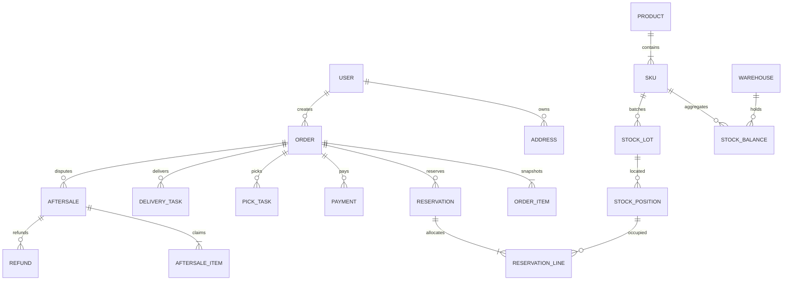

# 数据库与库存账本设计 V1.1

2026-10-26：用户已确认[PostgreSQL决策](../architecture/ADR-002-DATABASE-CHOICE.md)。以下为PostgreSQL业务设计草案；S0迁移仅建立带validation_前缀的隔离验证模型，不代表所有业务表已实现。

这是业务逻辑/物理设计草案，尚未全部转成业务Prisma schema。当前已建立真实PostgreSQL开发/测试库，验证S0模型，并落地员工/仓库基础与商品收货库存表；订单/支付/配送等仍待实现。下方规划表不等于实际字段清单，不能直接复制示意SQL到生产。

### S1已落地模型与迁移影响

2026-10-28增量：`202610280001_stock_counts`新增stock_counts及stock_count_lines；stock_balances新增active_count_id，复合外键确保同仓/SKU。部分唯一索引保证每SKU最多一个FROZEN/SUBMITTED/APPROVED盘点；deferred触发器验证冻结指针与活跃单据一致，不能孤立解冻。`202610280002_count_reason_constraints`额外拒绝NULL审批/终止原因，防止SQL CHECK空值被当成满足条件。旧数量与旧流水保持原样。

盘点快照记录所有位置及on_hand/reserved/blocked/version，实盘counted只允许冻结阶段由空值写入一次；提交后明细不可改删，终态单据不可改删。状态迁移、保护数量、独立审批和时间字段有SQL约束/触发器。员工外键、位置及单据复合外键均RESTRICT。应用先锁balance再重读单据；所有盘点动作和收货/移位遵守同一锁序。

盘点冻结期间，数据库BEFORE触发器拒绝位置/批次数量写入和余额数量变化。盘点过账在事务内设置对应APPROVED单据ID的本地写标记，新增COUNT:<countId>:<lineId>主流水及位置流水后再转终态并清指针。标记只供可信服务事务，不能当作面向客户端的授权手段。盘盈保留既有批次成本来源，不重估成本；未知批次不通过此接口创建。差异先减后加，余额按净差额更新，避免相抵差异导致中间临界量溢出。

迁移是加法，但旧API公开库存查询不认识盘点冻结，因此须停止旧写/读服务后迁移并部署新版本，不允许混跑或直接回退旧API。回退兼容代码需保留冻结、快照和两级账本，不能删除事实或清库。Prisma diff仅核对其支持的结构，SQL冻结与约束用真实集成测试另验。

当前增量：202610270003_locations_reconciliation及202610270004_require_position_entries已部署，新增warehouse_locations、stock_positions、position_ledger、stock_transfers、inventory_checks；stock_balances新增inventory_hold，business_audits新增可空reason。下方S2固定货位说明为历史模型，已由本增量演进。

迁移在事务内锁住旧库存写入，先验证汇总=批次、批次=主流水的三种数量；不一致直接停止，不修改数量。为已有仓库创建DEFAULT，为旧批次的历史location_code建位，按旧批次数量落stock_positions；position_ledger引用原stock_ledger回填历史、保留原时间，旧主流水不UPDATE。新仓由AFTER INSERT触发器建立DEFAULT。迁移前停止旧写服务，迁移后只能运行新版收货服务。

StockLot的on_hand/reserved/blocked暂作批次缓存，StockPosition为真实位置；lot.location_code仅历史兼容字段，不再表示当前唯一库位。位置同时通过复合外键关联批次/仓库/SKU及本仓库位。主流水新增复合唯一键供位置流水约束；位置流水按主流水+位置唯一。同仓移位产生零仓库增量主流水及两条位置流水（−N/+N），StockTransfer关联源/目标与原因，汇总version变化但数量不变。

位置/主流水在提交时通过deferred constraint trigger配平，零增量主流水也必须有明细。位置流水、移位单、核对报告有不可改/删触发器；数量与非负/占用边界有SQL CHECK。应用收货/移位/核对都按仓库SKU余额锁串行；今后预占/出库也必须遵守同一锁协议，不能只锁位置。旧版本收货遗漏位置流水时提交失败，禁止混跑旧写服务或直接回退旧写代码。

InventoryCheck保存单SKU报告（CONSISTENT/DIFFERENCES、issue_count、前100条issues、操作者与时间），不执行数量修复。核对比较汇总↔批次/主流水、批次↔位置/主流水、位置↔位置流水、主流水↔位置明细；比较证据的数量使用十进制整数字符串，避免汇总证据超出JS安全整数时失真。差异触发inventory_hold，不自动释放。解除需新检查一致及审计原因；不解除blocked、预占或其他业务限制。

兼容迁移保留旧列/主流水，接口新增字段为加法；但写协议已升级，旧应用不可继续收货。回退应部署仍支持位置账本的兼容代码并保留数据，禁止回滚DDL/删除历史流水。Prisma diff不检查SQL函数、CHECK和触发器语义，已另用真实DB测试覆盖。

最新增量：`202610270002_catalog_inbound`已在本机开发/测试库部署；新增categories、products、skus、inbound_receipts、inbound_lines、stock_balances、stock_lots、stock_ledger、business_audits、idempotency_records（10表）。员工基础迁移不改。商品/收货状态及版本、金额/数量和库存不变量有SQL CHECK；订单与配送表仍未实现。

本轮实际模型：库存汇总复合主键(warehouse_id,sku_id)，批次关联唯一receipt_line_id，固定location_code=DEFAULT，批次同时承载数量；尚未拆stock_positions。复合外键保证单据行、批次、流水的仓库/SKU一致。每行成本price以BIGINT分保存，当前边界0–100000000（售价至少1）；数量1–100000，库存最大10亿件；JSON输出前转换为范围内安全number。生产/到期必须成对，expires_at>produced_at；业务层校验未来/已到期。

流水action_key唯一、receipt_line_id唯一防重复事实，流水及业务审计有BEFORE UPDATE/DELETE触发器拒绝修改/删除。幂等表按(scope,key_hash)唯一，保存请求摘要与首次JSON结果，无中间状态提交；事务级advisory锁串行相同意图，单据行锁阻止不同键重复过账，按SKU顺序原子建余额/加库存。失败回滚后同键可重试。无自动清理库存关键幂等记录。

兼容性：本轮仅新增表/函数/触发器，不重置原数据；回退应用时保留这些表，禁止通过删除流水实现回退。未来多库位需将批次数量迁移到位置，核对汇总与账本后再切换。新增DB适配器显式schema与search_path支持，用于yumi_test一次性schema测试；默认仍public。Prisma diff不覆盖SQL CHECK/触发器语义，测试另行验证。

迁移`202610270001_staff_foundation`新增warehouses、staff、staff_roles、staff_warehouses、staff_sessions、staff_login_throttles、auth_audit_events，全部UUID主键或组合主键。仅新增表，不重命名/删除S0数据；历史S0迁移保持不变。仓库当前只有code/name/enabled，地址与经营配置将在业务切片补充。

staff实际字段为login_name/display_name/password_hash/enabled/auth_version/created_at。staff_sessions为员工专用，不与消费者共表；含token_hash(CHAR64唯一)、auth_version、created_at/expires_at/revoked_at；CHECK要求expires_at>created_at，员工有效性与版本每次请求重查。角色为7个固定代码的CHECK；范围表组合唯一，外键删除RESTRICT。auth_audit_events只记录认证、退出与权限拒绝，当前不是完整业务审计表；无明文凭据或原始Cookie。

staff_login_throttles使用摘要键、数据库窗口起点与原子UPSERT计数，跨实例共享。会话/限流/审计数据保留与定期清理任务尚未实现，须在上线前补齐。开发seed只允许本机yumi_dev且禁止production，重复执行不覆盖既有员工、密码、仓库或库存。未来消费者会话、轮换族、仓库作业审计需另建迁移，不能把下方设计表当成已落地字段。

## 1. 统一数据约定

- PostgreSQL17、UTF8；本机Docker Desktop隔离开发与测试库。事务关联用真实外键；历史交易不级联删除。字典停用，员工/商品软停用，订单/支付/流水不物理业务删除。
- 内部主键可 BIGINT，外部 public_id 用不可预测ID并设唯一；API只返回字符串。订单号/商户单号为独立唯一字符串，不依赖时间戳毫秒防碰撞。
- 金额 BIGINT整数分（API返回前验证安全范围），数量 INT整数且非负；不使用FLOAT/DOUBLE金额。成本也是分，成本来源不齐时不计算毛利。
- 时间 TIMESTAMPTZ(3) 表达绝对时间，按UTC存取；到期日期按经营时区定义后转换 cutoff_at。日期边界、含当日与否必须用样例测试。
- 业务实体有 created_at、updated_at、version；流水有 created_at、业务发生时间和操作者，不允许编辑已过账事实。
- 字符串字段长度、枚举、CHECK与索引在迁移中显式定义。JSONB只承载不可变快照、元信息与脱敏审计差异，不把需要索引的核心数量/状态全塞JSON。

## 2. 主要实体关系



关系图展示核心关系，不等于要求每个模块同时建表上线。表名用单数概念示意；落地统一 snake_case 命名。

## 3. 身份、经营与商品表

| 表 | 关键字段 / 约束 | 索引与说明 |
|---|---|---|
| users | id/public_id、wechat_app_id、openid、status | UNIQUE(app_id,openid)，UnionID如适用可空，不当唯一业务主键 |
| staff | id、login_name、password_hash、name、status | login_name唯一；不存明文密码 |
| staff_roles | staff_id、role_code | UNIQUE(staff_id,role_code)；固定角色，权限点在代码版本化 |
| staff_warehouses | staff_id、warehouse_id | 组合唯一，限制仓库数据范围 |
| sessions | subject_type/id、token_hash、expires_at、revoked_at、rotation_family | token_hash唯一，索引有效期；消费者/员工会话隔离 |
| warehouses | code、name、address、status | code唯一，首期1条有效经营仓库 |
| service_areas | warehouse_id、name、status、version | warehouse_id/status；单小区也保留实体 |
| service_buildings | area_id、building_code/name、unit_rules、status | UNIQUE(area_id,building_code) |
| store_settings | singleton/business_id、opening_rules、min_goods_cents、delivery_fee_cents、paused、rule_version | 修改留审计；金额/暂停状态独立列 |
| addresses | user_id、area_id、building_id、unit、room、contact_name、phone_ciphertext、note、is_deleted | (user_id,is_deleted)；电话/详细地址敏感字段加密 |
| user_preferences | user_id、default_address_id | user_id主键；默认地址必须属于同一用户且有效 |
| categories | parent_id、name、sort、status | (parent_id,status,sort)，应用层禁止循环与超过两级 |
| products | public_id、category_id、name、description、status | (category_id,status,id)，关键字检索初期限制范围并分页 |
| skus | product_id、sku_code、barcode、spec、unit、price_cents、expiry_managed、status | sku_code唯一；barcode可空且唯一策略按真实商品规范确定 |
| assets | public_id、owner_type/id、purpose、object_key、visibility、mime、bytes、verified_at | object_key唯一，私有图片按归属授权 |
| product_assets | product_id、asset_id、sort、usage | 组合唯一；图片不能引用未校验上传 |
| home_content | slot、product_id/asset_id、sort、enabled | 受控推荐/横幅，不做自由脚本配置 |
| cart_items | user_id、sku_id、quantity、selected、version | UNIQUE(user_id,sku_id)；当前售价不写死在购物车 |

地址快照必须加密/受控保存，不因为联系方式加密就允许日志明文输出。字段级加密密钥位于独立配置，备份恢复同时考虑密钥恢复与访问权限。

## 4. 仓储与库存表

| 表 | 关键字段 / 约束 | 索引与说明 |
|---|---|---|
| locations | warehouse_id、code、type、status | UNIQUE(warehouse_id,code)，type含收货/存储/隔离 |
| stock_balances | warehouse_id、sku_id、on_hand、reserved、blocked、safety、version | UNIQUE(warehouse_id,sku_id)，所有操作先锁本行 |
| stock_lots | warehouse_id、sku_id、lot_no、received_at、produced_at、expires_at、unit_cost_cents、quality_status | (warehouse_id,sku_id,expires_at,id)，批次号按仓库/SKU/来源定义唯一 |
| stock_positions | lot_id、location_id、on_hand、reserved、blocked、version | UNIQUE(lot_id,location_id)，库位须属于同仓 |
| reservations | order_id、warehouse_id、status、expires_at、released_at | order_id首期唯一；(status,expires_at)；状态ACTIVE/CONSUMED/RELEASED/PARTIAL |
| reservation_lines | reservation_id、order_item_id、position_id、allocated_qty、released_qty、consumed_qty | 按行和库位唯一；累计释放+消耗≤allocated |
| stock_ledger | action_id、position_id、warehouse_id、sku_id、delta_on_hand、delta_reserved、delta_blocked、source_type/id/line_id、actor_id、reason | UNIQUE(action_id,position_id)，(warehouse_id,sku_id,id)、(source_type,source_id) |
| warehouse_documents | type、warehouse_id、doc_no、status、source_ref、reason、actor/reviewer、posted_at、reverses_id | doc_no唯一；类型为收货/盘点/报损/退货/移位，分别限定字段与状态 |
| warehouse_document_lines | document_id、sku_id、lot_id、from/to_location_id、quantity、book_qty、counted_qty、unit_cost_cents、expiry_fields | (document_id,id)，已过账不可改，按type校验必填 |
| stock_freezes | warehouse_id、sku_id、position_id?、count_document_id、status、expires_at | 活跃冻结范围唯一策略；过期需核对任务后释放，不能静默清掉进行中盘点 |

仓储单据共用表头/行不意味着共用一个任意“调整数量”接口。收货、盘点、报损、退货、移位由不同应用服务执行类型约束、权限和过账规则，避免泛化CRUD绕过账本。

### 4.1 不变量

1. 每个汇总/库位行的 on_hand、reserved、blocked、safety 均≥0，且 `reserved + blocked <= on_hand`。
2. 汇总 on_hand/reserved/blocked 与有效库位明细合计相等；safety在SKU仓库层维护，不在每个库位重复扣除。
3. 可售数量同时受汇总安全库存与可用批次限制，禁止单独凭汇总库存卖出过期/隔离批次。
4. 有效预占行的未释放未消耗数量合计，与库位reserved及汇总reserved一致。
5. stock_ledger 记录每个位置的增量；业务过账+位置+汇总+流水同事务。汇总初始值加流水增量可重建当前余额。
6. 库位移位记录一减一加，仓库 on_hand 总量不变；移动已预占库存首期禁止，先由授权流程重分配。
7. 隔离/到期发现占用：未被预占部分进入blocked，已预占部分进入履约异常并禁止出库，随后重分配或取消释放后转blocked；不能将同一数量同时算reserved和blocked。
8. 盘点真实数量小于已占用量时，先异常处理相关订单，不通过强制负数修正。

可售：`max(0, on_hand - blocked - reserved - safety)`，再与可分配批次可售合计取较小值。库存真相是数据库中一致提交的事实；内存、Redis、商品列表缓存都不是最终裁决。

### 4.2 预占事务示意

```sql
-- 仅示意一个SKU的汇总条件更新；真实实现必须与订单、批次位置、
-- reservation_lines、ledger、幂等记录同事务提交。
UPDATE stock_balances
SET reserved = reserved + $1, version = version + 1
WHERE warehouse_id = $2 AND sku_id = $3
  AND on_hand - blocked - reserved - safety >= $1
RETURNING warehouse_id, sku_id, reserved;
-- 返回行数必须为1，否则整体回滚；实际实现使用参数化查询。
```

实际实现顺序：锁/确认幂等记录 → 按SKU排序锁汇总 → 检查冻结 → 锁可用批次位置（近效期/先进先出）→ 校验商品价格与全部数量 → 分配预占 → 写订单与快照 → 写流水/Outbox/幂等结果 → 提交。可通过参数化原生SQL完成条件写，禁止字符串拼SQL。

### 4.3 主要动作的账本效果

| 动作 | on_hand | reserved | blocked |
|---|---:|---:|---:|
| 可售收货+N | +N | 0 | 0 |
| 隔离收货+N | +N | 0 | +N |
| 下单预占N | 0 | +N | 0 |
| 未出库取消N | 0 | −N | 0（若批次已隔离则转blocked） |
| 出库N | −N | −N | 0 |
| 不可售报损N | −N | 0 | −N |
| 可售品发现损坏N | 0 | 0 | +N；先建立数量隔离，再按独立报损单处理 |
| 退款无退货 | 0 | 0 | 0 |
| 实物退回且可售N | +N | 0 | 0 |
| 实物退回隔离N | +N | 0 | +N |

盘点按差异过账，先判断可售/隔离与预占影响；不能简单覆写余额且不写流水。

## 5. 报价、订单与支付表

| 表 | 关键字段 / 约束 | 索引与说明 |
|---|---|---|
| checkout_quotes | user_id、address_id/version、rule_version、snapshot_json、hash、expires_at | (user_id,expires_at)，绑定数量/价格/地址与主体 |
| orders | public_id、order_no、user_id、warehouse_id、area_id、order_status、fulfillment_status、goods_cents、delivery_fee_cents、payable_cents、paid_cents、refund_reserved_cents、refunded_cents、payment_deadline、paid_at、address_snapshot_ciphertext、version | order_no唯一；(user_id,created_at,id)、(warehouse_id,order_status,created_at)、(order_status,payment_deadline) |
| order_items | order_id、sku_id、name/spec/unit/image_snapshot、unit_price_cents、ordered_qty、canceled_qty、dispatched_qty、subtotal_cents、refund_reserved_qty/cents、refunded_qty/cents | (order_id,id)，快照不跟随商品修改；行金额核对 |
| order_events | order_id、event_type、before/after、actor_type/id、reason、request_id、created_at | (order_id,id)，只追加 |
| cancellation_requests | order_id、reason、requested_by、status、resolution、version | (order_id,status)，只允许一个有效取消请求，已付走退款流程 |
| payments | order_id、out_trade_no、provider_transaction_id、status、amount_cents、currency、prepay_ref、success_at、last_queried_at、version | out_trade_no唯一，provider_transaction_id非空时唯一；首期每订单一张有效支付单 |
| payment_notifications | provider、provider_event_id、type、payload_digest、encrypted_payload_ref、processed_at | UNIQUE(provider,event_id)，不公开明文通知 |

出库行数量必须≤订购−已取消；退款数量不直接改变订购数量或出库数量。商品售后不代表未履约行被取消，需区别售后原因与履约决议。

未支付订单 payable_cents 在创建后不可随意修改。渠道成功必须匹配原单 amount、currency、商户和AppID；unknown状态要保留查询证据。金额字段恒等式在服务层与可适用的CHECK双重校验。

## 6. 仓库任务与骑手表

| 表 | 字段 | 索引 / 约束 |
|---|---|---|
| pick_tasks | order_id、warehouse_id、assigned_staff_id、status、claimed_at、packed_at、dispatched_at、version | 首期order_id唯一；(warehouse_id,status,created_at) |
| pick_task_lines | task_id、order_item_id、position_id、required_qty、picked_qty、shortage_qty、resolution | 行关联预占位置；任务+订单行+位置唯一 |
| warehouse_exceptions | order_id/task_id、type、affected_line_id、quantity、status、resolution、actor_id | (warehouse_id,status,created_at)，联系与决议可追溯 |
| delivery_tasks | order_id、warehouse_id、rider_id、status、assignment_version、accepted_at、started_at、delivered_at、proof_type/asset_id、version | 首期order_id唯一；(rider_id,status,created_at)、(warehouse_id,status,id) |
| delivery_assignments | task_id、rider_id、assigned_by、assignment_version、assigned_at、revoked_at、reason | UNIQUE(task_id,assignment_version)，不覆写历史 |
| delivery_exceptions | task_id、type、note、reported_by、resolution、resolved_by、resolved_at | (task_id,status)，附件关联assets |

骑手可复用 staff 身份，用固定 rider 角色与仓库范围约束。配送任务当前指派是冗余快照，更新时与指派历史同事务；客户端 version/assignment_version必须匹配。送达不写库存负向流水。

## 7. 售后与退款表

| 表 | 关键字段 / 约束 | 索引与说明 |
|---|---|---|
| aftersales | order_id、user_id、type、reason、status、requested_cents、approved_cents、shipping_refund_cents、reviewer_id、review_note、version | (user_id,created_at)、(status,created_at)，金额服务端计算 |
| aftersale_items | aftersale_id、order_item_id、quantity、goods_refund_cents、reason | 申请+订单行唯一；关联额度占用 |
| refunds | aftersale_id、payment_id、out_refund_no、provider_refund_id、amount_cents、status、success_at、last_queried_at、version | out_refund_no唯一，渠道ID非空唯一；(status,updated_at) |
| refund_allocations | refund_id、order_item_id?、allocation_type、amount_cents、quantity | 区分商品与运费；合计=本次渠道退款金额 |

申请额度在事务内锁定订单与相关行；检查已退+有效占用+本次≤原实付，同时检查数量。订单退款金额计数、行金额/数量计数、申请与分配在同一事务更新。运费另设受限额度（可用独立订单字段或独立allocation聚合），不能让每个申请都再退一份运费。

渠道超时/处理中保留额度；退款最终成功将reserved转refunded；申请被拒绝/正式终止才释放。退款失败仍有义务时保留占用并重试/人工处理。首版一次申请只发一张有效退款单；若官方渠道要求对确认终态失败新建退款单，必须记录前后替代关系、确认旧单不可能成功并保留同一业务义务，不能在网络超时后简单换号。

已退款不能因重放通知重复增加 refunded_cents。退款总额只能≤渠道确认支付金额。每个退款都能追溯订单行、运费和操作者。

## 8. 基础可靠性与对账表

| 表 | 字段 / 约束 | 用途 |
|---|---|---|
| idempotency_records | scope、key_hash、request_hash、status、resource_id、result_json、expires_at | UNIQUE(scope,key_hash)，提交结果与业务动作同事务 |
| outbox_events | event_id、aggregate_type/id、type、payload、status、next_run_at、lease_until、attempts | event_id唯一；(status,next_run_at,id)，可重放 |
| background_jobs | kind、business_key、payload、status、next_run_at、lease_owner/until、attempts、last_error | UNIQUE(kind,business_key)，扫描+重试，不依赖进程定时器 |
| audit_logs | actor_type/id、warehouse_id、action、resource_type/id、reason、result、request_id、redacted_changes | (resource_type,resource_id,id)、(actor_id,created_at)，只追加 |
| reconciliation_runs | provider、bill_date、bill_type、status、source_digest、started/completed_at | UNIQUE(provider,bill_date,bill_type)，下载重试可追踪 |
| reconciliation_differences | run_id、business_no、type、local_cents、provider_cents、status、resolution、resolved_by | UNIQUE(run_id,business_no,type)，处置留痕 |

Outbox消费业务还需自身唯一键（如pick_tasks.order_id），仅把事件标记已消费不能保证业务侧恰好一次。目标是至少一次投递加业务幂等。

## 9. 迁移、备份与验证

- 每个模块交付迁移、索引、开发样例、回退/修复说明；生产禁用reset、db push替代迁移或自动清库。
- 采用先增后改后删的兼容迁移；大表索引与回填独立执行，观察锁和耗时。
- 开发样例：1仓、1小区、若干楼栋、3普通SKU、2员工角色组合、1骑手，价格450/590/1680分；不使用真实居民信息。
- 集成验证：多SKU中途失败完全回滚；最后一件争抢；重复出入库；盘点/报损与预占冲突；断点重启；退款并发；库位流水重建与聚合余额一致。
- 每日核对汇总与明细、预占与订单、出库与履约；检查不变量失败立即告警并停用受影响SKU销售，不能无声修正数据。

## 2026-10-28 隔离/报损实际增量

迁移`202610280003_stock_dispositions`新增stock_isolations（原位置/批次、quantity、remaining、version、reason、创建员工、唯一stock_ledger_id）及stock_dispositions（关联隔离、RELEASE/DAMAGE、数量、位置/隔离版本快照、状态/版本、独立审批、实物说明和唯一过账流水）。复合外键限定同仓/SKU/批次/位置，原始事实不可改删，终态不可改。已部署迁移不重写。

延迟触发器在提交时检查remaining=quantity−已过账处置之和、每条动作恰好一条正确主流水和一条正确位置流水、位置blocked不小于其隔离remaining总和。历史blocked不回填来源，也不能通过新单据消费。SQL CHECK拒绝空原因、无独立审批过账、报损缺核验说明、终态时间/流水不配对。全部数量更新、隔离余额、单据、两级流水、审计、幂等结果同事务。

加法迁移，无旧数量回填或历史流水改写。部署停旧API/worker、备份后执行db:migrate及db:migrate:test并启动新版；旧服务不理解新增隔离事实，禁止混跑/降级丢弃事实。回退保留新表与全部防护，使用兼容代码修复。Prisma结构diff为空不涵盖触发器语义，另用真实DB集成验证。

## 2026-10-28 收货逆向纠错实际增量

`202610280004_receipt_reversals`新增receipt_reversals，一单一个原批次位置：quantity/position_version、不可变reason/creator、状态/版本、独立reviewer/review_reason、physical_evidence、取消/过账时间和唯一stock_ledger_id。仓库/SKU/批次/位置及流水复合外键约束归属，索引(warehouse_id,sku_id,id)与lot_id。来源通过lot.receipt_line_id追溯，不复制或接受客户端修改原数量/成本。

CHECK和触发器约束初始/迁移/终态、独立审批、非空核验、不可改删；延迟检查原单POSTED、按lot累计已过账逆向≤原收货quantity、恰一条RECEIPT_REVERSE主流水及恰一条对应位置流水且deltaOnHand=−quantity、R/B=0。延迟额度核对锁原lot；API统一先锁balance，再检查快照、额度与完整账本。单据、三层库存、双流水、审计和幂等结果同事务。

原已过账收货及其行新增不可改删保护，也禁止追加行；lot原收货行/仓库/SKU/批次号/成本来源禁止改写。旧原单和流水不改，不回填/重估金额，不修改隔离remaining。加法迁移，停旧写服务、备份、部署两库并重启新版；禁止混跑旧代码或删除事实回退。Prisma结构diff不覆盖SQL约束语义，另用真实DB测试证明。
