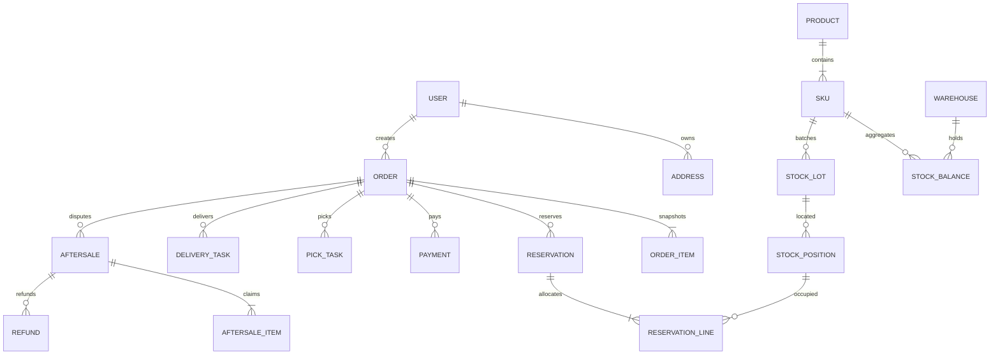

2026-11-02最新优先级：负责人要求新增积分商城，小程序与运营后台同时交付，优先实现并上线，其他功能随后依次上线。详见[积分商城首发设计](../product/POINTS-MALL-V1.md)。本轮为设计，尚未实现或上线；积分经营参数仍待配置。该要求覆盖历史排除积分及旧下一步顺序，必要的真实登录、库存、履约、售后和生产验收依赖仍须完成。API与数据新增内容均为设计草案，非已发布契约。

# 数据库与库存账本设计 V1.1

2026-10-26：用户已确认[PostgreSQL决策](../architecture/ADR-002-DATABASE-CHOICE.md)。以下为PostgreSQL业务设计草案；S0迁移仅建立带validation_前缀的隔离验证模型，不代表所有业务表已实现。

这是业务逻辑/物理设计草案，尚未全部转成业务Prisma schema。当前已建立真实PostgreSQL开发/测试库，验证S0模型，并落地员工/仓库基础与商品收货库存表；订单/支付/配送等仍待实现。下方规划表不等于实际字段清单，不能直接复制示意SQL到生产。

### S1已落地模型与迁移影响

2026-10-28增量：`202610280001_stock_counts`新增stock_counts及stock_count_lines；stock_balances新增active_count_id，复合外键确保同仓/SKU。部分唯一索引保证每SKU最多一个FROZEN/SUBMITTED/APPROVED盘点；deferred触发器验证冻结指针与活跃单据一致，不能孤立解冻。`202610280002_count_reason_constraints`额外拒绝NULL审批/终止原因，防止SQL CHECK空值被当成满足条件。旧数量与旧流水保持原样。

盘点快照记录所有位置及on_hand/reserved/blocked/version，实盘counted只允许冻结阶段由空值写入一次；提交后明细不可改删，终态单据不可改删。状态迁移、保护数量、独立审批和时间字段有SQL约束/触发器。员工外键、位置及单据复合外键均RESTRICT。应用先锁balance再重读单据；所有盘点动作和收货/移位遵守同一锁序。

盘点冻结期间，数据库BEFORE触发器拒绝位置/批次数量写入和余额数量变化。盘点过账在事务内设置对应APPROVED单据ID的本地写标记，新增COUNT:<countId>:<lineId>主流水及位置流水后再转终态并清指针。标记只供可信服务事务，不能当作面向客户端的授权手段。盘盈保留既有批次成本来源，不重估成本；未知批次不通过此接口创建。差异先减后加，余额按净差额更新，避免相抵差异导致中间临界量溢出。

迁移是加法，但旧API公开库存查询不认识盘点冻结，因此须停止旧写/读服务后迁移并部署新版本，不允许混跑或直接回退旧API。回退兼容代码需保留冻结、快照和两级账本，不能删除事实或清库。Prisma diff仅核对其支持的结构，SQL冻结与约束用真实集成测试另验。

当前增量：202610270003_locations_reconciliation及202610270004_require_position_entries已部署，新增warehouse_locations、stock_positions、position_ledger、stock_transfers、inventory_checks；stock_balances新增inventory_hold，business_audits新增可空reason。下方S2固定货位说明为历史模型，已由本增量演进。

迁移在事务内锁住旧库存写入，先验证汇总=批次、批次=主流水的三种数量；不一致直接停止，不修改数量。为已有仓库创建DEFAULT，为旧批次的历史location_code建位，按旧批次数量落stock_positions；position_ledger引用原stock_ledger回填历史、保留原时间，旧主流水不UPDATE。新仓由AFTER INSERT触发器建立DEFAULT。迁移前停止旧写服务，迁移后只能运行新版收货服务。

StockLot的on_hand/reserved/blocked暂作批次缓存，StockPosition为真实位置；lot.location_code仅历史兼容字段，不再表示当前唯一库位。位置同时通过复合外键关联批次/仓库/SKU及本仓库位。主流水新增复合唯一键供位置流水约束；位置流水按主流水+位置唯一。同仓移位产生零仓库增量主流水及两条位置流水（−N/+N），StockTransfer关联源/目标与原因，汇总version变化但数量不变。

位置/主流水在提交时通过deferred constraint trigger配平，零增量主流水也必须有明细。位置流水、移位单、核对报告有不可改/删触发器；数量与非负/占用边界有SQL CHECK。应用收货/移位/核对都按仓库SKU余额锁串行；今后预占/出库也必须遵守同一锁协议，不能只锁位置。旧版本收货遗漏位置流水时提交失败，禁止混跑旧写服务或直接回退旧写代码。

InventoryCheck保存单SKU报告（CONSISTENT/DIFFERENCES、issue_count、前100条issues、操作者与时间），不执行数量修复。核对比较汇总↔批次/主流水、批次↔位置/主流水、位置↔位置流水、主流水↔位置明细；比较证据的数量使用十进制整数字符串，避免汇总证据超出JS安全整数时失真。差异触发inventory_hold，不自动释放。解除需新检查一致及审计原因；不解除blocked、预占或其他业务限制。

兼容迁移保留旧列/主流水，接口新增字段为加法；但写协议已升级，旧应用不可继续收货。回退应部署仍支持位置账本的兼容代码并保留数据，禁止回滚DDL/删除历史流水。Prisma diff不检查SQL函数、CHECK和触发器语义，已另用真实DB测试覆盖。

最新增量：`202610270002_catalog_inbound`已在本机开发/测试库部署；新增categories、products、skus、inbound_receipts、inbound_lines、stock_balances、stock_lots、stock_ledger、business_audits、idempotency_records（10表）。员工基础迁移不改。商品/收货状态及版本、金额/数量和库存不变量有SQL CHECK；订单与配送表仍未实现。

本轮实际模型：库存汇总复合主键(warehouse_id,sku_id)，批次关联唯一receipt_line_id，固定location_code=DEFAULT，批次同时承载数量；尚未拆stock_positions。复合外键保证单据行、批次、流水的仓库/SKU一致。每行成本price以BIGINT分保存，当前边界0–100000000（售价至少1）；数量1–100000，库存最大10亿件；JSON输出前转换为范围内安全number。生产/到期必须成对，expires_at>produced_at；业务层校验未来/已到期。

流水action_key唯一、receipt_line_id唯一防重复事实，流水及业务审计有BEFORE UPDATE/DELETE触发器拒绝修改/删除。幂等表按(scope,key_hash)唯一，保存请求摘要与首次JSON结果，无中间状态提交；事务级advisory锁串行相同意图，单据行锁阻止不同键重复过账，按SKU顺序原子建余额/加库存。失败回滚后同键可重试。无自动清理库存关键幂等记录。

兼容性：本轮仅新增表/函数/触发器，不重置原数据；回退应用时保留这些表，禁止通过删除流水实现回退。未来多库位需将批次数量迁移到位置，核对汇总与账本后再切换。新增DB适配器显式schema与search_path支持，用于yumi_test一次性schema测试；默认仍public。Prisma diff不覆盖SQL CHECK/触发器语义，测试另行验证。

迁移`202610270001_staff_foundation`新增warehouses、staff、staff_roles、staff_warehouses、staff_sessions、staff_login_throttles、auth_audit_events，全部UUID主键或组合主键。仅新增表，不重命名/删除S0数据；历史S0迁移保持不变。仓库当前只有code/name/enabled，地址与经营配置将在业务切片补充。

staff实际字段为login_name/display_name/password_hash/enabled/auth_version/created_at。staff_sessions为员工专用，不与消费者共表；含token_hash(CHAR64唯一)、auth_version、created_at/expires_at/revoked_at；CHECK要求expires_at>created_at，员工有效性与版本每次请求重查。角色为7个固定代码的CHECK；范围表组合唯一，外键删除RESTRICT。auth_audit_events只记录认证、退出与权限拒绝，当前不是完整业务审计表；无明文凭据或原始Cookie。

staff_login_throttles使用摘要键、数据库窗口起点与原子UPSERT计数，跨实例共享。会话/限流/审计数据保留与定期清理任务尚未实现，须在上线前补齐。开发seed只允许本机yumi_dev且禁止production，重复执行不覆盖既有员工、密码、仓库或库存。未来消费者会话、轮换族、仓库作业审计需另建迁移，不能把下方设计表当成已落地字段。

## 1. 统一数据约定

- PostgreSQL17、UTF8；本机Docker Desktop隔离开发与测试库。事务关联用真实外键；历史交易不级联删除。字典停用，员工/商品软停用，订单/支付/流水不物理业务删除。
- 内部主键可 BIGINT，外部 public_id 用不可预测ID并设唯一；API只返回字符串。订单号/商户单号为独立唯一字符串，不依赖时间戳毫秒防碰撞。
- 金额 BIGINT整数分（API返回前验证安全范围），数量 INT整数且非负；不使用FLOAT/DOUBLE金额。成本也是分，成本来源不齐时不计算毛利。
- 时间 TIMESTAMPTZ(3) 表达绝对时间，按UTC存取；到期日期按经营时区定义后转换 cutoff_at。日期边界、含当日与否必须用样例测试。
- 业务实体有 created_at、updated_at、version；流水有 created_at、业务发生时间和操作者，不允许编辑已过账事实。
- 字符串字段长度、枚举、CHECK与索引在迁移中显式定义。JSONB只承载不可变快照、元信息与脱敏审计差异，不把需要索引的核心数量/状态全塞JSON。

## 2. 主要实体关系



关系图展示核心关系，不等于要求每个模块同时建表上线。表名用单数概念示意；落地统一 snake_case 命名。

## 3. 身份、经营与商品表

| 表 | 关键字段 / 约束 | 索引与说明 |
|---|---|---|
| users | id/public_id、wechat_app_id、openid、status | UNIQUE(app_id,openid)，UnionID如适用可空，不当唯一业务主键 |
| staff | id、login_name、password_hash、name、status | login_name唯一；不存明文密码 |
| staff_roles | staff_id、role_code | UNIQUE(staff_id,role_code)；固定角色，权限点在代码版本化 |
| staff_warehouses | staff_id、warehouse_id | 组合唯一，限制仓库数据范围 |
| sessions | subject_type/id、token_hash、expires_at、revoked_at、rotation_family | token_hash唯一，索引有效期；消费者/员工会话隔离 |
| warehouses | code、name、address、status | code唯一，首期1条有效经营仓库 |
| service_areas | warehouse_id、singleton、name、enabled、version | 全局singleton=true唯一，warehouse_id唯一，默认停用 |
| service_buildings | area_id、name、name_key、enabled | UNIQUE(area_id,name_key)，name_key=lower(name)，默认停用；编码/单元规则未实现 |
| store_settings | singleton/business_id、opening_rules、min_goods_cents、delivery_fee_cents、paused、rule_version | 修改留审计；金额/暂停状态独立列 |
| consumer_addresses（已实现） | user_id、area_id、building_id、payload、is_default、deleted | payload为联系/门牌JSON的AES-256-GCM密文；本人索引；有效默认部分唯一 |
| consumer_address_books（已实现） | user_id、version | 每人独立版本和锁；当前默认用地址表部分唯一标记，未建立user_preferences |
| categories | parent_id、name、sort、status | (parent_id,status,sort)，应用层禁止循环与超过两级 |
| products | public_id、category_id、name、description、status | (category_id,status,id)，关键字检索初期限制范围并分页 |
| skus | product_id、sku_code、barcode、spec、unit、price_cents、expiry_managed、status | sku_code唯一；barcode可空且唯一策略按真实商品规范确定 |
| assets | public_id、owner_type/id、purpose、object_key、visibility、mime、bytes、verified_at | object_key唯一，私有图片按归属授权 |
| product_assets | product_id、asset_id、sort、usage | 组合唯一；图片不能引用未校验上传 |
| home_content | slot、product_id/asset_id、sort、enabled | 受控推荐/横幅，不做自由脚本配置 |
| cart_items | user_id、sku_id、quantity、selected、version | UNIQUE(user_id,sku_id)；当前售价不写死在购物车 |

地址快照必须加密/受控保存，不因为联系方式加密就允许日志明文输出。字段级加密密钥位于独立配置，备份恢复同时考虑密钥恢复与访问权限。

## 4. 仓储与库存表

| 表 | 关键字段 / 约束 | 索引与说明 |
|---|---|---|
| locations | warehouse_id、code、type、status | UNIQUE(warehouse_id,code)，type含收货/存储/隔离 |
| stock_balances | warehouse_id、sku_id、on_hand、reserved、blocked、safety、version | UNIQUE(warehouse_id,sku_id)，所有操作先锁本行 |
| stock_lots | warehouse_id、sku_id、lot_no、received_at、produced_at、expires_at、unit_cost_cents、quality_status | (warehouse_id,sku_id,expires_at,id)，批次号按仓库/SKU/来源定义唯一 |
| stock_positions | lot_id、location_id、on_hand、reserved、blocked、version | UNIQUE(lot_id,location_id)，库位须属于同仓 |
| reservations | order_id、warehouse_id、status、expires_at、released_at | order_id首期唯一；(status,expires_at)；状态ACTIVE/CONSUMED/RELEASED/PARTIAL |
| reservation_lines | reservation_id、order_item_id、position_id、allocated_qty、released_qty、consumed_qty | 按行和库位唯一；累计释放+消耗≤allocated |
| stock_ledger | action_id、position_id、warehouse_id、sku_id、delta_on_hand、delta_reserved、delta_blocked、source_type/id/line_id、actor_id、reason | UNIQUE(action_id,position_id)，(warehouse_id,sku_id,id)、(source_type,source_id) |
| warehouse_documents | type、warehouse_id、doc_no、status、source_ref、reason、actor/reviewer、posted_at、reverses_id | doc_no唯一；类型为收货/盘点/报损/退货/移位，分别限定字段与状态 |
| warehouse_document_lines | document_id、sku_id、lot_id、from/to_location_id、quantity、book_qty、counted_qty、unit_cost_cents、expiry_fields | (document_id,id)，已过账不可改，按type校验必填 |
| stock_freezes | warehouse_id、sku_id、position_id?、count_document_id、status、expires_at | 活跃冻结范围唯一策略；过期需核对任务后释放，不能静默清掉进行中盘点 |

仓储单据共用表头/行不意味着共用一个任意“调整数量”接口。收货、盘点、报损、退货、移位由不同应用服务执行类型约束、权限和过账规则，避免泛化CRUD绕过账本。

### 4.1 不变量

1. 每个汇总/库位行的 on_hand、reserved、blocked、safety 均≥0，且 `reserved + blocked <= on_hand`。
2. 汇总 on_hand/reserved/blocked 与有效库位明细合计相等；safety在SKU仓库层维护，不在每个库位重复扣除。
3. 可售数量同时受汇总安全库存与可用批次限制，禁止单独凭汇总库存卖出过期/隔离批次。
4. 有效预占行的未释放未消耗数量合计，与库位reserved及汇总reserved一致。
5. stock_ledger 记录每个位置的增量；业务过账+位置+汇总+流水同事务。汇总初始值加流水增量可重建当前余额。
6. 库位移位记录一减一加，仓库 on_hand 总量不变；移动已预占库存首期禁止，先由授权流程重分配。
7. 隔离/到期发现占用：未被预占部分进入blocked，已预占部分进入履约异常并禁止出库，随后重分配或取消释放后转blocked；不能将同一数量同时算reserved和blocked。
8. 盘点真实数量小于已占用量时，先异常处理相关订单，不通过强制负数修正。

可售：`max(0, on_hand - blocked - reserved - safety)`，再与可分配批次可售合计取较小值。库存真相是数据库中一致提交的事实；内存、Redis、商品列表缓存都不是最终裁决。

### 4.2 预占事务示意

```sql
-- 仅示意一个SKU的汇总条件更新；真实实现必须与订单、批次位置、
-- reservation_lines、ledger、幂等记录同事务提交。
UPDATE stock_balances
SET reserved = reserved + $1, version = version + 1
WHERE warehouse_id = $2 AND sku_id = $3
  AND on_hand - blocked - reserved - safety >= $1
RETURNING warehouse_id, sku_id, reserved;
-- 返回行数必须为1，否则整体回滚；实际实现使用参数化查询。
```

实际实现顺序：锁/确认幂等记录 → 按SKU排序锁汇总 → 检查冻结 → 锁可用批次位置（近效期/先进先出）→ 校验商品价格与全部数量 → 分配预占 → 写订单与快照 → 写流水/Outbox/幂等结果 → 提交。可通过参数化原生SQL完成条件写，禁止字符串拼SQL。

### 4.3 主要动作的账本效果

| 动作 | on_hand | reserved | blocked |
|---|---:|---:|---:|
| 可售收货+N | +N | 0 | 0 |
| 隔离收货+N | +N | 0 | +N |
| 下单预占N | 0 | +N | 0 |
| 未出库取消N | 0 | −N | 0（若批次已隔离则转blocked） |
| 出库N | −N | −N | 0 |
| 不可售报损N | −N | 0 | −N |
| 可售品发现损坏N | 0 | 0 | +N；先建立数量隔离，再按独立报损单处理 |
| 退款无退货 | 0 | 0 | 0 |
| 实物退回且可售N | +N | 0 | 0 |
| 实物退回隔离N | +N | 0 | +N |

盘点按差异过账，先判断可售/隔离与预占影响；不能简单覆写余额且不写流水。

## 5. 报价、订单与支付表

| 表 | 关键字段 / 约束 | 索引与说明 |
|---|---|---|
| checkout_quotes（已实现） | user_id、key、digest、snapshot、request_id、created_at、expires_at | UNIQUE(user_id,key)，(user_id,expires_at)；无地址联系明文 |
| orders | public_id、order_no、user_id、warehouse_id、area_id、order_status、fulfillment_status、goods_cents、delivery_fee_cents、payable_cents、paid_cents、refund_reserved_cents、refunded_cents、payment_deadline、paid_at、address_snapshot_ciphertext、version | order_no唯一；(user_id,created_at,id)、(warehouse_id,order_status,created_at)、(order_status,payment_deadline) |
| order_items | order_id、sku_id、name/spec/unit/image_snapshot、unit_price_cents、ordered_qty、canceled_qty、dispatched_qty、subtotal_cents、refund_reserved_qty/cents、refunded_qty/cents | (order_id,id)，快照不跟随商品修改；行金额核对 |
| order_events | order_id、event_type、before/after、actor_type/id、reason、request_id、created_at | (order_id,id)，只追加 |
| cancellation_requests | order_id、reason、requested_by、status、resolution、version | (order_id,status)，只允许一个有效取消请求，已付走退款流程 |
| payments | order_id、out_trade_no、provider_transaction_id、status、amount_cents、currency、prepay_ref、success_at、last_queried_at、version | out_trade_no唯一，provider_transaction_id非空时唯一；首期每订单一张有效支付单 |
| payment_notifications | provider、provider_event_id、type、payload_digest、encrypted_payload_ref、processed_at | UNIQUE(provider,event_id)，不公开明文通知 |

出库行数量必须≤订购−已取消；退款数量不直接改变订购数量或出库数量。商品售后不代表未履约行被取消，需区别售后原因与履约决议。

未支付订单 payable_cents 在创建后不可随意修改。渠道成功必须匹配原单 amount、currency、商户和AppID；unknown状态要保留查询证据。金额字段恒等式在服务层与可适用的CHECK双重校验。

## 6. 仓库任务与骑手表

| 表 | 字段 | 索引 / 约束 |
|---|---|---|
| pick_tasks | order_id、warehouse_id、assigned_staff_id、status、claimed_at、packed_at、dispatched_at、version | 首期order_id唯一；(warehouse_id,status,created_at) |
| pick_task_lines | task_id、order_item_id、position_id、required_qty、picked_qty、shortage_qty、resolution | 行关联预占位置；任务+订单行+位置唯一 |
| warehouse_exceptions | order_id/task_id、type、affected_line_id、quantity、status、resolution、actor_id | (warehouse_id,status,created_at)，联系与决议可追溯 |
| delivery_tasks | order_id、warehouse_id、rider_id、status、assignment_version、accepted_at、started_at、delivered_at、proof_type/asset_id、version | 首期order_id唯一；(rider_id,status,created_at)、(warehouse_id,status,id) |
| delivery_assignments | task_id、rider_id、assigned_by、assignment_version、assigned_at、revoked_at、reason | UNIQUE(task_id,assignment_version)，不覆写历史 |
| delivery_exceptions | task_id、type、note、reported_by、resolution、resolved_by、resolved_at | (task_id,status)，附件关联assets |

骑手可复用 staff 身份，用固定 rider 角色与仓库范围约束。配送任务当前指派是冗余快照，更新时与指派历史同事务；客户端 version/assignment_version必须匹配。送达不写库存负向流水。

## 7. 售后与退款表

| 表 | 关键字段 / 约束 | 索引与说明 |
|---|---|---|
| aftersales | order_id、user_id、type、reason、status、requested_cents、approved_cents、shipping_refund_cents、reviewer_id、review_note、version | (user_id,created_at)、(status,created_at)，金额服务端计算 |
| aftersale_items | aftersale_id、order_item_id、quantity、goods_refund_cents、reason | 申请+订单行唯一；关联额度占用 |
| refunds | aftersale_id、payment_id、out_refund_no、provider_refund_id、amount_cents、status、success_at、last_queried_at、version | out_refund_no唯一，渠道ID非空唯一；(status,updated_at) |
| refund_allocations | refund_id、order_item_id?、allocation_type、amount_cents、quantity | 区分商品与运费；合计=本次渠道退款金额 |

申请额度在事务内锁定订单与相关行；检查已退+有效占用+本次≤原实付，同时检查数量。订单退款金额计数、行金额/数量计数、申请与分配在同一事务更新。运费另设受限额度（可用独立订单字段或独立allocation聚合），不能让每个申请都再退一份运费。

渠道超时/处理中保留额度；退款最终成功将reserved转refunded；申请被拒绝/正式终止才释放。退款失败仍有义务时保留占用并重试/人工处理。首版一次申请只发一张有效退款单；若官方渠道要求对确认终态失败新建退款单，必须记录前后替代关系、确认旧单不可能成功并保留同一业务义务，不能在网络超时后简单换号。

已退款不能因重放通知重复增加 refunded_cents。退款总额只能≤渠道确认支付金额。每个退款都能追溯订单行、运费和操作者。

## 8. 基础可靠性与对账表

| 表 | 字段 / 约束 | 用途 |
|---|---|---|
| idempotency_records | scope、key_hash、request_hash、status、resource_id、result_json、expires_at | UNIQUE(scope,key_hash)，提交结果与业务动作同事务 |
| outbox_events | event_id、aggregate_type/id、type、payload、status、next_run_at、lease_until、attempts | event_id唯一；(status,next_run_at,id)，可重放 |
| background_jobs | kind、business_key、payload、status、next_run_at、lease_owner/until、attempts、last_error | UNIQUE(kind,business_key)，扫描+重试，不依赖进程定时器 |
| audit_logs | actor_type/id、warehouse_id、action、resource_type/id、reason、result、request_id、redacted_changes | (resource_type,resource_id,id)、(actor_id,created_at)，只追加 |
| reconciliation_runs | provider、bill_date、bill_type、status、source_digest、started/completed_at | UNIQUE(provider,bill_date,bill_type)，下载重试可追踪 |
| reconciliation_differences | run_id、business_no、type、local_cents、provider_cents、status、resolution、resolved_by | UNIQUE(run_id,business_no,type)，处置留痕 |

Outbox消费业务还需自身唯一键（如pick_tasks.order_id），仅把事件标记已消费不能保证业务侧恰好一次。目标是至少一次投递加业务幂等。

## 9. 迁移、备份与验证

- 每个模块交付迁移、索引、开发样例、回退/修复说明；生产禁用reset、db push替代迁移或自动清库。
- 采用先增后改后删的兼容迁移；大表索引与回填独立执行，观察锁和耗时。
- 开发样例：1仓、1小区、若干楼栋、3普通SKU、2员工角色组合、1骑手，价格450/590/1680分；不使用真实居民信息。
- 集成验证：多SKU中途失败完全回滚；最后一件争抢；重复出入库；盘点/报损与预占冲突；断点重启；退款并发；库位流水重建与聚合余额一致。
- 每日核对汇总与明细、预占与订单、出库与履约；检查不变量失败立即告警并停用受影响SKU销售，不能无声修正数据。

## 2026-10-28 隔离/报损实际增量

迁移`202610280003_stock_dispositions`新增stock_isolations（原位置/批次、quantity、remaining、version、reason、创建员工、唯一stock_ledger_id）及stock_dispositions（关联隔离、RELEASE/DAMAGE、数量、位置/隔离版本快照、状态/版本、独立审批、实物说明和唯一过账流水）。复合外键限定同仓/SKU/批次/位置，原始事实不可改删，终态不可改。已部署迁移不重写。

延迟触发器在提交时检查remaining=quantity−已过账处置之和、每条动作恰好一条正确主流水和一条正确位置流水、位置blocked不小于其隔离remaining总和。历史blocked不回填来源，也不能通过新单据消费。SQL CHECK拒绝空原因、无独立审批过账、报损缺核验说明、终态时间/流水不配对。全部数量更新、隔离余额、单据、两级流水、审计、幂等结果同事务。

加法迁移，无旧数量回填或历史流水改写。部署停旧API/worker、备份后执行db:migrate及db:migrate:test并启动新版；旧服务不理解新增隔离事实，禁止混跑/降级丢弃事实。回退保留新表与全部防护，使用兼容代码修复。Prisma结构diff为空不涵盖触发器语义，另用真实DB集成验证。

## 2026-10-28 收货逆向纠错实际增量

`202610280004_receipt_reversals`新增receipt_reversals，一单一个原批次位置：quantity/position_version、不可变reason/creator、状态/版本、独立reviewer/review_reason、physical_evidence、取消/过账时间和唯一stock_ledger_id。仓库/SKU/批次/位置及流水复合外键约束归属，索引(warehouse_id,sku_id,id)与lot_id。来源通过lot.receipt_line_id追溯，不复制或接受客户端修改原数量/成本。

CHECK和触发器约束初始/迁移/终态、独立审批、非空核验、不可改删；延迟检查原单POSTED、按lot累计已过账逆向≤原收货quantity、恰一条RECEIPT_REVERSE主流水及恰一条对应位置流水且deltaOnHand=−quantity、R/B=0。延迟额度核对锁原lot；API统一先锁balance，再检查快照、额度与完整账本。单据、三层库存、双流水、审计和幂等结果同事务。

原已过账收货及其行新增不可改删保护，也禁止追加行；lot原收货行/仓库/SKU/批次号/成本来源禁止改写。旧原单和流水不改，不回填/重估金额，不修改隔离remaining。加法迁移，停旧写服务、备份、部署两库并重启新版；禁止混跑旧代码或删除事实回退。Prisma结构diff不覆盖SQL约束语义，另用真实DB测试证明。

## 2026-10-29 收货详情读模型说明

本轮无表、列、索引或迁移变化。收货详情按warehouse_id和单据id查询inbound_receipts，联查inbound_lines及当前SKU/商品目录，仅供receipt.read员工；现有单据行数量、成本、批次、效期与历史流水不改。接口展示的商品名称/规格为当前目录资料，未新增名称快照字段，不将其声称为入库时历史名称。BigInt成本在既有金额边界内转换为JSON整数分；合计只在UI用整数分乘整数件计算。

## 商品基本资料编辑（2026-10-30，无迁移）

复用Product.name/category_id/description/version，UPDATE不包含status或SKU/库存字段。先锁Product并比对version，与上下架共享串行点；目标分类/父分类按ID共享锁后重读启用状态。成功版本+1，现有BusinessAudit action=PRODUCT_UPDATE_DETAILS，reason记录旧/新版本及字段名（现有varchar200）；不新增历史前后值表。现有幂等scope按员工/动作/商品，审计、商品版本/资料、首次结果同事务提交，晚期失败全回滚；旧键返回历史结果，最新资料另GET。表、列、索引和约束未变，无数据迁移；既有收货/库存事实不改。18项相关真实DB检查见[报告](../verification/S2-PRODUCT-DETAILS-2026-10-30.md)。

## SKU维护并发与兼容性（2026-10-30）

本切片没有DDL/迁移。复用Sku.priceCents（整数分BigInt）/enabled及Product.version，不新增SKU版本。规格动作事务先Product FOR UPDATE，校验归属/版本，再Sku FOR UPDATE；商品资料和上下架也先取同一Product锁，保证最后启用规格规则和聚合版本串行。收货新建按已排序skuId加FOR SHARE再校验启用；过账沿用Sku FOR SHARE后校验启用，因此与停用串行。停用先提交则过账拒绝且库存不变，过账先完成则保留已入库事实，后续停用不追溯扣库。未引入Product/库存反向加锁依赖。

SKU_SET_PRICE / SKU_ENABLE / SKU_DISABLE审计resourceId为SKU，reason包含商品ID、旧→新Product.version和旧→新整数售价/启用值（现有200字内），与目录变化、幂等结果同事务提交。库存汇总/批次/位置/账本、收货行成本不写；停用不是报损。历史审计及幂等不可变约束保留，没有补建完整字段历史表。既有客户端仍可读取原Product/SKU结构；旧页面动作可能因共享商品版本推进收到409，须刷新。

## 分类版本与层级锁（2026-10-30）

新增迁移202610300001_category_version：categories.version INTEGER NOT NULL DEFAULT 0，CHECK version>=0。已有分类以0起步，不重写名称、层级、enabled、商品或库存事实。Category接口增加version，CategoryDetail增加parent。发布顺序：停止旧API/Worker写入→应用迁移→生成Prisma并构建→启动新版；未迁移库不能先运行新Prisma客户端，HTTP旧读客户端可忽略额外字段。应用回退可保留该增量列，不应删除数据/审计作为回退。

父分类关系本切片不可变。分类维护先读取父ID，再按UUID排序对自身和父分类FOR UPDATE，重读version/状态；只推进自身版本。商品创建、编辑目标分类及上架持Product锁（已有商品）后按相同UUID顺序FOR SHARE锁分类/父分类，重读enabled。分类动作不加Product锁，不引入类别→商品反向锁顺序；新建子分类也共享锁父分类后校验。父级停用与子级启用、商品创建/编辑/上架按事务次序串行，父级停用不自动更新子/商品状态。

CATEGORY_RENAME / CATEGORY_ENABLE / CATEGORY_DISABLE审计以分类为resourceId；reason记录旧→新版本和字段名或旧→新启用值，不记录完整名称前后值历史。目录变化、版本、审计、幂等结果原子提交；库存和收货表不写入。名称仍非唯一，层级及外键约束保留。真实测试验证非负版本、幂等/竞争及晚期审计失败回滚。

## SKU规格说明更正一致性（2026-10-30）

沿用现有Sku.spec VARCHAR(100)，本轮无新模型、列、索引或迁移。已有分类version迁移仍为运行前置，不能运行新客户端到未迁移库。规格说明更正先Product FOR UPDATE，检查SKU归属及聚合version，再Sku FOR UPDATE，只写spec及Product.version+1；与售价/启停、商品资料/上下架共享锁顺序，其他SKU不写。库存、收货行、批次、位置、两级流水和成本均不更新；仓储读接口继续联查当前目录，不新增历史规格文字快照。

审计SKU_UPDATE_SPEC的resourceId是SKU，reason含商品ID、旧→新版本及fields spec；不是完整文字前后值历史。目录变更、版本、审计及首次幂等结果同事务提交，晚期失败全回滚，原键可再试。没有单位换算/包装身份变更模型，接口只提供说明文字更正，不能自动判别自然语言中的实物差异。

## SKU条码列、唯一性与迁移（2026-10-30）

新增迁移202610300002_sku_barcode：skus.barcode VARCHAR(64)可空，CHECK为null或1–64位ASCII数字，唯一索引skus_barcode_key。Prisma Sku.barcode String? @unique；不回填现有商品码，已有SKU均null，多行null允许。一个SKU一条码，停用行仍参与唯一索引；清空释放该绑定，但保留审计。当前不设跨时间永久不可复用规则、不设校验位算法或多码映射表。

先停止旧API/Worker写入，应用增量迁移、生成Prisma并构建后启动新服务；未迁移库不能使用新客户端。额外可空字段对旧HTTP读客户端增量兼容；应用回退可保留列/索引，不通过删除绑定/审计回退。本机开发库已应用，其他环境仍需按序迁移。

写事务顺序Product FOR UPDATE→SKU归属/版本校验→Sku FOR UPDATE，只写barcode及Product.version；唯一索引处理不同商品同时绑定同码，P2002映射BARCODE_IN_USE并全部回滚，不推进失败商品版本。已有售价/规格/启停等共享商品版本，旧表单409。SKU_SET_BARCODE审计resourceId为SKU，reason含旧→新版本及旧→新条码/null（64+64位及版本文案在200字内）；条码/版本/审计/幂等结果原子提交。幂等成功后即使绑定已清空/转给其他SKU，历史重放不再次执行更新。库存、收货、成本和两级流水不写。

## 条码读取与收货草稿（2026-10-31）

本轮无DDL/迁移。复用Sku.barcode唯一索引findUnique读取，再附当前Product.name；仓库鉴权优先于查询，不新增库存/成本读写。GET不生成业务审计或幂等记录，权限拒绝仍沿用认证审计。此前条码/分类迁移仍需先应用，本机已具备。

查询不持有绑定租约，不把结果作为收货唯一真相；前端明确选择skuId，清空/重绑后查询反映新映射，但不追溯替换已选行。候选可能来自未载入的目录页，前端按id缓存该候选供该草稿展示/校验，不复制为新商品。创建收货及过账沿用仓库权限、SKU共享锁/启用/效期、唯一明细、成本整数分、幂等和库存事务；查询本身不增加数量或成本。不新增收货行条码历史快照。


## 商品主图增量（202610310001_product_images）

products.image_id可空，旧行NULL；product_images保存id/product_id/object_key/mime/bytes/width/height/created_at，object_key唯一、(id,product_id)唯一，产品(image_id,id)复合外键限制同商品引用。MIME限定PNG、字节1..4194304、边长1..1200。文件位于本地开发目录，不存PG二进制。版本/绑定/审计同事务，失败确认无DB引用才删除新对象；不确定结果保留待核对。解除/替换不删历史元数据，旧URL不可再读。数据库与对象需一起备份，恢复演练未完成；verify:product-images仅只读盘点。迁移已应用本机开发库并在测试隔离schema验证，无库存迁移。见[记录](../verification/S2-PRODUCT-IMAGE-2026-10-31.md)。


## 图片集和结构化审计迁移（2026-10-31）

202610310002_product_gallery：product_images.sort_order可空，CHECK 0..5、UNIQUE(product_id,sort_order)，非空为当前集，NULL为历史。只回填当前同商品主图为0，不激活历史对象。应用持商品行锁、清空旧顺序再写连续位置，同事务同步products.image_id=首图或NULL、version、审计与幂等；已有复合归属外键保留。202610310003_audit_details：business_audits.details可空JSONB，保存完整before/after有序图片ID，reason只存200字符内版本/数量摘要，旧记录不改。

两项迁移已应用本机开发库并在隔离测试schema验证；无库存迁移。需停止旧API写入后应用全部迁移再重启新版，不允许旧写入和新排序逻辑混跑。移除只解绑/清空排序，历史元数据/对象保留、API不提供旧图片恢复。备份/恢复和只读对象盘点边界沿用前轮，见[报告](../verification/S2-PRODUCT-GALLERY-2026-10-31.md)。


## 规格详情读取增量（2026-10-31）

无DDL或新迁移。复用skus.product_id索引及公开目录SQL，以启用的锚点SKU所属product_id限定兄弟规格，同一语句快照继续计算公开仓各SKU可用量。最多20+1检测异常过量，不分页截断。GET不改商品、库存、成本、审计或幂等记录；商品创建1–20上限不变。此前图片集/审计增量仍为工程运行前置。见[验证记录](../verification/S2-PRODUCT-VARIANTS-2026-10-31.md)。


## 公开分类读取增量（2026-10-31）

无DDL/新迁移。复用categories父关联及UUID游标，条件enabled且父enabled，投影id/name/parent_id与父name；公开分类和商品共享经营仓可用性检查。读取不写分类版本、审计、幂等、库存/成本。商品筛选继续本级或直接子级，并按既有公开目录条件过滤。见[验证记录](../verification/S2-CONSUMER-CATEGORIES-2026-10-31.md)。


## 商品聚合列表读取（2026-10-31）

无新表/DDL/迁移。提取既有公开SKU SQL供SKU列表/详情与商品卡片共用；以匹配SKU窗口计数/BOOL_OR有货及ROW_NUMBER选最低有货价（否则最低参考价，UUID打破同价），随后以product_id做游标和limit。价格/有货/入口同语句快照，金额仍整数分，混合单位不相加库存；不写业务数据/审计/幂等。旧SKU接口身份和分页不变。见[验证记录](../verification/S3-PRODUCT-CARDS-2026-10-31.md)。


## 游客草稿本机结构（2026-10-31）

无PG表/迁移变化。微信本机键yumi.guest-cart.v1:API_BASE_URL保存 {version:1,items:[{skuId,quantity,selected,name,spec,unit}]}，只缓存身份标签，不存售价/库存/顾客资料。数量1–200、最多50 SKU且总量≤200，非法/重复/未知版本保留原值并拒绝操作，明确重置才覆盖；同步写入成功才发布新状态，每次修改重新读当前稿。现有cart_items/user_id设计仍待登录购物车切片。无订单/资金/库存唯一真相落在本机，见[验收记录](../verification/S4-GUEST-CART-2026-10-31.md)。


## 2026-10-31 消费者开发会话增量

202610310004_consumer_sessions新增consumer_users(provider,subject唯一；当前约束仅DEVELOPMENT和两项预设身份)、consumer_sessions(随机令牌SHA256摘要、user_id、auth_version、绝对到期及撤销)、consumer_login_throttles和consumer_auth_audits。与staff完全独立，不改既有商品/库存/金额表。默认会话8小时，技术配置范围60–86400秒。开发库已迁移；集成测试仅一次性schema，yumi_test/public尚未应用新迁移。前端yumi.consumer-session.v1:API_BASE_URL只存token/expiresAt；购物车键不变。真实users微信身份及cart_items仍是后续设计，不能将开发subject当作openid，见[兼容性记录](../verification/S4-CONSUMER-SESSION-2026-10-31.md)。


## 2026-10-31 账号购物车数据实施

202610310005_consumer_carts新增consumer_carts(user_id唯一/version)、consumer_cart_items(user_id+sku_id唯一/数量1–200/selected/未核验标签)、consumer_cart_merges(user_id+key唯一/digest/result)及consumer_cart_audits。依附consumer_users；不设SKU外键，保留失效或未知引用，禁止通过隐藏商品资料补全。全购物车版本代替计划中逐行版本，所有动作锁本人cart、复验并共享锁会话/用户，购物车写入、版本、审计、回执同事务。无价格/库存/成本快照，无库存预占；回执暂不自动过期。开发库已应用，测试为一次性schema，yumi_test/public未迁移。原本机键保留version1/items并增加可选merge:{key,userId,items独立快照}，待确认时冻结，权威拒绝保留稿解除、成功确认才清空。真实微信用户仍待下一适配，见[兼容性记录](../verification/S4-ACCOUNT-CART-2026-10-31.md)。


## 2026-10-31 服务范围增量

迁移202610310006_service_areas仅增加上述两表，外键RESTRICT，整数版本非负，不触碰历史商品/库存/购物车；无默认小区和楼栋。全范围版本随所有小区/楼栋修改递增。写事务先经营仓库共享锁，再全局小区advisory锁及小区行排他锁，名称唯一和200栋容量在锁内校验；审计和既有idempotency_records同事务提交。公开楼栋读取在事务内共享锁定有效父小区和仓库，返回该快照的有效楼栋；下次刷新可能变化，未来地址写入仍需重新事务校验。

本机yumi_dev/public已增量迁移；测试使用一次性yumi_test schema完整迁移后删除。部署顺序：停API、迁移、生成客户端/构建、重启。无删表回退；不修改已应用迁移。真实范围尚待提供，不在种子脚本写入样例。


## 2026-10-31 本人地址增量

202610310007_consumer_addresses新增地址簿、地址、幂等操作回执、地址审计四表；外键RESTRICT，数据库约束有效默认唯一，已删行必须payload=null且非默认。20条容量在本人地址簿排他锁内计算；当前消费者/会话在共享锁下二次核验。范围共享锁持续至地址、默认标记、版本、审计及回执一起提交，与范围启停互斥。默认替换先清本人旧默认，再设置本人目标，同事务回滚。没有地址删除级联影响其他模块。

payload使用AES-256-GCM随机12字节nonce、128位认证标签，AAD绑定userId:addressId；存v1.nonce.tag.ciphertext，不存联系明文。回执只存id/version、内容摘要用同环境密钥HMAC-SHA256，避免对电话等低熵内容暴露无密钥摘要；审计仅动作、地址ID、本人ID、版本、requestId和时间。默认查询返回解密后的本人资料以及当前小区/楼栋名称、available状态。

ADDRESS_ENCRYPTION_KEY为32随机字节的64位hex环境配置，无默认值；缺失时地址服务503，其他模块保持可用。已有密文必须保留对应密钥，备份数据库时另行受控备份密钥；当前仅单密钥v1，轮换须显式离线解密/重加密及回执摘要迁移，禁止直接改值。生产KMS、多密钥轮换/保留清理仍未实施。删除清payload，不删除最小墓碑/审计/回执，避免迟到重试重新创建。

迁移已应用本机yumi_dev/public并重启API，无样例地址/经营范围。隔离测试schema完整迁移后清理；yumi_test/public未做本次增量。其他环境先停消费者写入、迁移、生成客户端/构建、重启，不删表回退。订单快照模型后续实现，不能由地址可变行替代。


## 2026-10-31 报价增量

202610310008_checkout_quotes新增checkout_policies与checkout_quotes。规则warehouse_id主键并外键绑定仓库，整数分配送/起送/免运在0–100000000，免运可null，open默认false，版本非负。报价user_id外键绑定消费者，唯一(user_id,key)，保存规范化输入摘要和不可变JSON明细、服务端生成时间/到期时间、request_id，不存电话/门牌/联系人。snapshot引用地址ID与全地址簿版本、购物车版本、范围版本、规则版本和SKU数量/名称/规格/单价/行额/可用量快照。未创建订单、库存预占或事件表。

预检/报价使用READ COMMITTED事务：共享锁二次校验消费者会话；共享锁本人地址簿、本人购物车及有效范围链、规则行，使这些配置在本次校验期间保持一致；已选商品的可见性/批次/库位/余额汇总在一个SQL语句快照读取。效期使用statement_timestamp()，防止事务等锁后仍按事务开始时间销售已过期批次。只在短事务期间保护配置，事务提交不持库存锁或预占，之后可能变化。

生成报价先按用户取advisory事务锁串行化多键创建和查重，同键摘要冲突409，已成功重放先于当前版本/范围重新核验以保持历史结果但不延长到期。最新有效报价最多20条，过期记录暂保留以保障迟到重放；自动清理/存储治理仍待后续设计。未来订单必须重新核验报价所有依赖、过期、价格和库存，不能只信snapshot.ready。无独立报价审计表，报价不可变行保存本人/时间/requestId作为生成记录；规则变更用既有business_audits同事务。

已应用本机yumi_dev/public并重启API，未配置经营规则或样例报价。全部测试使用一次性yumi_test schema并清理，未改变public结构或库存。部署按停写/迁移/生成客户端/构建/重启执行，不删表回退。


## 2026-11-01 订单预占增量

迁移`202611010001_order_reservations`新增consumer_orders、order_items、order_allocations、order_events，不回填合成订单或修改旧库存数量。订单以BIGINT整数分保存金额，以(user_id,key)、quote_id及order_no唯一；报价必须属于同消费者。商品快照和逐位置分配数量受延迟约束检查，预占/释放流水必须与仓库、SKU、批次、位置及数量配平。分配只能一次性补写release_ledger_id，不可删除；商品/事件追加后不可改；订单快照不可改，只允许未支付取消及version+1。现有事件仅PENDING，不宣称完整Outbox消费者已实现。

地址小区/楼栋名称、联系人/电话/门牌/地址备注及单独orderNote整体AES-256-GCM加密，以订单+用户ID作AAD；随机nonce，复用已配置地址密钥。源地址修改/删除不改变订单快照。key/digest使用规范化请求HMAC，不把备注明文放入流水、事件、日志或幂等回执；密钥须随数据库备份，未配置不能创建/读取联系资料。

stock_ledger增量actor_kind默认STAFF，既有actor_id与原字段值不改；actor_id变可空，新增consumer_actor_id。CHECK强制三种合法结构：STAFF仅员工、CONSUMER仅消费者、SYSTEM无用户ID。消费者预占/主动取消记录真实consumerActorId，后台超时记SYSTEM，不借用员工身份。现有员工写入不传actor_kind仍取STAFF，保持兼容。实物on_hand不因创建/取消/超时改变，reserved在汇总、批次、位置同事务增减，stock_balance和position版本递增；配套不可变两级流水。

创建按SKU有序锁汇总，再锁批次/位置及商品元数据，分配FEFO并排除过期、停售、冻结、隔离、核对暂停和无效位置。取消与超时先锁订单，再按SKU有序锁汇总，共用释放内核；最后库存争抢、晚期事件失败、取消/超时竞争均通过真实PostgreSQL验证。工作进程每次事务只处理一笔，最长批次20笔，不将Redis当库存真相。


## 2026-11-01 后台订单读取模型

本轮无表结构或数据迁移，复用consumer_orders、order_items、order_allocations及order_events。按warehouse_id与不可变created_at/id进行20笔游标分页，订单号前缀/状态由服务端筛选；游标锚点限定同仓库且匹配筛选。详情通过原分配关联StockPosition→批次/库位及预占/释放流水时间，不使用当前汇总reserved冒充本单数量。

读取事务采用RepeatableRead，订单、分配与事件处在同一快照。取消并发时，返回取消前的一致预占记录或取消后的一致释放记录，不混合两者。显式字段白名单不读取联系密文和消费者身份，查询不更改订单/两级库存账/事件；原有取消、超时、不可变约束和加密密钥不变。员工权限使用代码中的order.read及现有StaffWarehouse范围，每请求重新验证，无权限数据回填。


## 2026-11-01 支付准备单增量

迁移202611010002_payment_preparation新增payment_preparations与payment_preparation_events，无历史数据回填。order_id唯一并外键绑定订单，(user_id,key)唯一；记录订单归属/仓库与金额快照、CNY、DISABLED渠道、PREPARED/CLOSED及建立/关闭时间和原因。重复的归属/仓库字段通过延迟约束与原订单核对，金额严格等于payable_cents，建立时间须在订单创建与预占截止之间。SQL CHECK拒绝其他币种/真实渠道/成功等状态，关闭时间与原因不可缺失。

快照不可改，只能首次PREPARED→CLOSED；准备记录不可删除，事件追加后不可改删，(preparation_id,type)唯一。延迟一致性触发器挂在准备记录、事件及原订单更新上，验证金额/归属、NOT_STARTED及订单状态、关闭原因和相应CONSUMER/SYSTEM事件；直接改原订单不能遗留打开的准备记录。查询不读取密钥或顾客联系密文，事件不存用户提供的备注/请求体。

准备事务按用户幂等键串行化后锁订单，与取消/超时共享订单行锁。库存释放内核同事务关闭准备、追加关闭事件再取消订单；准备关闭失败时库存计数/两级流水/订单/事件一并回滚。历史无准备记录的订单仍按原逻辑释放。没有更改订单NOT_STARTED约束，PREPARED不能进入渠道处理中或履约；未来真实支付接入必须另行迁移和实现渠道事实核验。


## 2026-11-01 接入检查读取模型

本轮无迁移或配置写表。非敏感格式状态在应用配置阶段计算，只保留状态/固定说明；不将原AppID、商户号、通知地址或凭据存入接入报告。经营项在授权仓库的RepeatableRead事务内读取checkout_policies和service_areas/有效楼栋；仅说明配置存在或暂停，不改变订单、支付准备、库存、事件或业务规则。权限沿用每请求员工角色与StaffWarehouse授权，不新增默认跨仓库权限。


## 2026-11-01 通知合成验证边界

本轮没有数据库迁移、通知收件箱或支付成功写入。管理员运行仅在授权仓库核验后，用服务端内存生成的RSA/AES材料调用纯函数，返回固定用例结果；不保存密钥、原文、明文、结果或payer信息，不修改订单、支付准备、库存、流水、事件。重复通知的持久化唯一性与业务状态迁移尚未实现，密码学检查通过不能触发付款确认或履约。

## 2026-11-01 合成通知独立记录表

新增迁移202611010003_notification_lab_records，无既有行变更。notification_lab_records保存id、warehouse_id、notification_id、out_trade_no、transaction_id、整数分amount_cents、CNY、合成success_time、facts_hash和首次created_at。通知/订单/交易标识仅允许合成前缀；无真实订单/支付准备外键、付款人、报文或密钥字段。warehouse_id引用仓库，(warehouse_id,notification_id)唯一，仓库/创建时间/id索引用于稳定游标；数据库触发器拒绝UPDATE/DELETE。表用于隔离基础，不是正式通知收件箱或已支付账本。

服务先验证签名与解密，再在事务内检查仓库、按仓库+通知标识取事务锁、查已有事实摘要。相同事实返回原记录；冲突拒绝覆盖。首次写入及NOTIFICATION_LAB_RECORDED业务审计原子提交，审计失败整体回滚。签名/密文及接收时间不参与事实判等；当前合成生产器按操作键生成稳定事实，重启后依赖PostgreSQL而非内存去重。重复尝试次数、冲突尝试和处理状态不在本轮持久化。

部署需停旧API/Worker写入，应用迁移，生成客户端并构建后启动新版；只增表，可保留表退回旧版应用，不能删除记录或清库回退。本机开发/测试库已应用，其他环境需自行按部署门禁执行。

## 2026-11-01 关闭前重读与支付证据判定

本轮无迁移。releaseUnpaidOrder在事务内按订单ID FOR UPDATE重读id/user_id/warehouse_id/status/payment_state，校验调用者身份/仓库/支付快照，再基于真实行判断。已取消返回，只有AWAITING_PAYMENT+NOT_STARTED才允许本地释放；现有余额/分配/支付准备关闭/流水与事件仍在同一事务，数据库约束未放宽。旧快照并发调用在锁后看到已取消，不再重复释放或因旧快照二次过账。

新增纯paymentCloseDecision及mergePaymentEvidence。NONE/UNKNOWN/CLOSED/SUCCEEDED/CONFLICT为隔离证据输入；合并满足幂等、交换、结合，成功与关闭冲突粘滞，未知不降级已知结果。只有未发起且无证据返回releaseAllowed=true。其余返回查单、请求关闭、事务核对或人工核查预案；没有实现这些动作。本轮证据不持久化，未来适配器必须按同一支付尝试在数据库锁内合并证据，持久化支付已发起状态后才可调用渠道，不能将纯函数返回值直接当作入账或释放许可。现有真实支付禁用，订单仍无PAID/PENDING状态。

## 2026-11-01 合成尝试与证据事件链

新增202611010004_payment_attempt_labs迁移。payment_attempt_labs保存id、warehouse_id、创建key、evidence、version、created_at，(warehouse_id,key)唯一且有仓库/时间/id游标索引。payment_attempt_lab_events保存attempt_id、操作key、业务action、observation、合并后evidence、version、created_at，(attempt_id,key)/(attempt_id,version)唯一。独立合成表与真实订单/支付准备没有关联，无金额、顾客、凭据或报文字段。

创建以仓库/键事务锁保证一次STARTED；后续按尝试行FOR UPDATE串行合并。首次写入和每个新操作的业务审计同事务，重复操作不追加事件或审计。STARTED为版本0且key等于创建键；每个新结果版本加1，上限100。数据库触发器拒绝变更身份/创建时间、删除尝试、修改或删除事件；延迟约束验证完整连续事件链、观察与动作映射、合并规则及最终汇总一致。SQL合并函数与共享纯函数全25对证据组合对比通过，成功/关闭冲突不可被未知结果洗掉。

本轮仅持久化隔离证据及预案，未接收真实渠道结果，未实现自动查单任务/租约/重试调度或支付入账。部署需停旧API/Worker写入、迁移、生成客户端并构建后启动新版；只增表，无已有数据回填。本机开发/测试库已应用；其他环境仍需按门禁部署，可保留新表退回旧应用，禁止删除事实或清库回退。

## 2026-11-01 查询任务、租约与补偿历史

新增202611010005_payment_query_labs迁移：payment_query_lab_jobs每个合成attempt_id唯一，复合外键(attempt_id,warehouse_id)固定同仓；state、attempts(0..3)、next_run_at、lease_token/lease_until、version及created_at。RETRY/LEASED/DONE/EXHAUSTED字段约束租约组合。payment_query_lab_events保存不可变任务历史、操作键、原因、状态、领取次数、版本及可空attempt_event_id，(job_id,key)/(job_id,version)唯一，关联的证据事件必须属于同一尝试。延迟约束要求任务汇总与完整版本历史一致，触发器拒绝无历史更新、身份变更、任务删除及历史修改/删除。

保存UNKNOWN观察与安排任务在同事务。迁移事务为旧UNKNOWN合成记录回填唯一RETRY任务及SCHEDULED历史，已知结果不回填。领取使用数据库时间、FOR UPDATE SKIP LOCKED，设置新随机租约令牌且增加领取次数；仅当前未过期令牌可完成。完成按仓库共享锁→尝试锁→任务锁重读，再原子提交UNKNOWN证据事件及任务历史/重试安排，晚期失败整体回滚。领取只锁任务且先提交，不持有任务锁等待尝试；与API保持锁序，避免互相等待。

普通未知结果最多3次领取，1秒/5秒退避后耗尽；第3次过期租约也耗尽，不无限回收。已知/冲突结果或100证据上限停止查询，旧Worker不能降级或重复提交。耗尽后负责人可原键幂等重新安排，保留旧历史，重置本轮次数0。没有自动退款/释放/入账，不将任务表作为交易账本。

本机两库已应用；其他环境需停旧API/Worker、迁移、生成客户端并构建后再启动。新增表保留即可退回旧应用；若其他环境已有UNKNOWN，迁移会补任务但默认关闭的自动Worker不执行。不得清库或删除历史回退。

## 2026-11-01 合成核查不可变备注

新增202611010006_payment_review_labs，只增加payment_review_lab_notes及约束/索引/触发器，无既有行回填。保存attempt_id/warehouse_id复合外键、actor_id员工外键、actor_name姓名快照、操作key、note(500)、evidence、attempt_version、可空task_state/job_version和created_at。同尝试/员工/键唯一，尝试/时间/id索引用于历史分页；任务状态及任务版本须同时为空或非空。

服务锁序仓库共享锁→尝试更新锁→任务共享锁；插入触发器再核对当前证据和版本快照，拒绝伪造快照。备注不可UPDATE/DELETE。首次备注与业务审计同事务，晚期失败回滚，审计只记noteId及合成标识，不复制自由文本。既有备注随后不受新证据变化影响，作为当时快照保留。无真实订单/资金状态关联或写入。

历史回填测试原先排除“最后一个”任务迁移，本轮新增更晚迁移后修正为只执行任务迁移之前的历史，避免新备注表提前引用尚不存在的复合约束；该历史场景已单独重验通过。部署停旧API/Worker、迁移、生成客户端/构建后重启；本机两库已应用，其他环境另行执行，可保留表退回旧应用，不清库或删除备注回退。

## 2026-11-01 查询适配器契约兼容性

本轮无模型、约束或迁移变化，不写订单、库存流水、支付准备、合成尝试、查询任务、备注或业务审计。契约只在内存生成分类/证据/后续建议，后台运行结果不保存。PaymentQueryLabJob及其不可变事件仍使用既有固定UNKNOWN算法；不得把新RETRY/REVIEW建议宣称为已持久化的任务状态，也不能将合成SUCCEEDED/CLOSED写入真实订单。后续需要单独设计分类事件的不可变记录、租约校验和回滚测试。无迁移回填或数据兼容影响。

## 2026-11-01 查询分类事件迁移

新增迁移202611010007_payment_query_classifications：PaymentQueryLabEvent增加可空classification(VARCHAR32)、resultEvidence(VARCHAR16)、next(VARCHAR16)、scenario(VARCHAR32)；任务/事件及备注快照允许REVIEW，新增REVIEW_REQUIRED和CLASSIFIED_KNOWN原因。历史四字段保持null。

SQL检查分类/证据/建议/任务状态的允许组合和固定场景白名单，要求分类结果关联同一尝试的不可变证据事件；插入触发器核对结果与关联observation、完成原因及已知冲突必须REVIEW。保留原事件不可变、版本链、摘要一致性及禁止事实删除约束。任务领取只扫描RETRY和过期LEASED，REVIEW不会被自动重领。

运行固定合成查询在事务外进行；完成按仓库共享锁→尝试更新锁→任务更新锁，重读数据库时钟并检查当前令牌、任务归属及有效期。分类、尝试版本/事件和任务版本/事件同事务；晚期插入失败全部回滚，仍有效的原租约可重试一次完成。已知相反证据合并CONFLICT而不是丢弃；未知结果不降级已知证据。

部署需先停旧API/Worker，再应用迁移和启动新构建；新触发器要求新完成事件携带分类，旧Worker不宜与迁移后结构混跑。迁移只扩展实验表，不改真实订单约束或经营配置；回退旧应用需要另行兼容迁移，不删除新历史。两库本机迁移已应用。

补充边界：REVIEW任务后来追加合成成功证据，也保留在“全部待核查”列表且needsReview=true，不能通过证据按钮清除核查要求；已补对应断言及原筛选回归。

## 2026-11-01 通知绑定与应用事实迁移

迁移202611010008_payment_notification_links新增PaymentNotificationLabBinding（attemptId主键、复合仓库FK、固定测试身份/2499分/CNY、仓库商户单号唯一）及PaymentNotificationLabApplication（每尝试唯一、仓库交易号唯一、不可变关联成功事件）。NotificationLabRecord新增可空applicationId及关联历史索引；不更新旧记录、不回填绑定。

两张新表禁止更新/删除。应用插入触发器核对尝试/成功observation/action及事件幂等键；通知插入触发器核对仓库、交易号、成功时间、商户单号、金额和币种与绑定/应用一致。延迟触发器要求应用在提交前确有通知记录，孤立应用整笔回滚。既有不可变通知及尝试版本链继续校验。

按仓库共享锁→尝试更新锁→通知标识与交易号事务锁→查询任务锁处理。服务器强制使用不可变绑定作为密码学验证的expected，不能信任来料expected自声明。通知记录、唯一应用、尝试证据、任务变更和审计同事务；审计保存合成标识、关联ID和是否首次生效，不复制报文。新通知标识共享既有应用，不新增成功事件。

查询历史原因扩展NOTIFICATION_EVIDENCE，无查询分类字段；结算清除租约令牌，DONE或REVIEW，保留已有REVIEW。旧令牌完成被拒绝。无真实订单/库存/资金表变化。两库已应用本机迁移，需停旧服务后升级；回退旧应用应处理新响应/关联事实，不删除历史。

## 2026-11-01 统一证据只读投影

本轮无模型或迁移变化。API持有仓库、尝试及任务共享锁，按既有写入锁序读取；UNION ALL只选择四来源的id、类型、固定排序权重和createdAt，先在数据库按createdAt/source-rank/id降序取21个键，再按最多20个键显式选择允许展示的字段和关联。候选通过attemptId/warehouseId及既有索引过滤，不在内存全量加载备注或通知。

cursor/focus重新从同范围来源查询锚点；同刻权重NOTE4、NOTIFICATION3、QUERY2、ATTEMPT1，UUID继续降序，跨表相同UUID用来源区分。来源过滤与排序、定位均在数据库执行。备注引用按attemptVersion/jobVersion匹配不可变事件，不使用当前最新版本替换旧快照；同交易通知分别显示并共享唯一成功证据链接。

单请求按现有API写入锁序与版本约束读取一致事实，页间不持有事务、不宣称冻结快照。API只读，不追加审计、备注、事件或任务，不改变订单/库存/资金；未使用Redis缓存。历史无通知绑定、无任务或无备注时不补造关系。


## 2026-11-01 核查跨页入口与返回定位

无模型、迁移或回填变化。跨页目标引用已有仓库/尝试/通知/事件主键；不新增数据库关联。客户端内存缓存按仓库与尝试隔离保存草稿、未确认请求键和原版本，工作空间按账号、会话及授权范围重建，不将缓存作为权限或事实来源。所有读取与备注写入仍由既有事务/范围/版本/幂等及审计约束处理。


## 2026-11-01 合成核查只读概览

无模型、迁移或回填变化。只读统计沿用payment_attempt_labs.warehouse_id索引与payment_query_lab_jobs.attempt_id唯一约束，一条聚合语句按尝试计数，不关联不可变事件/备注明细。所有分类使用同一MVCC语句快照；generatedAt来自statement_timestamp，不将读取作为业务事件或创建统计缓存真相。复用既有仓库启用锁与归属权限校验，不锁定/更改支付尝试或任务。不新增资金、库存、订单状态。


## 2026-11-01 S6拣货准备只读核验

本轮无迁移、新表、回填或库存写入。复用consumer_orders/order_items/order_allocations与stock_positions/stock_lots/stock_balances/warehouse_locations做最小只读投影，未修改订单状态约束、付款证据、预占流水或资金模型。

列表和详情分别使用REPEATABLE READ；详情在同一事务核对订单/原分配/未释放数量及当时库存条件，避免并发取消时拼接出“取消但仍有旧预占”的跨时刻响应。checkedAt为事务内数据库读取时刻，不承诺刷新后仍成立。按本单同SKU/批次汇总核查当前预占承载量，不将其他订单预占当成本单新分配，不修改库存或建立新的预占真相。当前正式订单仍不能转为已付/可领取状态。

新picking.read为代码内角色权限，无数据库角色种子更新；API每请求重新核对角色与范围，前端重新进入会读取新权限。未来任务持久化、领取竞争、行核对及幂等出库需要独立模型和增量迁移，本轮没有冒充实现。


## 2026-11-01 拣货领取与逐行核对隔离演练

新增迁移202611010009_picking_labs：picking_lab_tasks与picking_lab_events，已应用本机yumi_dev/yumi_test。仅FK仓库/员工及演练任务；不关联正式订单、SKU、批次、库位、库存流水或资金。FIXED_V1不可变模板定义在API，数据库限制fixture固定值及两种checked_lines；不回填历史或建立真实预占。

任务唯一(warehouse_id,creator_id,key)；事件唯一(task_id,actor_id,key)及(task_id,version)。READY版本0无领取人/无核对行；PICKING版本1/2为唯一人员领取后0/1行；CHECKED版本3为2个不同合法行。无删除/重开/重派。事件记录动作、原期望版本、精确行数量、状态/人员/已核对行及操作者姓名快照，更新/删除拒绝。

更新触发器约束身份不变、版本逐次递增、领取人不变、每次仅加一条核对；延迟一致性触发器核对完整连续历史、创建者/创建键、领取/核对人员、行数量及最终状态。核对数量/行/expected_version须显式非NULL。缺事件、篡改历史、抢占或无审计事务失败不落地；业务审计与写入在同一事务，已测晚失败回滚。

原正式订单付款/履约约束与库存表未改。部署新代码前需应用迁移并生成Prisma Client；旧应用不访问新表，兼容保留旧行为。不提供删除演练事实的回退脚本；代码回退或关闭开关不删除历史。


## 2026-11-01 合成缺货上报与未决阻断

新增迁移202611010010_picking_shortages：picking_lab_tasks及picking_lab_events增加exception_version默认0，新增picking_lab_shortages与picking_lab_shortage_events；已应用本机开发/测试库，Prisma Client已生成。旧历史只补默认0，不伪造缺货记录，不改正式订单/库存/资金模型。

任务同一行锁串行化REPORT/RESTORE/CHECK。缺货记录FK独立演练任务/员工，固定合成明细/数量/原因，OPEN版本0→RESOLVED版本1且必须有处理人/时间；同任务同明细最多一条OPEN（部分唯一索引）。缺货事件唯一(task_id,actor_id,key)、(task_id,revision)及(shortage_id,action)，REPORT/RESTORE不可修改/删除；记录身份不变、仅首次处理，不删除事实。

exception_version独立于原任务version，每次新缺货事件递增。任务更新触发器允许只递增缺货版本而不改原进度，OPEN时拒绝核对推进；延迟触发器检查连续缺货事件数/版本、上报与处理记录一致、领取人归属、未核对明细和当前阻断状态。原领取/核对事件插入前必须匹配当前缺货版本，防止处理后用旧快照写入。应用审计晚失败会回滚记录/事件/任务版本，已实测。

每任务最多100条缺货事件/50次上报；新上报为当前OPEN和新记录预留对应RESTORE事件空间，数据库也要求exception_version+未决数≤100，避免达到上限后无法解除已有记录。保持旧无缺货流程兼容；有新缺货事实后旧写入快照会拒绝，不能回退到不识别缺货的写服务继续作业。回退需关闭演练写入，保留所有事实，不提供删表/删历史脚本。

## 2026-11-01 合成打包与出库凭据

迁移202611010011_picking_dispatch新增picking_lab_packs及picking_lab_dispatches，已应用本机yumi_dev/yumi_test，Prisma Client已生成。仅关联原合成任务/员工/打包；正式订单、库存、资金、预占表不改，不回填旧任务的打包或出库事实。旧任务保留CHECKED状态及原version，阶段由新增只读关系投影。

打包task_id唯一，保存领取人姓名、原键、任务/缺货版本、精确两行数量及包裹数。出库task_id、pack_id均唯一，复合FK(pack_id,task_id)确保引用同任务打包，复合唯一索引与Prisma一对一关系一致。BEFORE INSERT触发器锁任务并校验CHECKED/版本/两合法明细/无OPEN；打包人必须领取人，出库引用的打包版本须匹配。CHECK约束任务版本3、缺货版本0–100、两行数量2/1和包裹数1–20；两表禁止更新/删除。

应用与数据库均以任务锁防竞争，两份凭据各自与业务审计同事务；晚审计失败不留下孤立凭据。每任务最多一份，原键幂等比较保存的完整请求内容；不同人员不能恢复他人原键。需先迁移再部署读取新关系的服务；回退关闭演练写入并保留事实，不提供删表或历史清除脚本，不可让旧写服务绕过新阶段继续作业。

## 2026-11-02 合成配送分配事实

迁移202611020001_delivery_assignments新增delivery_lab_assignments，已应用本机yumi_dev/yumi_test，Prisma Client已生成。dispatch_id唯一FK合成出库，骑手/分配人FK员工，保存姓名快照、原键与时间；按rider_id建索引。通过dispatch→pack→task推导仓库，不增加独立可漂移仓库字段，无真实订单、库存或配送表写入，不回填旧记录。

BEFORE INSERT触发器锁对应合成任务，检查已核对且无未决缺货；要求目标骑手账号启用、RIDER角色及同仓范围。staff、staff_roles和staff_warehouses资格记录加共享锁，撤权/停用与分配提交串行化；应用也执行同样资格检查以返回可读409。每份合成出库最多一条，UPDATE/DELETE由不可变事实触发器拒绝。

应用分配与业务审计同事务，晚失败不留孤立事实；用已保存actor_id/key/rider_id判断精确原请求重放，不覆盖、不改派。读取时重算资格，撤权不会清除历史，骑手查询在服务端附加本人条件，详情和分页锚点不能越权。

需先迁移/生成客户端再部署新服务；旧任务/打包/出库/正式订单模型与状态不变，旧代码忽略新增关系。回退须关闭演练写入、保留分配事实；不提供删表/删历史回退，不允许忽略分配凭据的旧写服务继续交接。

## 2026-11-02 合成骑手接货增量（待运行验证）

已编写本人合成接货实现：POST /api/v1/delivery-lab/:id/accept?warehouseId=…，请求严格限定key(UUID)、packageCount(1–100整数)，需CSRF与delivery-lab.accept（仅RIDER角色授予）。服务端按当前仓库及本人分配过滤；未分配/他人任务404，包裹数与原合成出库不一致409。提交锁原合成任务，重新锁定核验当前启用账号/RIDER/仓库范围及出库快照、未决缺货。

新增delivery_lab_handoffs，assignment_id唯一外键、原请求键、核对数量、创建时间；骑手身份取不可变分配，不接受客户端操作者。原本人/键/数量重试恢复，新键或数量改变409；凭据与DELIVERY_LAB_ACCEPT审计同事务。数据库触发器复核数量/资格/快照，拒绝凭据更新删除。响应新增可空handoff{id,packageCount,createdAt}，不暴露原键。历史分配不补造接货。

骑手详情提供独立数量核对与原请求重试，仓管只读接货凭据；仍无真实订单/库存/支付/配送送达动作，演练沿用默认关闭及生产拒启。迁移202611020002_delivery_handoffs尚未应用；先迁移、生成Prisma Client再部署。回退须关闭演练并保留凭据，禁止旧服务重复交接。

本次环境无项目依赖/本地配置，未找到Node/npm，故PG集成测试、构建、OpenAPI自动导出和浏览器截图未运行。本节是实现契约及待验证说明，不是业务或UI验收通过声明；OpenAPI JSON待实际应用导出。

2026-11-02验证更新：本节接货实现已通过37项相关PG、1项配置及实际API浏览器检查；OpenAPI0.32.0已自动导出。前述无Node/未运行说明已由后续恢复环境和验证覆盖；迁移仅应用临时测试schema，正式开发库未启用。完整检查及剩余微信/真实交接边界见S7-DELIVERY-HANDOFF-2026-11-02验收记录。

## 2026-11-02 合成配送开始与送达

已实现本人合成接货→开始→送达的显式动作接口start/complete，仅请求key(UUID)，需delivery-lab.work（仅RIDER授予）、CSRF和本仓本人归属。跳步409、他人404、无权限403；首次提交重验账号/角色/仓库及出库快照，事务内锁任务并生成凭据/审计，同阶段原键恢复、新键409，完成后仍可恢复原开始凭据而不回退阶段。

新增delivery_lab_journey_facts，assignment_id+kind唯一，kind限定START/COMPLETE；数据库复核接货/开始前置与当前资格并拒绝修改删除。DTO新增journey.start/completion可空{id,createdAt}，旧记录不补造。骑手详情明确勾选合成动作并支持未知结果原请求恢复，仓管只读进度。不涉及真实顾客签收、照片/定位、订单/库存扣减或支付；PICKING_LAB_ENABLED仍默认关闭/生产拒启。

迁移202611020003_delivery_journey仅在真实PG临时schema应用验证，正式开发库未部署；目标部署先迁移、生成Prisma Client、重建服务，回退关闭演练且保留事实。OpenAPI0.33.0已导出，24项PG及1项配置检查、实际API桌面/手机UI通过；微信真机/真实交付仍未验收。详见S7-DELIVERY-JOURNEY-2026-11-02记录。

## 2026-11-02 合成配送异常基础

已接货且未合成送达的本人任务可POST /delivery-lab/:id/report-exception（warehouseId查询参数，key UUID、reason限定UNREACHABLE/REFUSED/DAMAGED），需delivery-lab.work及CSRF。每分配最多一份不可变未决异常，原键/原原因恢复，改原因或新键409。异常与送达锁同一任务串行竞争；未决异常阻断新开始/送达，已有凭据原键恢复只读不改变阶段。本轮无处置/退款/改派/退回入库。

新增delivery_lab_exceptions及202611020004_delivery_exceptions，DB阶段门禁同时复核接货/完成和异常；凭据/审计同事务且事实不可修改删除。DTO新增可空exception{id,reason,createdAt}，OpenAPI0.34.0；历史任务不补造。迁移仅临时PG schema验证，部署先迁移并重建，回退关闭演练保留事实。18项PG与实际API桌面/手机UI通过，真实配送/微信真机/生产仍未验收。截图仅本地保留并由Git忽略，详见S7-DELIVERY-EXCEPTION-2026-11-02记录。

## 2026-11-02 合成异常处置与恢复

本仓负责人/仓管通过resolve-exception显式确认合成异常已处理，请求仅key、exceptionId UUID，需assign权限/CSRF/仓库范围。新增不可变delivery_lab_resolutions（异常唯一、分配/处置人FK及姓名/键/时间），原人原键恢复、新人/键冲突；原异常保留，未决条件改为缺少处置凭据。处置与审计同事务，DB复核当前处置人/骑手资格及异常归属，只解除隔离阻断，不自动推进阶段或改变真实库存资金。OpenAPI0.35.0、迁移202611020005仅临时PG schema验证，部署先迁移并重建，回退关闭演练保留事实。20项PG及实际桌面/手机UI通过；真实配送/微信真机/生产未验。详见S7-DELIVERY-RESOLUTION-2026-11-02记录。

## 2026-11-02 合成异常清单与概览

配送GET列表新增exceptionState=ALL/OPEN/RESOLVED/NONE（默认ALL），当前授权仓库/骑手本人范围内过滤；游标也校验筛选。summary返回all/open/resolved/none/readAt，三类互斥覆盖全部，统计不受分页/筛选影响并与当前页同一RepeatableRead快照。异常已处置不等于送达。UI计数筛选、原因标识、空/错态和详情返回刷新完成。OpenAPI0.36.0，无迁移和新写入动作；22项PG及实际桌面/手机UI验证通过，截图仅本地忽略。完整边界见S7-DELIVERY-EXCEPTION-LIST-2026-11-02记录。

## 2026-11-02 合成配送凭据时间线

任务DTO新增最多7节点timeline{id,kind,createdAt,actorName,reason,relatedId}，只聚合已保存出库/分配/接货/开始/异常/处置/送达事实，按记录时间及同毫秒固定次序展示；姓名来自不可变凭据/原分配快照，处置关联原异常，不暴露请求键或员工内部ID。复用本仓/本人服务端权限，无迁移或新增状态写入。UI支持异常过滤、无异常空态及滚动/键盘焦点定位。OpenAPI0.37.0，23项相关PG及实际桌面/手机UI验证通过，真实履约/真机/生产仍未验收；详见S7-DELIVERY-TIMELINE-2026-11-02记录。

## 2026-11-02 异常清单追溯与返回

异常卡片可直达当前上报/处置时间线事实并聚焦；返回按原筛选重读原已加载页数，恢复来源按钮焦点/滚动位置。来源不在已加载结果时提示并聚焦列表标题；返回503保留详情供整段重试，401/403清除缓存。导航仅组件进程内保存，不承诺跨侧栏/整页重载持久化；多页逐请求读取不承诺跨页固定快照。复用现有API及服务端范围，无接口/模型/迁移变化，OpenAPI仍0.37.0。实际PG浏览器验证和构建/类型规范通过，历史PG套件本轮未重跑。详见S7-DELIVERY-NAVIGATION-2026-11-02记录。

## 2026-11-02 合成履约权限回归

分配人权限新增事务内启用/管理角色/当前本仓资格重验及共享锁，入口鉴权后已提交撤权会403且不产生分配/审计。新增迁移202611020006_delivery_assigner_gate同步加强DB门禁；表结构、接口及OpenAPI0.37.0不变。迁移仅临时PG schema验证，部署先迁移再服务，回退关闭演练保留事实及更严格门禁。最终53项PG、1项配置及实际API桌面/手机弱网注入回归通过，真实履约/真机/生产仍未验收；详见S6-FULFILLMENT-REGRESSION-2026-11-02。


## 2026-11-02 积分P1a账户查询增量

本人余额/分页流水及后台授权账户查询已实现，积分为十进制字符串；新用户真实零余额，无发放或兑换动作。新增账户/不可变流水及延迟配平约束，仅临时schema迁移验证。P1整体未完成，实际UI截图与微信/真机待验；详见P1A-POINTS-ACCOUNTS-2026-11-02验证记录及POINTS-MALL-V1计划。


## 2026-11-02 P1b积分发放已实现（本地）

正向发放申请直接提交待审批，另一负责人批准/驳回、本人撤销；单笔与北京时间每日预算，缺配置默认暂停。批准同事务写余额/不可变流水/审计及幂等结果，终态不可改删。新增points_grant_policies/points_grants及Prisma模型，迁移202611020009仅临时schema验证；OpenAPI0.39.0。6项真实PG及实际双员工浏览器闭环通过，小程序同源码预览查到账，微信/真机与生产未验。下一项P1纠错扣减/冲正及来源追溯，不跳到P2。详见P1B-POINTS-GRANTS-2026-11-02验证记录。


## 2026-11-02 P1c关联误发冲正（本地已实现）

仅从本仓已入账发放发起部分/全额冲正，待审批及已批准占用原来源额度；独立审批、本人撤销，余额不足保持待审批并拒绝负数，不自动追缴，冲正不恢复发放预算。新增points_corrections与来源复合外键/SQL保护，迁移202611020010仅临时schema验证。后台独立入口及小程序负流水来源展示、原键恢复完成；OpenAPI0.40.0，8项真实PG及28张浏览器截图通过。微信/真机及生产未验。下一项P2兑换商品管理与商城/详情。详见P1C-POINTS-CORRECTIONS-2026-11-02验证记录。


## 2026-11-02 P2兑换商品与商城浏览增量

后台按真实名称/规格选择SKU，维护积分价、上下架、排序、时间与累计限兑/总配额配置；一仓一SKU一个兑换商品，来源不可更换，版本与审计/原键恢复同事务。公开列表/详情复用现金商品可售SQL，受效期、冻结/隔离、预占、库位及源商品启用约束。新增reward_products及迁移202611020011，含来源复合唯一和SQL保护；仅临时schema验证，不应用业务主库。GET /rewards、/:id，GET /admin/rewards、/skus，POST /admin/rewards/store/create及/:id/update、publish、unpublish；版本0.41.0。小程序商城/详情展示整数数量与积分合计，redemptionEnabled固定false，不是兑换报价，无扣积分/预占/订单；累计已兑与配额占用在P3实现后才开放下单。正式经营规则仍待确认。具体契约及验收见P2-REWARD-CATALOG-2026-11-02记录；最终检查结果以该记录为准。
