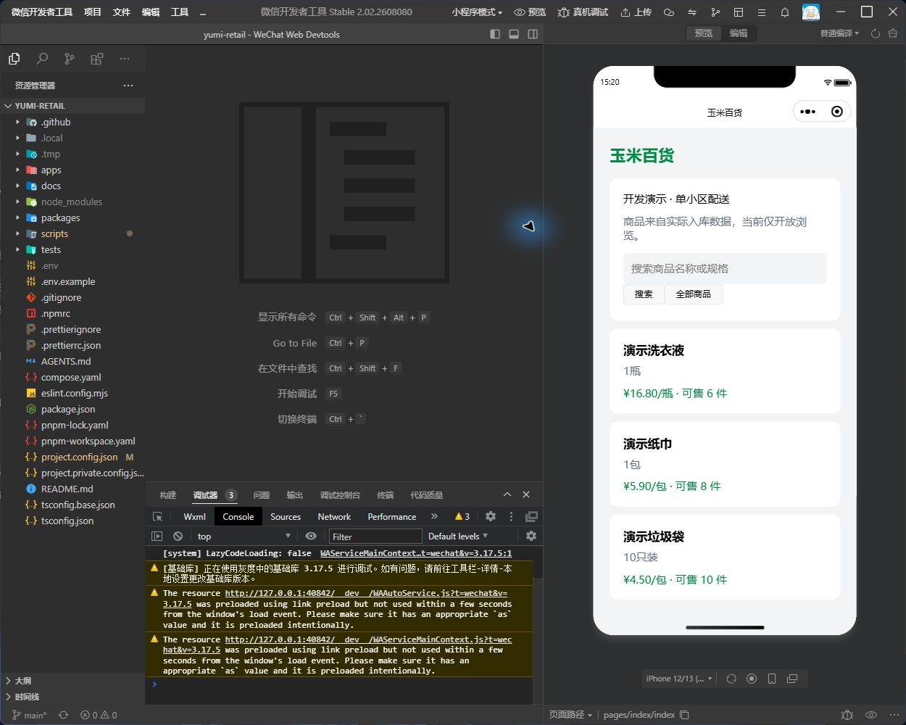

2026-10-30最新接续：负责人授权沿用当前风格自主完成未做UI和交互调整，不再将逐页UI确认作为推进前提。原商品维护计划已接续，名称/分类/说明编辑完成；18项相关真实DB测试与浏览器实链通过，见[本轮交付](../verification/S2-PRODUCT-DETAILS-2026-10-30.md)。后续继续其余商品资料维护；真机待HTTPS API，支付/部署等原边界不变。以下早期暂停/等待确认条目按历史记录解读。

# UI 偏差与调整方向

2026-10-28：负责人要求先暂停，指出界面杂乱、与原图不一致、偏开发调试。暂停新增商品维护等业务切片，先纠正界面交付标准。前次提交 b95e3a8 已修复微信工程入口，并实现登录、导航框架、商品/分类/收货/库存分区及小程序浏览视觉。仓储任务页仍有长表单和状态交互缺口，完整UI尚未验收。以下方向尚非负责人确认的最终设计稿。

## 实际偏差

既有78项数据库测试证明特定功能行为，不证明产品UI完成。后台“开发工作台”将分类、商品、收货、位置、盘点、隔离、报损和逆向单表单纵向堆在一页，部分流程要求输入UUID或阅读内部字段。小程序只有浏览列表和详情，缺少原图品牌首页、图片卡片、分类导航及完整购物路径。之前持续按功能切片推进，没有把视觉和任务可用性一起验收，交付偏离负责人期望。

本轮重新查看board1及mini1并对照源码；7张原图及此前逐图评审保留。当前界面不称“复刻完成”或“产品UI验收通过”。

| 原图方向 | 建议调整 |
|---|---|
| board1 登录/框架/商品/分类 | 品牌登录、侧栏/顶栏、独立页面；搜索筛选与表格；新增编辑用抽屉或独立表单 |
| board2 库存/订单/拣货 | 库存、收货、库位、盘点、报损/纠错按任务分开；商品/批次选择替代手填ID |
| board3 作业/配送 | 仓管任务列表和单据详情；骑手按本人任务组织，随业务实现开放 |
| board4 设置/日志/权限 | 按实际数据与授权开放，不放假统计或无响应入口 |
| mini1 首页/分类/详情 | 绿/黄品牌、图片商品卡、清晰价格和规格、分类搜索及详情结构；改用非生鲜样例 |
| mini2/mini3 订单/账户 | 保持统一设计，业务实现后接真实流程，明确尚未交付的范围 |

## 建议顺序与验收

1. 先完成可审查的登录页、后台框架、商品列表/表单及库存入口，以及小程序首页/商品卡/详情视觉方案，对照原图和真实经营范围。
2. 确立字体、间距、颜色、按钮、表格、状态标签与错误反馈组件；后台与手机作业采用适合各自任务的信息密度。
3. 逐页接回已有API，使用名称/编码/批次/库位选择。UUID、requestId等内部标识在排障详情中次要展示，默认操作不要求复制或记忆。
4. 按角色走完整任务：找到待审批单→核验→审批→结果。失败保留输入，冲突解释对象变化并提供恢复动作。
5. 功能与设计分别验收：原图对照截图、桌面/移动布局、触控、空/加载/失败状态及任务路径；保留服务端权限、幂等和真实DB测试。页面可打开或测试通过不等于UI通过。

不加入尚未确认的生鲜/营销、虚构销量、30分钟承诺或订单统计。经营约束、业务事实和原始资料保留。

## 微信 app.json 修复

根因：从仓库根目录导入时，根project.config.json缺少miniprogramRoot，工具寻找根目录app.json；Taro产物实际在apps/consumer-mini/dist/app.json。

已在根配置增加miniprogramRoot=apps/consumer-mini/dist/，保留现有AppID及其他设置。子工程入口仍为apps/consumer-mini（dist/），生成目录入口为dist（./）；不复制app.json产生第二份配置。

verify-mini-artifacts现检查三个工程配置都解析到同一产物目录、存在app.json和页面产物。verify:mini、format:check、lint通过。使用computer-use技能检查当前微信开发者工具Stable 2.02.2608080，重新编译后模拟器显示首页及3个合成商品，未再出现app.json缺失错误。此观察不代表真机、真实账号全部能力或UI产品验收通过。

## 接续检查（2026-10-28）

审阅 b95e3a8 后，判定上一项 UI 调整仍未完成，继续暂停新增业务。基础框架与浏览页已有代码和截图，不能继续沿用“本轮未重做UI”的旧描述；这些截图也不能证明仓储任务及真机已验收。

本轮边界为实物盘点页：列表优先、当前已载入状态筛选、新建独立窗口、详情独立窗口；审批/过账/终止仅在详情按状态与权限提供，失败保留输入，支持刷新当前单据。加载/空/失败与重试独立呈现；桌面与320/375/414宽度检查分别记录。沿用现有API及服务端规则，未改变库存模型、权限、迁移或依赖版本。

验收与待办见[本轮复核报告](../verification/UI-CONTINUATION-2026-10-28.md)。下一项仍是仓储UI整理：隔离/报损、收货纠错的列表与详情分离，然后补库位/核对和各角色完整任务路径；完成这些后再评估恢复商品资料维护。

## 隔离/报损与收货纠错接续（2026-10-28）

隔离记录和处置申请分开浏览，筛选仅针对已载入单据。立即隔离、新建纠错及各类详情使用独立窗口；审批、实物核验、过账和取消留在单据详情内。提交失败保留输入，详情可刷新；内部编号仅在次要展开信息中展示。已完成相关23项真实PostgreSQL测试和双员工浏览器/API合成库存闭环；功能验收与UI截图分别记录于[交付报告](../verification/UI-STOCK-TASKS-2026-10-28.md)。

下一任务是库位/批次位置/移位/核对页的列表、表单、详情与空错态，以及仓管/拣货角色的任务路径。完整UI尚未负责人验收，商品资料维护继续暂缓。

## 库位/核对与角色查询接续（2026-10-28，最新）

批次位置、存储库位、移位记录、核对报告四个入口已接现有API；新建/移位/核对及位置流水/库位/移位/报告详情使用独立窗口。各列表与流水有独立加载/空/失败重试，筛选保留规格选项并防止过期响应覆盖；核对窗口每次打开重新读取账面。手机仓管导航聚焦仓储，拣货员手机仅显示库存总览和库位查询。均不替代服务端权限。

真实移动作业端完成新增库位、移位、流水与一致核对；一次性拣货员只读路径及越权403通过，验收账号已停用并撤销会话。13项相关DB测试及共享UI回归见[报告](../verification/UI-LOCATIONS-2026-10-28.md)。下一任务为收货入库列表/详情、审核/入库影响提示与手机表单；完整UI仍待负责人验收，新增商品维护业务继续暂缓。

## 收货UI接续（2026-10-29，当前）

收货按单据列出，详情逐行核验后审核/入库；多行新建、北京时间效期和整数分成本接回现有规则。新增受仓库及receipt.read保护的GET详情，用于查询实际状态。11项真实DB测试、真实移动端2行/5件/2215分入库，以及响应丢失等浏览器合成状态检查见[报告](../verification/UI-RECEIPTS-2026-10-29.md)。本轮不改经营规则或迁移。

下一项为首页/商品/分类/库存列表的加载、空错与角色入口一致性收尾，汇总整体验收。完整UI仍待负责人审阅，商品资料维护新业务继续暂缓。

## 首页/目录/库存状态与微信编译（2026-10-29）

各列表独立加载、空态与错误重试；首页数据不可用时不显示零待办，计数明确为已载入范围。导航和快捷入口共享当前角色/终端允许页面，PICKER库存不出现收货入口；跨页筛选清除、旧仓响应丢弃、创建成功而刷新失败时关闭已完成表单。业务权限/API/数据模型不变，真实API只读检查、UI回归与截图见[报告](../verification/UI-LIST-STATES-MINI-2026-10-29.md)。微信weapp编译及工程入口通过，工具/真机和整套产品UI仍待验收。

## 小程序浏览重试与工具联通（2026-10-29）

下一页失败重试保留原页游标和已载入商品，未提交的输入修改不改变失败请求；新搜索关键词及时更新，旧响应不能覆盖新查询。现有快捷入口明确是关键词查找，完整两级分类待开放，底部改为“找好物”。4项读取状态测试、weapp编译及本机公开API检查通过；负责人确认临时开发设置并重新编译后，清理本项目编译缓存/重开已加载新版；真实微信运行时API及模拟器列表/详情/搜索/空结果、合成失败/分页恢复均通过并有截图，域名校验已恢复。整体产品UI和真机仍待确认。见[检查记录与下一步](../verification/WECHAT-BROWSE-2026-10-29.md)。

## 整体UI复核与弹窗交互（2026-10-30）

修复共享弹窗内部留白误关草稿、Tab/Shift+Tab循环与关闭后恢复焦点；提交时继续阻止关闭，失败保留输入。专项浏览器检查、收货/库位/盘点/处置纠错回归及后台/H5构建类型检查通过；真实API只读走查管理员9页、手机仓管7页和骑手未开放提示，截图及异常/任务历史证据汇总于[负责人审阅入口](../verification/UI-REVIEW-2026-10-30.md)。本轮没有业务写入/规则/API/迁移变化，未重跑历史交易集成套件。技术复核不替代负责人整体UI确认；新业务继续暂缓，真机待HTTPS测试API。
