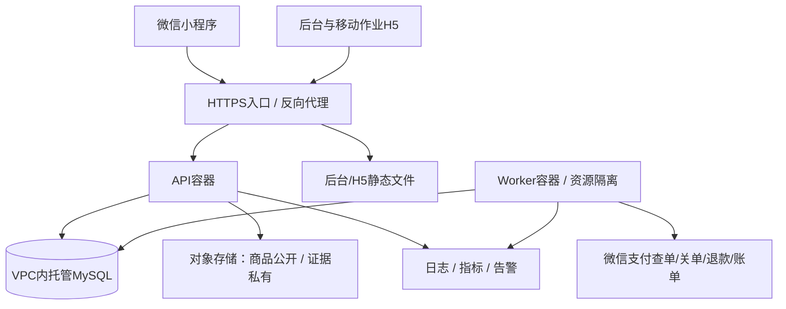

# 服务器、测试、上线与试运营方案

更新：2026-10-25。资源规格、预算和指标均是规划建议，未购买云服务、未部署、未取得平台审核结果。

## 1. 环境与部署拓扑

| 环境 | 建议 | 数据与支付 |
|---|---|---|
| 本地 | Windows开发工具 + Docker Desktop/WSL2（可用性待查），MySQL Compose | 合成数据、隔离模拟支付；不假称微信官方沙箱 |
| 测试 | 小规格云主机，隔离数据库/存储路径，部署同一构建产物 | 测试账号；真实支付联调如需使用生产商户，限定受控测试单与小额退款，必须显式授权 |
| 生产 | 一台Linux应用云主机 + 托管MySQL + 对象存储 + HTTPS | 真实数据与支付密钥；禁用模拟支付 |

首期可将API与Worker部署同一主机的不同容器，避免多个进程各自执行无保护的重复定时任务。数据库不开放全网访问，SSH限可信来源；后台与移动H5通过同域代理访问API，降低跨域会话复杂度。

这套性价比方案存在应用主机单点，不能宣称高可用。首期通过自动重启、健康检查、容器重建、数据库持久化、任务恢复、报警和人工值守控制影响。稳定经营且停机代价上升后，升级双实例、负载均衡和数据库高可用。

## 2. 起步规格与费用规划

优先评估腾讯云或其他具有国内服务支持的云厂商；地域接近经营区域，应用、数据库、对象存储尽量同地域。CPU、内存、盘、网络和数据库规格需根据压测选择，不能从日订单量直接推算吞吐。

| 项目 | 建议起点 | 月度工程预算占位（人民币） |
|---|---|---:|
| 应用云主机 | 2核4GB起，内存不足升4核8GB；按量/包月评估 | 150–500 |
| 托管MySQL | 小规格、存储与连接数满足验证；开启备份 | 250–900 |
| 对象存储/请求/网络/备份 | 商品图压缩、私有证据生命周期 | 50–300 |
| 日志与告警 | 低量起步、采样与保留上限 | 0–150 |
| 合计 | 不含额外测试环境和特殊网络服务 | 450–1850 |

建议先为生产基础设施预留 **500–2000元/月**；这是工程预算区间，非厂商报价或最低价保证。测试环境可按需开启，本地优先。不含人员、域名/认证、支付渠道手续费、经营资质、短信、仓租、设备、货品与配送成本。若预算明显更低，可以评估单机数据库，但会增加备份、恢复、维护与单点风险，不作为默认真实交易方案。

云费用随地域、续费、促销、磁盘、带宽与数据库备份变化；购买前按[官方价格计算器](https://buy.cloud.tencent.com/pricing/cvm/calculator?devPayMode=monthly&imageType=linux)和[云服务器产品说明](https://cloud.tencent.com/product/cvm)重新核价，记录首购与续费。不能拿促销首年价代表长期成本。

## 3. 本地开发工具与外部依赖

所需工具：Git、兼容Node/pnpm、微信开发者工具、可用MySQL开发环境、编辑器、至少一台Android和一台iPhone用于真机覆盖（设备不足时记录覆盖缺口）。Docker不可用时先诊断WSL/虚拟化；可使用独立开发数据库，但生产数据库不用于本地测试。

账号依赖待核实：经营主体、微信小程序AppID及管理员、小程序类目/备案状态、微信支付商户及AppID绑定、APIv3/验签材料、域名与DNS、国内云账号、对象存储和HTTPS。密码与私钥由负责人在受控环境配置，不要求粘贴到聊天或写入设计文档。

H5骑手端首版不依赖微信内嵌JS-SDK；电话按钮等基础能力需手机浏览器验证。若增加相机扫码、地图导航或消息推送，再单独核验域名、HTTPS、权限和平台接入条件。

## 4. CI与发布流程

1. 开发分支完成业务切片，更新必要契约与迁移。
2. CI依次执行依赖锁检查、Lint、类型检查、关键单元/集成测试、构建；集成测试使用独立MySQL，不能只用SQLite替代。
3. 构建带唯一版本的镜像与Web/H5/小程序产物，记录提交号和迁移版本。
4. 部署测试环境，执行真实接口、仓储/骑手浏览器流程和微信开发者工具/真机验证。
5. 准备生产配置、备份、迁移预检和回退说明，经明确发布授权后执行。
6. 先运行兼容性迁移，再部署API/Worker和Web；检查探针、队列积压、关键订单，再发布小程序体验版/提交审核。
7. 微信审核通过后发布并小范围试营业；服务端兼容仍在使用的旧小程序版本，不能同时强制破坏API。

回退：应用回到上一镜像；数据库优先前向修复，不默认执行破坏性down迁移。涉及已产生真实交易的字段变更不能靠恢复旧备份抹掉新订单。

## 5. 测试范围与质量门槛

| 层级 | 重点 | 通过证据 |
|---|---|---|
| 纯业务单元 | 金额、起送/营业、状态迁移、退款额度 | 必测案例与实际结果 |
| MySQL集成 | 多SKU事务、锁竞争、幂等、库存流水、资金额度 | 数据不变量和并发结果，非仅HTTP200 |
| API权限 | 消费者越权、骑手跨任务、仓管跨仓、退款权限 | 未授权请求失败且无数据变化 |
| Web/H5 | 商品、入库、拣货、指派、送达、售后 | 浏览器E2E与截图/错误记录 |
| 小程序 | 真登录/隐私/支付、切后台、弱网、布局 | 开发者工具+真机记录，H5不能替代 |
| 外部联调 | 回调验签、查单、关单、退款、账单 | 受控真实交易与渠道结果核对 |
| 恢复演练 | 重启、任务重领、备份恢复、回调重放 | 恢复后业务数量/资金一致 |

强制并发场景：最后1件由50个购买意图争抢；单意图重复提交20次；重复/乱序通知；超时关单竞争；两人同时出库；盘点与购买/报损竞争；两次退款占用同一额度；骑手重派后旧端送达；Worker提交前后崩溃。以上数字是建议测试用例规模，不是日订单目标。

性能初始目标：2000SKU/300日订单假设下，100活跃浏览会话、10并发下单持续测试；自有读接口p95建议<500ms，提交事务p95<1s，外部支付调用单独统计；0超卖、0重复有效出库、0超退款。具体目标在实际云规格和网络环境下修订，不能把外部渠道延迟算成本地事务能力。

发布门槛：无已知阻断性问题；交易、权限、库存和退款关键案例通过；未验证项如真机/真实支付不允许写“全部通过”；备份恢复演练完成；负责人能够独立处理异常单。

## 6. 备份与故障恢复

- 生产托管数据库开启自动备份与可用的时间点恢复能力，验证保留期限、加密和费用；至少每日备份，日志备份频率按恢复目标配置。
- 试运营建议目标RPO≤15分钟、RTO≤2小时；这是待演练验证目标，不是已达标能力。恢复不了就调整方案/目标，不能仅凭“备份成功”验收。
- 每月及重大迁移前抽样恢复到隔离环境，核对订单、支付、库存、退款与任务。对象存储与加密密钥也有恢复/访问策略。
- 恢复到过去时间点后，先暂停接单和Worker，按渠道查单/账单补齐恢复窗口内支付退款，核对仓库出库和配送实物，再恢复处理。数据库回滚不等于外部支付与实物能回滚。
- 原始故障库保留只读快照，禁止直接在有新订单的生产库上覆盖恢复。

## 7. 监控、告警和处置

| 信号 | 建议触发 / 动作 |
|---|---|
| API 5xx/延迟 | 持续升高告警，检查版本、数据库和资源；按影响暂停接单 |
| 数据库锁/连接池/磁盘 | 到达阈值提前告警，避免连接堆积与磁盘写满 |
| 支付未核实 | 超过配置的查询周期仍未知则告警，不释放预占 |
| 退款失败/未知 | 进入处理队列，保留额度，负责人核实渠道状态 |
| Outbox/任务积压 | 最老任务年龄与失败次数告警；租约恢复与人工重放 |
| 库存不变量异常 | 立即停止受影响SKU销售并核对流水，不自动填平差异 |
| 配送无人接单/超时 | 工作台待办，联系调度，记录重新分配/异常 |
| 渠道对账差异 | 按日生成差异单，不用报表总额替代逐笔核对 |

建议试运营时由负责人值守关键营业时段。告警渠道在负责人选定后接入；本轮不自动发送外部消息或创建定时自动化。

## 8. 平台、隐私与经营准备

APP备案通知覆盖含小程序在内的分发场景，相关备案与域名准备应前置，具体执行以属地和平台当前流程为准，参见[工信部通知](https://www.miit.gov.cn/jgsj/xgj/wjfb/art/2023/art_dd783a581c9644a4aee10afa582811db.html)。平台账号、服务类目、支付商户/AppID绑定及实际经营品类的资质，需要负责人在官方后台核对。

本次无法直接读取微信开发者文档的隐私与登录页面，因此不声称已经核实该账号的隐私接口资格、类目资质或最新审核细则。上线前逐项核对：隐私保护指引、实际采集信息、授权时机、第三方SDK、账号注销/数据处理入口、客服与真实主体信息。食品/酒类/冷冻等品类若加入，再根据所在地区和实际经营方式核验要求；“暂无生鲜”不自动意味着没有其他品类要求。

配送条款、售后说明、证照和客服电话使用真实材料；不得发布示例“24小时后不处理”、示意证照、虚假评分或未经验证的到达承诺。数据保存/删除期限按业务必要性和适用要求制定，不能一概立即删除支付和库存审计事实。

## 9. 仓库与骑手试运营SOP

开店前：核对营业/暂停状态、商品售价、可售库存、批次效期、库位、设备与骑手在线情况；测试工作队列能看到新单。

收货：实物验收→记录来源/数量/适用效期→入库过账→上架库位→抽查账实；有问题商品隔离。

接单：支付确认→拣货任务→领取核对→缺货沟通与决议→打包出库→调度分配→骑手接单/配送→送达留记录。禁止先送货再补记出库作为日常流程。

异常：不能联系顾客、无法送达、商品损坏时上报任务异常；调度记录重送/退回/退款，不在聊天里处理后忘记系统记录。退回实物另行验收，不随退款自动入库。

日结：逐笔支付/退款对账、核对未完成/未送达/未退款单、抽盘库存、清理超期任务、查看告警与备份。净收款、渠道手续费、实际到账和利润分别看待。

首轮验收建议以限定用户与商品范围试营业7–14天，订单量不设虚假保证；每天复盘异常后再扩大。必须覆盖真实下单、真实支付、出库、骑手送达、部分/全额退款及至少一次故障恢复演练。
