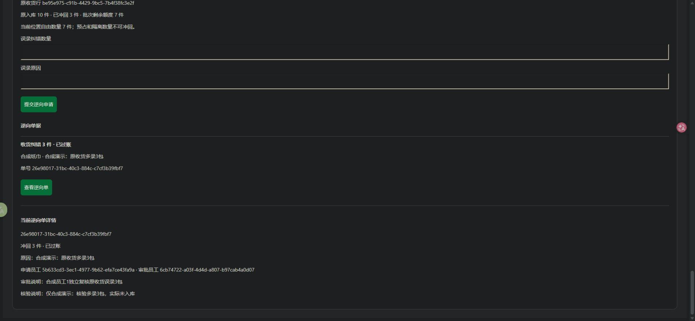

# 收货入库逆向纠错验收记录

日期：2026-10-28，Asia/Shanghai。结论：本地切片完成；新增12项、既有66项真实PostgreSQL集成测试全部通过，共78项。后台与移动H5使用一次性合成资料完成独立审批及过账。真实支付保持disabled。

## 本轮完成与边界

收货误录通过独立逆向单冲减，原收货保持POSTED、原行/成本来源与原流水保留。每单只关联原批次的一个位置，可部分冲回；移位后仍追溯同一原批次。正确资料另建收货单，跨位置分单处理，不用其他批次补足。

管理员/仓管申请、取消与过账，另一员工独立审批。DRAFT→APPROVED→POSTED，前两态可带原因取消。过账须确认原记录与实物误录核验并填写说明；草稿不预扣额度，取消不改库存。岗位分权和真实SOP仍是待负责人确认的开发默认规则。

批次累计逆向≤原收货行数量；盘盈不增加可逆向额度。只扣当前位置onHand−reserved−blocked自由数，三层onHand同减，reserved/blocked及隔离remaining不变。申请/审批/过账检查位置版本、冻结、核对暂停、账本一致和原数量上限；取消不清除冻结/暂停。过期/停用位置可纠错，但不恢复任何可售资格。

模型、服务、HTTP动作、共享页面、无成本来源查询、权限、审计和持久化幂等已实现。原单不可改保护、数据库额度/状态/双流水证据约束、位置流水原因展示已补齐。OpenAPI从实际代码导出为0.6.0；PRD/API/数据设计、架构、UI和状态已同步。切片约定见[边界定义](../roadmap/RECEIPT-REVERSAL-SLICE.md)。

当前不是供应商退货、报损、退款、成本会计、增加数量、通用改数/改状态或整张多批次收货一键撤销；账本不一致必须调查，不能用此接口修平。

## 实际检查

| 命令/检查 | 实际结果 |
|---|---|
| `npm run test:reversals` | 12/12通过，local yumi_test随机schema，结束删除 |
| `test:s0` / `test:s1` / `test:s2` | 6/6、12/12、10/10通过 |
| `test:inventory` / `test:counts` / `test:dispositions` | 13/13、14/14、11/11通过 |
| `npm run build` | 全工作区通过，含Taro微信编译、后台和移动H5 |
| `npm run typecheck` / `npm run lint` | 通过 |
| `npm run format:check` / `git diff --check` | 通过 |
| `npm run verify:mini` | 编译产物检查通过；不是微信工具/真机验收 |
| `db:migrate` / `db:migrate:test` | 两库部署第9条迁移；重复运行无待执行项 |
| Prisma真实开发库→schema diff | empty migration；SQL约束语义由真实DB测试另验 |
| OpenAPI导出/安装版本观察 | 0.6.0契约；锁文件与依赖版本未变 |
| 浏览器后台/H5 | 双员工审批、核验后过账、取消不改数量，后台未观察到console error |

新增12项覆盖：部分纠错及原单/成本保留；审批/核验/终态与两种取消；20次相同创建及过账重试、不同键争抢最后1件；移位后多位置来源追溯；盘盈后额度不放大；预占/隔离/旧快照保护；冻结/核对暂停/不平账拒绝；晚期审计失败全事务回滚及原键重试；原单/行与单据不可变及过账证据；绕过应用仍拒绝超额过账和改成本来源；过期可纠错仍不可售；跨仓/角色/CSRF/整数边界/字段白名单/分页/公开隐私。

实现中补齐了Prisma客户端getter导出类型，清理测试未使用变量后编译、类型与Lint通过；没有调整锁定依赖或放宽库存约束。

证据：[集成结果](REVERSAL-EVIDENCE.json)、[浏览器数据库核验](REVERSAL-BROWSER-EVIDENCE.json)、[精确安装观察](REVERSAL-INSTALLED-VERSIONS.json)。测试文件只记录合成数量/结果，不保存凭据或会话。

## 浏览器闭环

默认3000/5173/5174已有服务占用，首次临时API启动收到EADDRINUSE。本轮使用独立API3101、后台5273、移动H55274与专用Origin/代理，仅临时配置，未改仓库默认配置，也未替换原有默认服务。

在yumi_test随机`reversal_browser_`schema应用全部9条迁移，创建两个合成员工，使用实际收货服务入库合成纸巾10件、成本200分。后台员工0查原单和额度，申请冲回3件；页面提示另一员工审批；员工1登录、独立审批，确认原记录与实物误录说明后过账。后台上方账面及来源额度自动更新，移动作业H5读取同一POSTED单与库存7件。另建1件草稿并取消，库存仍7件。

| 结果 | 数值 |
|---|---|
| 原收货状态 / 原数量 / 原单件成本 | POSTED / 10 / 200分 |
| 逆向单 | 3件POSTED；1件CANCELLED |
| 当前实物 / 预占 / 不可售 | 7 / 0 / 0 |
| 原批次已冲回 / 剩余额度 | 3 / 7 |
| 公开可售 | 7 |
| 账本核对issueCount | 0 |
| inventoryHold / activeCountId | false / null |



本轮独立测试端口的PID和脚本名核对后已关闭；临时标签页、随机schema及临时配置/脚本清理完成，并核验schema不存在。首次自动退到5175/5176的本轮临时Vite也已关闭。原默认服务保留，不能据本报告假定它们已经重载新版API；演示前应按下面步骤重启本项目API。没有清空或重置开发库原数据。

## 迁移与兼容性

新增`202610280004_receipt_reversals`，既有8条迁移不改：新表含原批次位置、数量/版本快照、状态、原因、创建/独立审批、实物核验、取消/过账及唯一流水关联；复合外键约束同仓/SKU/批次/位置。延迟触发器锁原lot检查累计上限与精确主/位置流水。原已过账收货及其行禁止改删/追加，lot收货来源、仓库/SKU、批次号和成本不可改。旧数量、旧成本、旧流水不回填/重估。

部署时停止本项目旧写进程、备份，执行开发/测试迁移后启动新版；不能混跑旧API/worker，也不能通过reset/db push或删事实回退。回退代码必须保留新事实、冻结/隔离/额度和两级账本保护。Prisma diff为空仅证明其支持的结构一致，不涵盖所有SQL触发器。

实测PostgreSQL17.11；沿用Node24.22.1、pnpm10.28.2、TypeScript6.0.3、Nest12.2.0、Prisma/client/adapter7.10.1、pg8.23.1、Taro4.3.1、React18.3.1及版本矩阵其他精确值。锁文件SHA256仍为`8f3840630f8452b4c2ebeee79109c2c41b2537e15cd8aacf7251612420fde952`。没有安装/升级依赖或连接外部账号。

## 本地复现与演示

在项目根目录PowerShell执行；Docker Desktop运行，凭据只读本机忽略的.env，不复制到聊天或提交。

```powershell
npm.cmd run db:up
npm.cmd run db:migrate
npm.cmd run db:migrate:test
npm.cmd run db:seed
npm.cmd run db:seed:catalog
npm.cmd run test:reversals
```

停止自己启动的旧API并分别用终端运行`npm.cmd run dev:api`、`npm.cmd run dev:admin`、`npm.cmd run dev:ops`。默认后台5173、作业端5174、API3000；端口占用时先核查，不误停其他服务。使用本机LOCAL_ADMIN与LOCAL_WAREHOUSE两套员工凭据。

1. 在合成商品有自由数量的情况下，进入“收货入库逆向纠错”，选择批次位置，点击“核对原收货及额度”。位置可用上方规格筛选/加载更多查找。
2. 核对原收货ID/行ID、原数量、已冲回/剩余额度和当前位置自由数，填写误录数量和原因提交。
3. 换另一员工登录，打开逆向单，填审批说明并独立审批。过账前核验原记录与实物，在合成演示说明中明确标注测试。
4. 过账后检查上方账面、原批次额度和位置流水；执行该SKU账本核对应一致。取消草稿或已审未过账申请不改变数量。位置快照冲突时取消重建。

## 未验证与下一步

真实仓库实物、正式分权/SOP、弱网/移动真机、微信开发者工具/真机、真实微信登录、真实支付退款、生产HTTPS/Cookie、备份恢复、远程CI及生产部署仍未验收。CI已增加test:reversals，未执行远程流水线。此次移动端为Chrome桌面加载H5，不等于手机验收。

未实现整单多批次自动冲回、供应商退货、财务会计、图片证据、未知批次调整及订单级预占/出库。错SKU/批次/成本等只在相应原数量可安全冲回时分别走逆向及新收货，不能回滚已经消费或受保护的库存。

下一切片：商品资料维护（商品字段编辑、分类/SKU启停及条码），为真实商品资料与后续消费者浏览完善提供基础；图片/素材上传另行规划。G1与完整S2/S3仍不整体标记完成。
