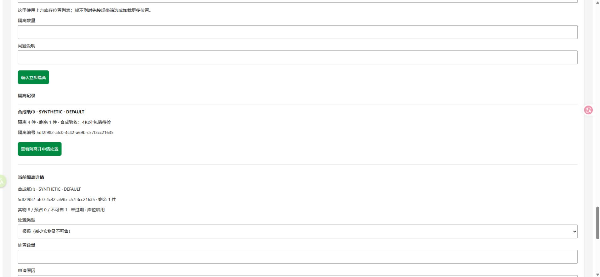

# 数量隔离、解除与报损切片验收记录

日期：2026-10-28，Asia/Shanghai。结论：本地切片完成；新增11项、原55项真实PostgreSQL集成测试全部通过，共66项。后台和移动作业H5使用合成数据完成双员工操作。未接真实支付，未验收微信真机、实物作业或生产。

## 实际完成

- 指定批次位置立即隔离数量，增加blocked，可售相应减少，onHand不变；只允许自由数量，不碰reserved或既有blocked。
- 解除/报损申请DRAFT→APPROVED→POSTED；必须另一位员工审批，报损过账须实物确认及说明；过账前可带原因取消，取消不解除隔离。
- 每次只消费自己隔离记录的剩余数量；草稿不预扣额度，竞争过账只有满足最新版本及剩余额度的申请成功。旧快照取消重建。
- 解除在过账再次检查批次未到期、库位启用；过期/停用位置允许报损。数量动作拒绝盘点冻结、核对暂停及账本差异。
- 主流水、位置流水、三层库存、隔离余额、单据、审计与幂等结果同事务。数据库保护原始事实、状态迁移、独立审批、剩余额度及流水配平。
- 管理后台与作业端共用新工作台，提供分页、详情、申请/审批/过账/取消；操作后刷新上方账面、位置和选中的隔离详情。位置流水可查看隔离/处置原因。
- 实际OpenAPI更新至0.5.0；PRD、API、数据/架构/UI规范、路线与当前状态已同步。来源资料未改。

边界与开发默认规则见[切片定义](../roadmap/STOCK-DISPOSITION-SLICE.md)。角色分权、实物SOP及损耗财务口径尚待负责人确认，不因本地实现声称已上线。

## 实际运行检查

| 检查 | 结果 |
|---|---|
| `npm run test:dispositions` | 11/11通过；独立yumi_test一次性schema，结束删除 |
| `npm run test:s0` | 6/6通过 |
| `npm run test:s1` | 12/12通过 |
| `npm run test:s2` | 10/10通过 |
| `npm run test:inventory` | 13/13通过 |
| `npm run test:counts` | 14/14通过 |
| `npm run build` | 所有工作区通过，包括Taro微信编译、后台及H5 |
| `npm run typecheck`、`npm run lint` | 通过 |
| `npm run format:check`、`git diff --check` | 通过 |
| `npm run verify:mini` | 微信编译产物检查通过，不等于工具/真机 |
| `db:migrate`、`db:migrate:test` | 两库部署第8条迁移；重复执行无待执行项 |
| Prisma真实开发库→schema diff | empty migration；不替代SQL触发器语义验证 |
| OpenAPI导出、安装版本观察 | 实际代码导出0.5.0；依赖与锁文件未改变 |
| Chrome后台/移动作业H5 | 真实页面操作双员工、解除及报损；观察到后台无console error |

新增测试覆盖：数量及公开可售、独立审批/实物必填/终态；取消不解隔离；20次相同隔离键重试及8个不同键争抢最后1件；多个已审申请争抢同一隔离剩余、20次相同过账重试；过账时到期/库位停用复核；冻结/核对暂停/旧快照拒绝；晚期审计失败完全回滚并可原键重试；数据库不可变及配平；预占和历史blocked保护；不平账拒绝、跨仓/角色/CSRF/输入/分页/公开隐私。

首轮1项日期夹具被既有“生产/到期成对”约束拒绝，修正测试夹具后11项全通过；没有放宽业务约束。共享UI的循环请求类型补全后全工作区类型检查通过。

测试证据：[集成结果](DISPOSITION-EVIDENCE.json)、[浏览器数量核验](DISPOSITION-BROWSER-EVIDENCE.json)、[精确安装观察](DISPOSITION-INSTALLED-VERSIONS.json)。测试结果文件仅保存合成结果，不保存账号密码、会话或连接串。

## 浏览器实际闭环

在本机yumi_test建立独立`dispos_browser_`随机schema，应用全部8条迁移，两个一次性员工和一件合成商品，通过实际收货服务入库10件。页面操作结果：

| 步骤 | 实物 | 预占 | 不可售 | 隔离剩余 | 公开可售 |
|---|---:|---:|---:|---:|---:|
| 初始入库 | 10 | 0 | 0 | — | 10 |
| 后台立即隔离4件 | 10 | 0 | 4 | 4 | 6 |
| 员工0申请解除1件，员工1审批并过账 | 10 | 0 | 3 | 3 | 7 |
| 移动作业页员工1申请报损2件，员工0审批并核验过账 | 8 | 0 | 1 | 1 | 7 |

申请人页面提示另一员工审批，不能自审。最后数据库核对issueCount=0、inventoryHold=false、activeCountId=null；两张处置单均POSTED。后台上方账面和隔离详情自动刷新为8/0/1；移动H5刷新后读取同样结果。独立读库/公开接口核验保存在浏览器证据JSON。



演示API/前端进程及本轮标签页已关闭；准确匹配本轮随机schema后删除并核验不存在。开发库原库存未用于演示或清空。忽略目录中的一次性演示脚本及元数据已清理。

## 迁移及版本影响

新增`202610280003_stock_dispositions`：stock_isolations与stock_dispositions、复合外键、索引、CHECK与不可变/延迟配平触发器。既有7条迁移不改；旧数量不回填，旧流水不改。旧blocked没有可猜测来源，不能直接按新单据报损；须另行有证据的业务迁移，不直接SQL改数。

部署顺序：停止旧API/worker写入，备份，执行`npm run db:migrate`（测试库另执行`db:migrate:test`），启动新版API/worker。所有未来库存写入口都须遵守balance行锁、冻结/核对暂停/blocked检查。禁止混跑旧服务、reset/db push或删事实回退；代码回退必须兼容新表与保护。

沿用Node24.22.1、pnpm10.28.2、TypeScript6.0.3、Nest12.2.0、Prisma/client/adapter7.10.1、pg8.23.1、PostgreSQL17.11、Taro4.3.1、React18.3.1，其他精确版本见安装观察和版本矩阵。锁文件SHA256仍为`8f3840630f8452b4c2ebeee79109c2c41b2537e15cd8aacf7251612420fde952`。

## 本机复现与演示

以下在项目根目录PowerShell执行，Docker Desktop需运行；凭据只从本机忽略的.env读取，不复制进聊天或提交。

```powershell
npm.cmd run db:up
npm.cmd run db:migrate
npm.cmd run db:migrate:test
npm.cmd run db:seed
npm.cmd run db:seed:catalog
npm.cmd run test:dispositions
```

分别打开三个终端运行`npm.cmd run dev:api`、`npm.cmd run dev:admin`、`npm.cmd run dev:ops`。后台`http://127.0.0.1:5173`、作业页`http://127.0.0.1:5174`；使用本机LOCAL_ADMIN与LOCAL_WAREHOUSE两套不同员工账号。

1. 在合成商品库存位置确认已有自由数量，进入“问题库存隔离与报损”，选位置、数量和原因，立即隔离；观察上方不可售增加。
2. 打开该隔离详情，申请解除或报损；先按页面提示由另一员工登录，查看处置单、填写审批说明并独立审批。
3. 已审单过账；报损必须勾选实物确认及填写说明。在合成数据上演示时明确写“合成验收”，不声称处理了真实货品。
4. 查看隔离剩余、上方账面、位置流水和核对报告；取消未过账申请后隔离应保持。版本冲突刷新后取消旧单重建。

## 未验证与后续

- 当前为原库位内数量隔离，未实现实体隔离区移位、供应商退货、自动到期隔离、损耗财务会计、图片凭证或批量审批。
- 真实仓库/实物报损、正式人员分权、弱网、移动真机及完整视觉体验未验收；此次为Chrome桌面加载后台与移动H5。
- 微信开发者工具/真机、正式AppID/登录、真实支付退款及对账、生产HTTPS/Cookie、备份恢复、远程CI与生产部署均未验证。CI已加新命令，未远程执行。
- 订单/预占/拣货/出库及骑手履约未开发，不将S0库存探针等同订单系统。

下一切片：收货入库逆向纠错，保留原入库与流水，通过受约束新单据处理；继续遵守冻结、预占、隔离归属、幂等和审计。完整S2与G1仍不整体标记完成。
